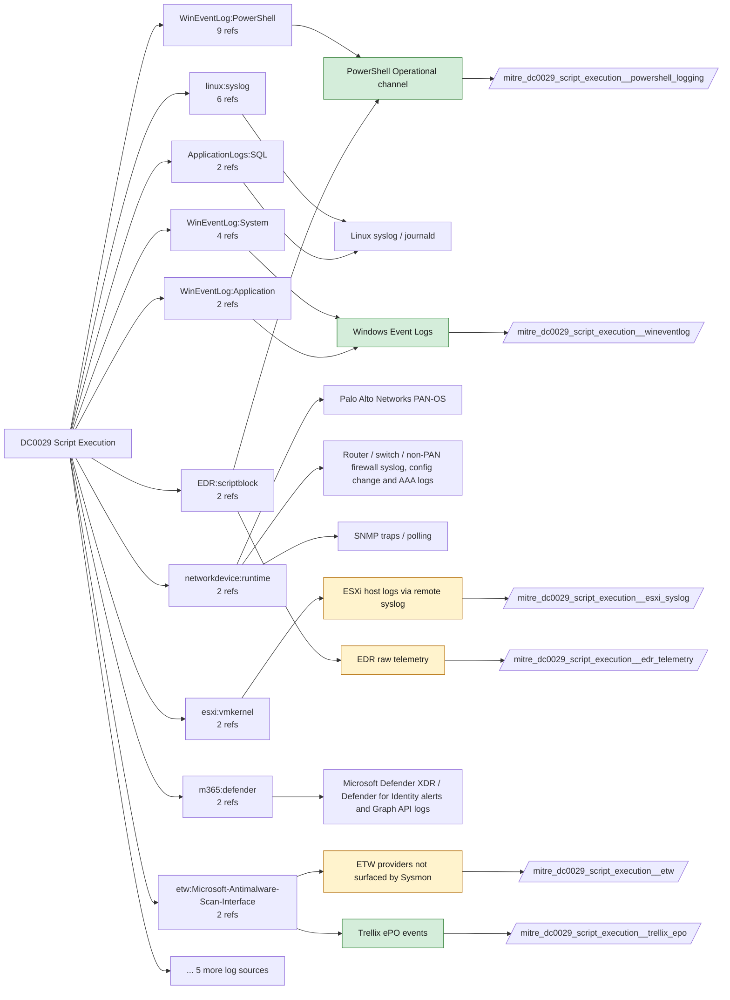

# DC0029 Script Execution

[ATT&CK](https://attack.mitre.org/datacomponents/DC0029) · version 2.0 · modified 2026-10-13 · ATT&CK release 20.1

Status: **Live** · umbrella eventtype `mitre_dc0029_script_execution`

> The execution of a text file that contains code via the interpreter.

## Why this component matters

Script-level visibility (PowerShell script blocks, cscript/wscript payloads, ESXi shell scripts) is where fileless and living-off-the-land activity surfaces. PowerShell Operational is the dominant source; ePO AMSI events add the content-inspection angle that EID 1 cannot see.

ATT&CK v20.1 has **36 analytics** across **30 detection strategies** that read this component, covering **30 techniques**. Tactics most dependent on it: execution (14), persistence (10), privilege-escalation (7), stealth (4).

Analytic references by platform: Windows 13, macOS 11, Linux 6, Office Suite 2, ESXi 2, Network Devices 1, IaaS 1

## Where it comes from



## Requirements

Component specific:

- Script Block Logging produces 4104 fragments for long scripts; the Splunk TA does not reassemble them, so analytics must key on ScriptBlockId.
- ENS AMSI scanning must be enabled for ePO AMSI events to exist.

Per feed (from `config/stack.yml` and `config/log_sources.yml`):

| Feed | Status | Sourcetype or source | Constraint | Origin | TA / collector |
|---|---|---|---|---|---|
| `powershell_logging` | live | source=`XmlWinEventLog:Microsoft-Windows-PowerShell/Operational` | `EventCode IN (4103, 4104)` | defaults | Splunk Add-on for Microsoft Windows |
| `trellix_epo` | live | sourcetype=`mcafee:epo` | `(threat_type="AMSI*" OR threat_name="AMSI*")` | derived | Splunk Add-on for McAfee ePO (mcafee:epo). Verify the sourcetype against your installed TA version. |
| `wineventlog` | live | source=`XmlWinEventLog:Application`, source=`XmlWinEventLog:System` | `EventCode IN (1502, 1503, 4016, 5312)` | defaults | Splunk Add-on for Microsoft Windows (Splunk_TA_windows), XML rendering (renderXml = true) |
| `auditd` | ready (tick in stack.yml) | sourcetype=`linux:audit` | `type IN (EXECVE, SYSCALL) (syscall IN (execve, execveat) OR SYSCALL IN (execve, execveat)) (exe IN ("/bin/bash", "/bin/sh", "/usr/bin/python*", "/usr/bin/perl", "/bin/dash", "/bin/zsh"))` | defaults | Splunk Add-on for Unix and Linux (linux:audit) or auditd -> auditbeat/syslog |
| `edr_telemetry` | ready (tick in stack.yml) | sourcetype=`edr:telemetry` | `(whole feed)` | derived | Vendor specific |
| `esxi_syslog` | ready (tick in stack.yml) | sourcetype=`vmware:esxlog:shell` | `(whole feed)` | defaults | Splunk Add-on for VMware ESXi Logs (vmware:esxlog:<log>) |
| `etw` | ready (tick in stack.yml) | sourcetype=`etw:json` | `(ProviderName="Microsoft-Antimalware-Scan-Interface")` | derived | Requires a user-mode ETW consumer (SilkETW/Sealighter, Splunk Stream for NDIS, or an EDR that exposes the provider). No standard Splunk TA. |

Collection prerequisites:

- **powershell_logging**: Turn on Script Block Logging and Module Logging GPO; consider Transcription to a protected share.
- **powershell_logging**: Add Microsoft-Windows-PowerShell/Operational as a WinEventLog input (renderXml=true).
- **trellix_epo**: ePO configured to forward threat events to Splunk (syslog or DB pull); confirm product_name/threat_type fields populate.
- **trellix_epo**: ENS AMSI and Exploit Prevention enabled if AMSI-type analytics are expected.
- **wineventlog**: Advanced Audit Policy configured (at minimum Process Creation, Logon, Account Management, Object Access, Policy Change, Privilege Use, Detailed Tracking). Without the matching subcategory the EventCodes below never fire.
- **wineventlog**: Include command line in process creation events enabled for 4688 (Computer Configuration > Administrative Templates > System > Audit Process Creation).
- **wineventlog**: PowerShell Script Block Logging (4104) and Module Logging (4103) enabled via GPO for the PowerShell/Operational channel.
- **wineventlog**: Object access events (4656/4663/4657/4660/4670) require SACLs on the files/keys of interest.
- **wineventlog**: Non-default channels (TaskScheduler, WMI-Activity, CodeIntegrity, Defender, Firewall, WinRM, SMBClient/Server...) must be listed as inputs in Splunk_TA_windows inputs.conf; several are disabled by default in Windows.
- **auditd**: audit rules for execve, connect, open/openat on sensitive paths, ptrace, module load, mount, setuid; a Neo23x0/auditd baseline or Florian Roth's rule set is a reasonable start.
- **auditd**: log_format = ENRICHED in auditd.conf so syscall names and uids resolve (otherwise syscall numbers are architecture dependent).
- **esxi_syslog**: Syslog.global.logHost set on every host; ESXi Shell/SSH audit enabled; consider Syslog.global.auditRecord (ESXi 8).

Review notes: `wineventlog` has 2 ATT&CK reference(s) with no usable event filter (prose channel), constraint origin is *defaults*; `edr_telemetry` has 4 ATT&CK reference(s) with no usable event filter (prose channel), constraint origin is *derived*.

## Splunk

Eventtypes (literal constraints, see `dist/splunk/TA-mitre-attack-datacomponents/default/eventtypes.conf`):

```ini
[mitre_dc0029_script_execution__powershell_logging]
search = index=wineventlog source="XmlWinEventLog:Microsoft-Windows-PowerShell/Operational" EventCode IN (4103, 4104)

[mitre_dc0029_script_execution__trellix_epo]
search = index=epo sourcetype="mcafee:epo" (threat_type="AMSI*" OR threat_name="AMSI*")

[mitre_dc0029_script_execution__wineventlog]
search = index=wineventlog source IN ("XmlWinEventLog:Application", "XmlWinEventLog:System") EventCode IN (1502, 1503, 4016, 5312)

[mitre_dc0029_script_execution__auditd]
search = index=linux sourcetype="linux:audit" type IN (EXECVE, SYSCALL) (syscall IN (execve, execveat) OR SYSCALL IN (execve, execveat)) (exe IN ("/bin/bash", "/bin/sh", "/usr/bin/python*", "/usr/bin/perl", "/bin/dash", "/bin/zsh"))
disabled = 1

[mitre_dc0029_script_execution__edr_telemetry]
search = index=edr sourcetype="edr:telemetry"
disabled = 1

[mitre_dc0029_script_execution__esxi_syslog]
search = index=vmware sourcetype="vmware:esxlog:shell"
disabled = 1

[mitre_dc0029_script_execution__etw]
search = index=etw sourcetype="etw:json" (ProviderName="Microsoft-Antimalware-Scan-Interface")
disabled = 1

[mitre_dc0029_script_execution]
search = eventtype=mitre_dc0029_script_execution__powershell_logging OR eventtype=mitre_dc0029_script_execution__trellix_epo OR eventtype=mitre_dc0029_script_execution__wineventlog OR eventtype=mitre_dc0029_script_execution__auditd OR eventtype=mitre_dc0029_script_execution__edr_telemetry OR eventtype=mitre_dc0029_script_execution__esxi_syslog OR eventtype=mitre_dc0029_script_execution__etw
```

Macros for analytics: `` `mitre_dc0029` `` (umbrella), `` `mitre_dc0029_powershell_logging` ``, `` `mitre_dc0029_trellix_epo` ``, `` `mitre_dc0029_wineventlog` ``, `` `mitre_dc0029_auditd` ``, `` `mitre_dc0029_edr_telemetry` ``, `` `mitre_dc0029_esxi_syslog` ``, `` `mitre_dc0029_etw` ``, `` `mitre_dc0029_filter` `` (site exclusions).
CIM: `Endpoint.Processes` via `` `mitre_dc0029_dm` `` / `` `mitre_dc0029_dm_where` `` for `tstats`. CIM tags emitted for: none (no feed is known CIM-compliant for this model).

## Sigma

Generic logsource categories scoped by this component in `dist/sigma/pipelines/splunk_mitre_dc.yml`: product `windows`: `ps_script`, `ps_module`.

## Dependents

Top techniques detected through this component (of 30):

| Technique | Name | Tactics | Analytics using this DC |
|---|---|---|---|
| [T1059.007](https://attack.mitre.org/techniques/T1059/007) | JavaScript | execution | 3 |
| [T1037](https://attack.mitre.org/techniques/T1037) | Boot or Logon Initialization Scripts | persistence, privilege-escalation | 2 |
| [T1059.005](https://attack.mitre.org/techniques/T1059/005) | Visual Basic | execution | 2 |
| [T1059.006](https://attack.mitre.org/techniques/T1059/006) | Python | execution | 2 |
| [T1505.001](https://attack.mitre.org/techniques/T1505/001) | SQL Stored Procedures | persistence | 2 |
| [T1016.001](https://attack.mitre.org/techniques/T1016/001) | Internet Connection Discovery | discovery | 1 |
| [T1027.018](https://attack.mitre.org/techniques/T1027/018) | Invisible Unicode | stealth | 1 |
| [T1037.001](https://attack.mitre.org/techniques/T1037/001) | Logon Script (Windows) | persistence, privilege-escalation | 1 |
| [T1037.003](https://attack.mitre.org/techniques/T1037/003) | Network Logon Script | persistence, privilege-escalation | 1 |
| [T1037.004](https://attack.mitre.org/techniques/T1037/004) | RC Scripts | persistence, privilege-escalation | 1 |
| [T1056.002](https://attack.mitre.org/techniques/T1056/002) | GUI Input Capture | collection, credential-access | 1 |
| [T1059.003](https://attack.mitre.org/techniques/T1059/003) | Windows Command Shell | execution | 1 |
| [T1059.004](https://attack.mitre.org/techniques/T1059/004) | Unix Shell | execution | 1 |
| [T1059.011](https://attack.mitre.org/techniques/T1059/011) | Lua | execution | 1 |
| [T1087](https://attack.mitre.org/techniques/T1087) | Account Discovery | discovery | 1 |
| … | 15 more | | |

Full list: `lookups/mitre_attack_analytics.csv` filtered on `dc_ids` containing `DC0029`.
