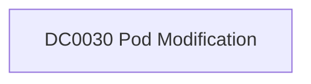

# DC0030 Pod Modification

[ATT&CK](https://attack.mitre.org/datacomponents/DC0030) · version 2.0 · modified 2025-10-21 · ATT&CK release 20.1

Status: **Ready** (needs a feed you have not ticked) · umbrella eventtype `mitre_dc0030_pod_modification`

> Changes made to a pod’s configuration or control data within a containerized cluster. This can include updating settings such as resource limits, environment variables, annotations, labels, or even the containers running within the pod. Pod modifications are often executed using commands like kubectl set, kubectl patch, or kubectl edit.  *Data Collection Measures:*   - Kubernetes API Server Audit Logs:     - Capture all API calls related to pod modification, such as PATCH, PUT, or UPDATE methods on v1/pods. - Runtime Security Tools:     - Tools like Falco, Sysdig, and Kube-bench can monitor pod modifications at runtime and alert on policy violations. - Container Orchestration Logs:     - Monitor events logged by Kubernetes itself (e.g., `kubectl logs -n kube-system kube-controller-manager`). - SIEM and EDR Solutions:     - Use SIEM platforms (e.g., Splunk) to aggregate API server logs and detect patterns of unauthorized or suspicious pod modifications.     - Endpoint Detection and Response (EDR) tools configured with container visibility can monitor commands like `kubectl` set or `kubectl patch`. - Host-Based Monitoring:     - Collect and analyze logs for processes executing `kubectl` commands or interacting with Kubernetes configuration files (e.g., `.kube/config`).

## Why this component matters

Patch/update on pods (ephemeral containers, spec edits) via API audit.

ATT&CK v20.1 has **0 analytics** across **0 detection strategies** that read this component, covering **0 techniques**. Tactics most dependent on it: none.

## Where it comes from



## Requirements

Per feed (from `config/stack.yml` and `config/log_sources.yml`):

| Feed | Status | Sourcetype or source | Constraint | Origin | TA / collector |
|---|---|---|---|---|---|
| `kubernetes_audit` | ready (tick in stack.yml) | sourcetype=`kube:apiserver-audit`, sourcetype=`kube:objects:events` | `verb IN (patch, update) (objectRef.resource=pods)` | defaults | Splunk OpenTelemetry Collector for Kubernetes / Splunk Connect for Kubernetes |

Collection prerequisites:

- **kubernetes_audit**: Audit policy at Metadata level minimum
- **kubernetes_audit**: RequestResponse for secrets/pods/exec; ship the audit log file from control-plane nodes.

## Splunk

Eventtypes (literal constraints, see `dist/splunk/TA-mitre-attack-datacomponents/default/eventtypes.conf`):

```ini
[mitre_dc0030_pod_modification__kubernetes_audit]
search = index=k8s sourcetype IN ("kube:apiserver-audit", "kube:objects:events") verb IN (patch, update) (objectRef.resource=pods)
disabled = 1

[mitre_dc0030_pod_modification]
search = eventtype=mitre_dc0030_pod_modification__kubernetes_audit
```

Macros for analytics: `` `mitre_dc0030` `` (umbrella), `` `mitre_dc0030_kubernetes_audit` ``, `` `mitre_dc0030_filter` `` (site exclusions).
CIM: no data model mapping; analytics on this component run as raw eventtype searches.

## Sigma

No generic Sigma category maps to this component; rules use `product`/`service` logsources, which the pipeline maps to index and sourcetype.

## Dependents

Top techniques detected through this component (of 0):

| Technique | Name | Tactics | Analytics using this DC |
|---|---|---|---|

Full list: `lookups/mitre_attack_analytics.csv` filtered on `dc_ids` containing `DC0030`.
