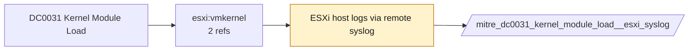

# DC0031 Kernel Module Load

[ATT&CK](https://attack.mitre.org/datacomponents/DC0031) · version 2.0 · modified 2025-10-21 · ATT&CK release 20.1

Status: **Ready** (needs a feed you have not ticked) · umbrella eventtype `mitre_dc0031_kernel_module_load`

> The process of loading a kernel module into the operating system kernel. Kernel modules are object files that extend the kernel’s functionality, such as adding support for device drivers, new filesystems, or additional system calls. This action can be legitimate (e.g., loading a driver) or malicious (e.g., adding a rootkit).   *Data Collection Measures:*  - Linux:     - Auditd: Enable auditing of kernel module loading. Example rule: `-a always,exit -F arch=b64 -S init_module,delete_module`.     - Syslog: Monitor `/var/log/syslog` or `/var/log/messages` for entries related to kernel module loads.     - Systemd Journal: Use `journalctl` to query logs for module loading events: `journalctl -k | grep "Loading kernel module"` - macOS:     - Unified Logs: Use the `log` command to query kernel module events: `log show --predicate 'eventMessage contains "kextload"' --info`     - Endpoint Security Framework (ESF): Monitor for `ES_EVENT_TYPE_AUTH_KEXTLOAD` (kernel extension loading events). - Kernel-Specific Tools:     - Lsmod: Use `lsmod` to list loaded kernel modules in real-time.     - Kprobe/eBPF: Use extended Berkeley Packet Filter (eBPF) or Kernel Probes (kprobes) to monitor kernel events, including module loading. Example using eBPF tools like BCC: `sudo python /path/to/bcc/tools/kprobe -v do_init_module` - Enable EDR Monitoring:     - Configure alerts for: Suspicious kernel module loads from non-standard paths (e.g., /tmp). Unexpected or unsigned kernel modules.     - Review detailed telemetry data provided by the EDR for insight into who initiated the module load, the file path, and whether the module was signed.

## Why this component matters

init_module/finit_module on Linux and vmkload_mod on ESXi are the rootkit path; needs auditd rules or vmkernel log forwarding.

ATT&CK v20.1 has **2 analytics** across **2 detection strategies** that read this component, covering **2 techniques**. Tactics most dependent on it: privilege-escalation (2), persistence (1).

Analytic references by platform: macOS 1, ESXi 1

## Where it comes from



## Requirements

Per feed (from `config/stack.yml` and `config/log_sources.yml`):

| Feed | Status | Sourcetype or source | Constraint | Origin | TA / collector |
|---|---|---|---|---|---|
| `auditd` | ready (tick in stack.yml) | sourcetype=`linux:audit` | `type IN (SYSCALL) (syscall IN (delete_module, finit_module, init_module) OR SYSCALL IN (delete_module, finit_module, init_module))` | defaults | Splunk Add-on for Unix and Linux (linux:audit) or auditd -> auditbeat/syslog |
| `esxi_syslog` | ready (tick in stack.yml) | sourcetype=`vmware:esxlog:vmkernel` | `(whole feed)` | defaults | Splunk Add-on for VMware ESXi Logs (vmware:esxlog:<log>) |
| `linux_syslog` | ready (tick in stack.yml) | sourcetype=`linux_messages_syslog`, sourcetype=`linux_secure`, sourcetype=`syslog` | `(kernel)` | defaults | Splunk Add-on for Unix and Linux (syslog, linux_secure, linux_messages_syslog) |

Collection prerequisites:

- **auditd**: audit rules for execve, connect, open/openat on sensitive paths, ptrace, module load, mount, setuid; a Neo23x0/auditd baseline or Florian Roth's rule set is a reasonable start.
- **auditd**: log_format = ENRICHED in auditd.conf so syscall names and uids resolve (otherwise syscall numbers are architecture dependent).
- **esxi_syslog**: Syslog.global.logHost set on every host; ESXi Shell/SSH audit enabled; consider Syslog.global.auditRecord (ESXi 8).

## Splunk

Eventtypes (literal constraints, see `dist/splunk/TA-mitre-attack-datacomponents/default/eventtypes.conf`):

```ini
[mitre_dc0031_kernel_module_load__auditd]
search = index=linux sourcetype="linux:audit" type IN (SYSCALL) (syscall IN (delete_module, finit_module, init_module) OR SYSCALL IN (delete_module, finit_module, init_module))
disabled = 1

[mitre_dc0031_kernel_module_load__esxi_syslog]
search = index=vmware sourcetype="vmware:esxlog:vmkernel"
disabled = 1

[mitre_dc0031_kernel_module_load__linux_syslog]
search = index=linux sourcetype IN (linux_messages_syslog, linux_secure, syslog) (kernel)
disabled = 1

[mitre_dc0031_kernel_module_load]
search = eventtype=mitre_dc0031_kernel_module_load__auditd OR eventtype=mitre_dc0031_kernel_module_load__esxi_syslog OR eventtype=mitre_dc0031_kernel_module_load__linux_syslog
```

Macros for analytics: `` `mitre_dc0031` `` (umbrella), `` `mitre_dc0031_auditd` ``, `` `mitre_dc0031_esxi_syslog` ``, `` `mitre_dc0031_linux_syslog` ``, `` `mitre_dc0031_filter` `` (site exclusions).
CIM: no data model mapping; analytics on this component run as raw eventtype searches.

## Sigma

No generic Sigma category maps to this component; rules use `product`/`service` logsources, which the pipeline maps to index and sourcetype.

## Dependents

Top techniques detected through this component (of 2):

| Technique | Name | Tactics | Analytics using this DC |
|---|---|---|---|
| [T1547.006](https://attack.mitre.org/techniques/T1547/006) | Kernel Modules and Extensions | persistence, privilege-escalation | 1 |
| [T1611](https://attack.mitre.org/techniques/T1611) | Escape to Host | privilege-escalation | 1 |

Full list: `lookups/mitre_attack_analytics.csv` filtered on `dc_ids` containing `DC0031`.
