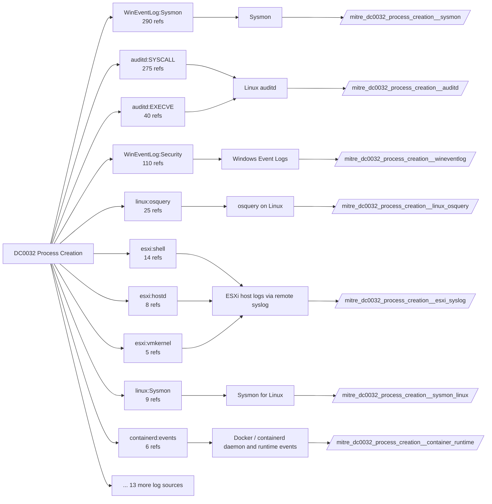

# DC0032 Process Creation

[ATT&CK](https://attack.mitre.org/datacomponents/DC0032) · version 2.2 · modified 2026-10-13 · ATT&CK release 20.1

Umbrella eventtype `mitre_dc0032_process_creation` over 11 feed(s)

> Refers to the event in which a new process (executable) is initialized by an operating system. This can involve parent-child process relationships, process arguments, and environmental variables. Monitoring process creation is crucial for detecting malicious behaviors, such as execution of unauthorized binaries, scripting abuse, or privilege escalation attempts..

## Why this component matters

The backbone of endpoint detection: 860 of 1773 analytics read it, and almost every execution, persistence, discovery and defense-evasion strategy starts from a process tree. Where deployed, Sysmon EID 1 is the primary feed (image, hashes, parent, command line, user), 4688 is the fallback where Sysmon is absent, and Solidcore EXECUTION_DENIED gives a high-signal second opinion on blocked binaries.

ATT&CK v20.1 has **860 analytics** across **456 detection strategies** that read this component, covering **456 techniques**. Tactics most dependent on it: stealth (214), persistence (122), discovery (111), privilege-escalation (99).

Analytic references by platform: Windows 366, macOS 239, Linux 224, ESXi 14, Containers 13, IaaS 3, Office Suite 1

## Where it comes from



## Requirements

Component specific:

- Sysmon config must include ProcessCreate with command line and parent command line (the default); hashes SHA256 at minimum.
- 4688 is useless without the 'Include command line in process creation events' GPO; also enable Audit Process Creation (Detailed Tracking).
- For Linux parity collect auditd with an execve rule (-a always,exit -F arch=b64 -S execve,execveat) and log_format=ENRICHED.
- ESXi: shell.log is the only process-level record on the hypervisor; forward it and enable ESXi Shell auditing.

Per feed (from `config/stack.yml` and `config/log_sources.yml`):

| Feed | Schedule | Sourcetype or source | Constraint | Origin | TA / collector |
|---|---|---|---|---|---|
| `auditd` | scheduled | sourcetype=`linux:audit` | `type IN (EXECVE, SYSCALL) (syscall IN (execve, execveat) OR SYSCALL IN (execve, execveat))` | defaults | Splunk Add-on for Unix and Linux (linux:audit) or auditd -> auditbeat/syslog |
| `container_runtime` | scheduled | sourcetype=`containerd:events`, sourcetype=`docker:daemon`, sourcetype=`docker:events` | `(status IN (create, start, exec_create, exec_start))` | defaults | docker events scripted input or OpenTelemetry (docker:events, containerd) |
| `ebpf` | scheduled | sourcetype=`falco` | `(whole feed)` | derived | Vendor specific (falco JSON, tetragon) |
| `esxi_syslog` | scheduled | sourcetype=`vmware:esxlog:shell` | `(whole feed)` | defaults | Splunk Add-on for VMware ESXi Logs (vmware:esxlog:<log>) |
| `etw` | scheduled | sourcetype=`etw:json` | `(ProviderName="Microsoft-Windows-Kernel-Process")` | derived | Requires a user-mode ETW consumer (SilkETW/Sealighter, Splunk Stream for NDIS, or an EDR that exposes the provider). No standard Splunk TA. |
| `kubernetes_audit` | scheduled | sourcetype=`kube:apiserver-audit` | `(objectRef.subresource=exec OR (verb=create objectRef.resource=pods))` | defaults | Splunk OpenTelemetry Collector for Kubernetes / Splunk Connect for Kubernetes |
| `linux_osquery` | scheduled | sourcetype=`osquery:results` | `(name=process_events OR name=processes)` | defaults | osquery TA |
| `solidcore` | scheduled | sourcetype=`mcafee:epo:syslog` | `(threat_name=EXECUTION_DENIED OR event_description=EXECUTION_DENIED) (product_name="Solidcore*")` | defaults | Arrives through the ePO TA; Solidcore events carry event names such as FILE_CREATED, FILE_MODIFIED, FILE_DELETED, EXECUTION_DENIED, REG_VALUE_MODIFIED, PROCESS_HIJACK_ATTEMPTED. Verify field names (threat_name / event_description) in your data. |
| `sysmon` | scheduled | source=`XmlWinEventLog:Microsoft-Windows-Sysmon/Operational` | `EventCode IN (1)` | defaults | Splunk Add-on for Sysmon (needs Splunk_TA_windows for XML parsing) |
| `sysmon_linux` | scheduled | sourcetype=`sysmon:linux` | `EventCode IN (1)` | defaults | Splunk Add-on for Sysmon for Linux |
| `wineventlog` | scheduled | source=`XmlWinEventLog:Security` | `EventCode IN (4688)` | defaults | Splunk Add-on for Microsoft Windows (Splunk_TA_windows), XML rendering (renderXml = true) |

Collection prerequisites:

- **auditd**: audit rules for execve, connect, open/openat on sensitive paths, ptrace, module load, mount, setuid; a Neo23x0/auditd baseline or Florian Roth's rule set is a reasonable start.
- **auditd**: log_format = ENRICHED in auditd.conf so syscall names and uids resolve (otherwise syscall numbers are architecture dependent).
- **esxi_syslog**: Syslog.global.logHost set on every host; ESXi Shell/SSH audit enabled; consider Syslog.global.auditRecord (ESXi 8).
- **kubernetes_audit**: Audit policy at Metadata level minimum
- **kubernetes_audit**: RequestResponse for secrets/pods/exec; ship the audit log file from control-plane nodes.
- **solidcore**: Change Control file and registry monitoring rules scoped to the paths/keys of interest; Application Control in Enabled (not Observe) mode for EXECUTION_DENIED.
- **sysmon**: Sysmon deployed with a maintained modular configuration (e.g. sysmon-modular or SwiftOnSecurity). Event IDs referenced by a data component only exist if the config includes that rule group (ProcessAccess=10, ImageLoad=7, DNS=22, FileDelete=23/26, ClipboardChange=24, ProcessTampering=25, FileBlock=27/28 are off in minimal configs).
- **sysmon**: Hashes configured (SHA256 at least, IMPHASH useful) for File/Process metadata components.
- **wineventlog**: Advanced Audit Policy configured (at minimum Process Creation, Logon, Account Management, Object Access, Policy Change, Privilege Use, Detailed Tracking). Without the matching subcategory the EventCodes below never fire.
- **wineventlog**: Include command line in process creation events enabled for 4688 (Computer Configuration > Administrative Templates > System > Audit Process Creation).
- **wineventlog**: PowerShell Script Block Logging (4104) and Module Logging (4103) enabled via GPO for the PowerShell/Operational channel.
- **wineventlog**: Object access events (4656/4663/4657/4660/4670) require SACLs on the files/keys of interest.
- **wineventlog**: Non-default channels (TaskScheduler, WMI-Activity, CodeIntegrity, Defender, Firewall, WinRM, SMBClient/Server...) must be listed as inputs in Splunk_TA_windows inputs.conf; several are disabled by default in Windows.

Review notes: `container_runtime` has 9 ATT&CK reference(s) with no usable event filter (prose channel), constraint origin is *defaults*; `ebpf` has 4 ATT&CK reference(s) with no usable event filter (prose channel), constraint origin is *derived*; `linux_osquery` has 25 ATT&CK reference(s) with no usable event filter (prose channel), constraint origin is *defaults*; `wineventlog` has 2 ATT&CK reference(s) with no usable event filter (prose channel), constraint origin is *defaults*.

## Splunk

Eventtypes (literal constraints, see `dist/splunk/TA-mitre-attack-datacomponents/default/eventtypes.conf`):

```ini
[mitre_dc0032_process_creation__auditd]
search = index=linux sourcetype="linux:audit" type IN (EXECVE, SYSCALL) (syscall IN (execve, execveat) OR SYSCALL IN (execve, execveat))

[mitre_dc0032_process_creation__container_runtime]
search = index=k8s sourcetype IN ("containerd:events", "docker:daemon", "docker:events") (status IN (create, start, exec_create, exec_start))

[mitre_dc0032_process_creation__ebpf]
search = index=linux sourcetype=falco

[mitre_dc0032_process_creation__esxi_syslog]
search = index=vmware sourcetype="vmware:esxlog:shell"

[mitre_dc0032_process_creation__etw]
search = index=etw sourcetype="etw:json" (ProviderName="Microsoft-Windows-Kernel-Process")

[mitre_dc0032_process_creation__kubernetes_audit]
search = index=k8s sourcetype="kube:apiserver-audit" (objectRef.subresource=exec OR (verb=create objectRef.resource=pods))

[mitre_dc0032_process_creation__linux_osquery]
search = index=osquery sourcetype="osquery:results" (name=process_events OR name=processes)

[mitre_dc0032_process_creation__solidcore]
search = index=epo sourcetype="mcafee:epo:syslog" (threat_name=EXECUTION_DENIED OR event_description=EXECUTION_DENIED) (product_name="Solidcore*")

[mitre_dc0032_process_creation__sysmon]
search = index=sysmon source="XmlWinEventLog:Microsoft-Windows-Sysmon/Operational" EventCode IN (1)

[mitre_dc0032_process_creation__sysmon_linux]
search = index=linux sourcetype="sysmon:linux" EventCode IN (1)

[mitre_dc0032_process_creation__wineventlog]
search = index=wineventlog source="XmlWinEventLog:Security" EventCode IN (4688)

[mitre_dc0032_process_creation]
search = eventtype=mitre_dc0032_process_creation__auditd OR eventtype=mitre_dc0032_process_creation__container_runtime OR eventtype=mitre_dc0032_process_creation__ebpf OR eventtype=mitre_dc0032_process_creation__esxi_syslog OR eventtype=mitre_dc0032_process_creation__etw OR eventtype=mitre_dc0032_process_creation__kubernetes_audit OR eventtype=mitre_dc0032_process_creation__linux_osquery OR eventtype=mitre_dc0032_process_creation__solidcore OR eventtype=mitre_dc0032_process_creation__sysmon OR eventtype=mitre_dc0032_process_creation__sysmon_linux OR eventtype=mitre_dc0032_process_creation__wineventlog
```

Macros for analytics: `` `mitre_dc0032` `` (umbrella), `` `mitre_dc0032_auditd` ``, `` `mitre_dc0032_container_runtime` ``, `` `mitre_dc0032_ebpf` ``, `` `mitre_dc0032_esxi_syslog` ``, `` `mitre_dc0032_etw` ``, `` `mitre_dc0032_kubernetes_audit` ``, `` `mitre_dc0032_linux_osquery` ``, `` `mitre_dc0032_solidcore` ``, `` `mitre_dc0032_sysmon` ``, `` `mitre_dc0032_sysmon_linux` ``, `` `mitre_dc0032_wineventlog` ``, `` `mitre_dc0032_filter` `` (site exclusions).
CIM: `Endpoint.Processes` via `` `mitre_dc0032_dm` `` / `` `mitre_dc0032_dm_where` `` for `tstats`. CIM tags emitted for: `auditd`, `sysmon`, `sysmon_linux`, `wineventlog`.

## Sigma

Generic logsource categories scoped by this component in `dist/sigma/pipelines/splunk_mitre_dc.yml`: product `windows`: `process_creation`; product `linux`: `process_creation`.

## Dependents

Top techniques detected through this component (of 456):

| Technique | Name | Tactics | Analytics using this DC |
|---|---|---|---|
| [T1016.001](https://attack.mitre.org/techniques/T1016/001) | Internet Connection Discovery | discovery | 6 |
| [T1036](https://attack.mitre.org/techniques/T1036) | Masquerading | stealth | 6 |
| [T1046](https://attack.mitre.org/techniques/T1046) | Network Service Discovery | discovery | 6 |
| [T1053](https://attack.mitre.org/techniques/T1053) | Scheduled Task/Job | execution, persistence, privilege-escalation | 6 |
| [T1059.006](https://attack.mitre.org/techniques/T1059/006) | Python | execution | 6 |
| [T1087.001](https://attack.mitre.org/techniques/T1087/001) | Local Account | discovery | 6 |
| [T1090.001](https://attack.mitre.org/techniques/T1090/001) | Internal Proxy | command-and-control | 6 |
| [T1090.002](https://attack.mitre.org/techniques/T1090/002) | External Proxy | command-and-control | 6 |
| [T1104](https://attack.mitre.org/techniques/T1104) | Multi-Stage Channels | command-and-control | 6 |
| [T1132.001](https://attack.mitre.org/techniques/T1132/001) | Standard Encoding | command-and-control | 6 |
| [T1132.002](https://attack.mitre.org/techniques/T1132/002) | Non-Standard Encoding | command-and-control | 6 |
| [T1190](https://attack.mitre.org/techniques/T1190) | Exploit Public-Facing Application | initial-access | 6 |
| [T1480](https://attack.mitre.org/techniques/T1480) | Execution Guardrails | stealth | 6 |
| [T1496](https://attack.mitre.org/techniques/T1496) | Resource Hijacking | impact | 6 |
| [T1496.001](https://attack.mitre.org/techniques/T1496/001) | Compute Hijacking | impact | 6 |
| … | 441 more | | |

Full list: `lookups/mitre_attack_analytics.csv` filtered on `dc_ids` containing `DC0032`.
