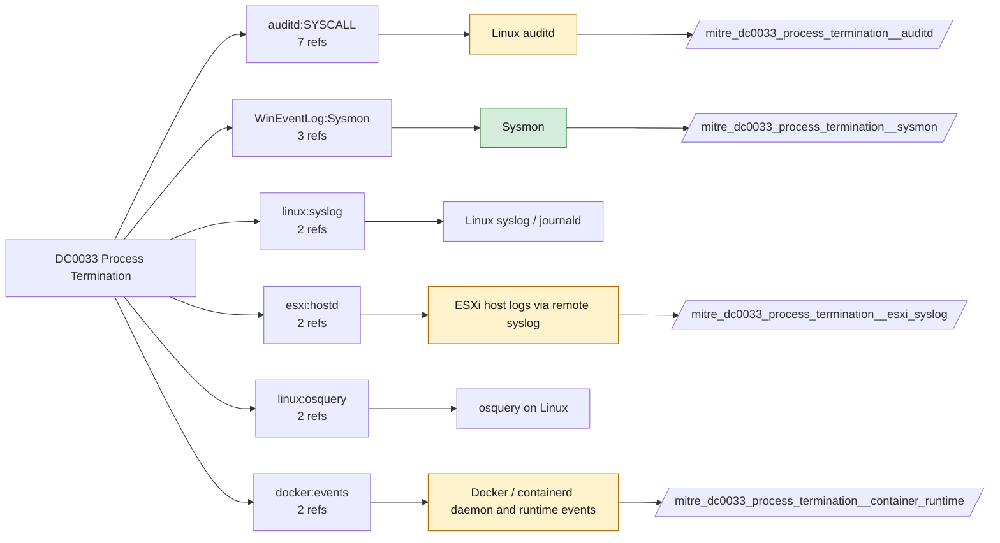

# DC0033 Process Termination

[ATT&CK](https://attack.mitre.org/datacomponents/DC0033) · version 2.0 · modified 2026-10-13 · ATT&CK release 20.1

Status: **Live** · umbrella eventtype `mitre_dc0033_process_termination`

> The exit or termination of a running process on a system. This can occur due to normal operations, user-initiated commands, or malicious actions such as process termination by malware to disable security controls.

## Why this component matters

Low volume on its own but essential for correlating short-lived processes and for detecting security tooling being killed. Sysmon EID 5 only; 4689 is available if Audit Process Termination is enabled.

ATT&CK v20.1 has **14 analytics** across **7 detection strategies** that read this component, covering **7 techniques**. Tactics most dependent on it: persistence (3), impact (3), stealth (2), defense-impairment (1).

Analytic references by platform: Linux 5, macOS 5, Windows 2, Containers 1, ESXi 1

## Where it comes from



## Requirements

Component specific:

- Sysmon ProcessTerminate (EID 5) is often excluded to save volume; include it at least for security products and system processes.

Per feed (from `config/stack.yml` and `config/log_sources.yml`):

| Feed | Status | Sourcetype or source | Constraint | Origin | TA / collector |
|---|---|---|---|---|---|
| `sysmon` | live | source=`XmlWinEventLog:Microsoft-Windows-Sysmon/Operational` | `EventCode IN (5)` | defaults | Splunk Add-on for Sysmon (needs Splunk_TA_windows for XML parsing) |
| `auditd` | ready (tick in stack.yml) | sourcetype=`linux:audit` | `type IN (SYSCALL) (syscall IN (exit_group, kill, tgkill, tkill) OR SYSCALL IN (exit_group, kill, tgkill, tkill))` | defaults | Splunk Add-on for Unix and Linux (linux:audit) or auditd -> auditbeat/syslog |
| `container_runtime` | ready (tick in stack.yml) | sourcetype=`docker:events` | `(status IN (die, kill, stop))` | defaults | docker events scripted input or OpenTelemetry (docker:events, containerd) |
| `esxi_syslog` | ready (tick in stack.yml) | sourcetype=`vmware:esxlog:hostd` | `(whole feed)` | derived | Splunk Add-on for VMware ESXi Logs (vmware:esxlog:<log>) |

Collection prerequisites:

- **sysmon**: Sysmon deployed with a maintained modular configuration (e.g. sysmon-modular or SwiftOnSecurity). Event IDs referenced by a data component only exist if the config includes that rule group (ProcessAccess=10, ImageLoad=7, DNS=22, FileDelete=23/26, ClipboardChange=24, ProcessTampering=25, FileBlock=27/28 are off in minimal configs).
- **sysmon**: Hashes configured (SHA256 at least, IMPHASH useful) for File/Process metadata components.
- **auditd**: audit rules for execve, connect, open/openat on sensitive paths, ptrace, module load, mount, setuid; a Neo23x0/auditd baseline or Florian Roth's rule set is a reasonable start.
- **auditd**: log_format = ENRICHED in auditd.conf so syscall names and uids resolve (otherwise syscall numbers are architecture dependent).
- **esxi_syslog**: Syslog.global.logHost set on every host; ESXi Shell/SSH audit enabled; consider Syslog.global.auditRecord (ESXi 8).

Review notes: `container_runtime` has 2 ATT&CK reference(s) with no usable event filter (prose channel), constraint origin is *defaults*.

## Splunk

Eventtypes (literal constraints, see `dist/splunk/TA-mitre-attack-datacomponents/default/eventtypes.conf`):

```ini
[mitre_dc0033_process_termination__sysmon]
search = index=sysmon source="XmlWinEventLog:Microsoft-Windows-Sysmon/Operational" EventCode IN (5)

[mitre_dc0033_process_termination__auditd]
search = index=linux sourcetype="linux:audit" type IN (SYSCALL) (syscall IN (exit_group, kill, tgkill, tkill) OR SYSCALL IN (exit_group, kill, tgkill, tkill))
disabled = 1

[mitre_dc0033_process_termination__container_runtime]
search = index=k8s sourcetype="docker:events" (status IN (die, kill, stop))
disabled = 1

[mitre_dc0033_process_termination__esxi_syslog]
search = index=vmware sourcetype="vmware:esxlog:hostd"
disabled = 1

[mitre_dc0033_process_termination]
search = eventtype=mitre_dc0033_process_termination__sysmon OR eventtype=mitre_dc0033_process_termination__auditd OR eventtype=mitre_dc0033_process_termination__container_runtime OR eventtype=mitre_dc0033_process_termination__esxi_syslog
```

Macros for analytics: `` `mitre_dc0033` `` (umbrella), `` `mitre_dc0033_sysmon` ``, `` `mitre_dc0033_auditd` ``, `` `mitre_dc0033_container_runtime` ``, `` `mitre_dc0033_esxi_syslog` ``, `` `mitre_dc0033_filter` `` (site exclusions).
CIM: `Endpoint.Processes` via `` `mitre_dc0033_dm` `` / `` `mitre_dc0033_dm_where` `` for `tstats`. CIM tags emitted for: `sysmon`.

## Sigma

Generic logsource categories scoped by this component in `dist/sigma/pipelines/splunk_mitre_dc.yml`: product `windows`: `process_termination`.

## Dependents

Top techniques detected through this component (of 7):

| Technique | Name | Tactics | Analytics using this DC |
|---|---|---|---|
| [T1668](https://attack.mitre.org/techniques/T1668) | Exclusive Control | persistence | 7 |
| [T1480.002](https://attack.mitre.org/techniques/T1480/002) | Mutual Exclusion | stealth | 6 |
| [T1485](https://attack.mitre.org/techniques/T1485) | Data Destruction | impact | 5 |
| [T1489](https://attack.mitre.org/techniques/T1489) | Service Stop | impact | 5 |
| [T1499.004](https://attack.mitre.org/techniques/T1499/004) | Application or System Exploitation | impact | 5 |
| [T1548.003](https://attack.mitre.org/techniques/T1548/003) | Sudo and Sudo Caching | privilege-escalation | 5 |
| [T1685](https://attack.mitre.org/techniques/T1685) | Disable or Modify Tools | defense-impairment | 5 |

Full list: `lookups/mitre_attack_analytics.csv` filtered on `dc_ids` containing `DC0033`.
