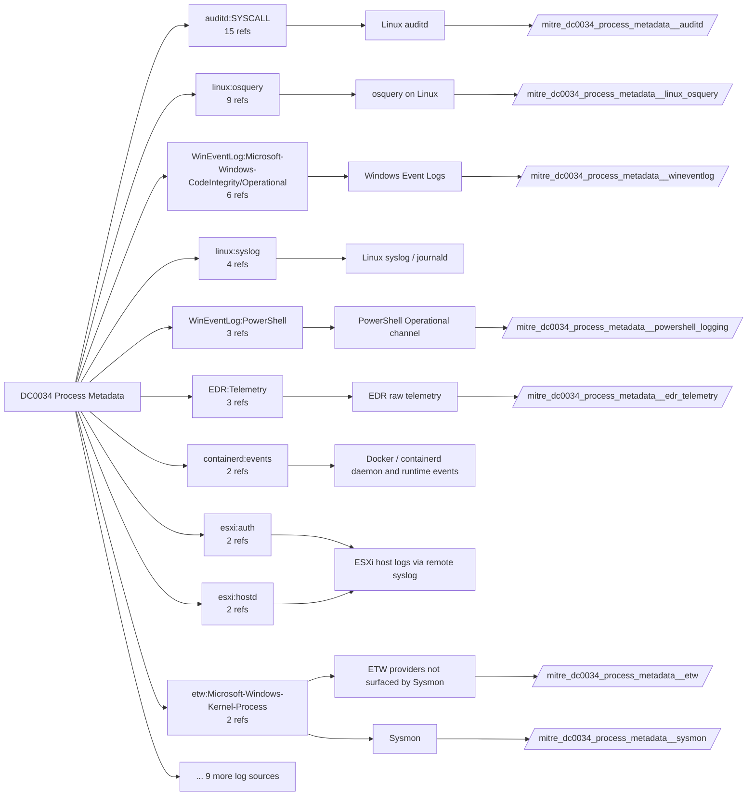

# DC0034 Process Metadata

[ATT&CK](https://attack.mitre.org/datacomponents/DC0034) · version 2.2 · modified 2026-10-13 · ATT&CK release 20.1

Umbrella eventtype `mitre_dc0034_process_metadata` over 7 feed(s)

> Contextual data about a running process, which may include information such as environment variables, image name, user/owner, etc.

## Why this component matters

Point-in-time facts about a process: signature, integrity level, parent lineage, PowerShell host version. Served by Sysmon EID 1 fields, CodeIntegrity/AppLocker/DeviceGuard channels and PowerShell 400/403.

ATT&CK v20.1 has **40 analytics** across **31 detection strategies** that read this component, covering **31 techniques**. Tactics most dependent on it: stealth (16), execution (8), privilege-escalation (8), discovery (5).

Analytic references by platform: macOS 16, Linux 10, Windows 9, ESXi 2, IaaS 1, Containers 1, Network Devices 1

## Where it comes from



## Requirements

Component specific:

- AppLocker and CodeIntegrity channels only populate when a policy is deployed, even in audit mode.

Per feed (from `config/stack.yml` and `config/log_sources.yml`):

| Feed | Schedule | Sourcetype or source | Constraint | Origin | TA / collector |
|---|---|---|---|---|---|
| `auditd` | scheduled | sourcetype=`linux:audit` | `type IN (PROCTITLE, SYSCALL) (syscall IN (execve, prctl, setgid, setuid) OR SYSCALL IN (execve, prctl, setgid, setuid))` | defaults | Splunk Add-on for Unix and Linux (linux:audit) or auditd -> auditbeat/syslog |
| `edr_telemetry` | scheduled | sourcetype=`edr:telemetry` | `(whole feed)` | derived | Vendor specific |
| `etw` | scheduled | sourcetype=`etw:json` | `(ProviderName="Microsoft-Windows-Kernel-Process")` | derived | Requires a user-mode ETW consumer (SilkETW/Sealighter, Splunk Stream for NDIS, or an EDR that exposes the provider). No standard Splunk TA. |
| `linux_osquery` | scheduled | sourcetype=`osquery:results` | `(name=processes OR name=process_open_sockets OR name=process_memory_map)` | defaults | osquery TA |
| `powershell_logging` | scheduled | source=`XmlWinEventLog:Microsoft-Windows-PowerShell/Operational` | `EventCode IN (400, 403)` | defaults | Splunk Add-on for Microsoft Windows |
| `sysmon` | scheduled | source=`XmlWinEventLog:Microsoft-Windows-Sysmon/Operational` | `EventCode IN (1, 5)` | defaults | Splunk Add-on for Sysmon (needs Splunk_TA_windows for XML parsing) |
| `wineventlog` | scheduled | source=`XmlWinEventLog:Microsoft-Windows-AppLocker/EXE and DLL`, source=`XmlWinEventLog:Microsoft-Windows-CodeIntegrity/Operational`, source=`XmlWinEventLog:Microsoft-Windows-DeviceGuard/Operational`, source=`XmlWinEventLog:Security` | `(whole feed)` | defaults | Splunk Add-on for Microsoft Windows (Splunk_TA_windows), XML rendering (renderXml = true) |

Collection prerequisites:

- **auditd**: audit rules for execve, connect, open/openat on sensitive paths, ptrace, module load, mount, setuid; a Neo23x0/auditd baseline or Florian Roth's rule set is a reasonable start.
- **auditd**: log_format = ENRICHED in auditd.conf so syscall names and uids resolve (otherwise syscall numbers are architecture dependent).
- **powershell_logging**: Turn on Script Block Logging and Module Logging GPO; consider Transcription to a protected share.
- **powershell_logging**: Add Microsoft-Windows-PowerShell/Operational as a WinEventLog input (renderXml=true).
- **sysmon**: Sysmon deployed with a maintained modular configuration (e.g. sysmon-modular or SwiftOnSecurity). Event IDs referenced by a data component only exist if the config includes that rule group (ProcessAccess=10, ImageLoad=7, DNS=22, FileDelete=23/26, ClipboardChange=24, ProcessTampering=25, FileBlock=27/28 are off in minimal configs).
- **sysmon**: Hashes configured (SHA256 at least, IMPHASH useful) for File/Process metadata components.
- **wineventlog**: Advanced Audit Policy configured (at minimum Process Creation, Logon, Account Management, Object Access, Policy Change, Privilege Use, Detailed Tracking). Without the matching subcategory the EventCodes below never fire.
- **wineventlog**: Include command line in process creation events enabled for 4688 (Computer Configuration > Administrative Templates > System > Audit Process Creation).
- **wineventlog**: PowerShell Script Block Logging (4104) and Module Logging (4103) enabled via GPO for the PowerShell/Operational channel.
- **wineventlog**: Object access events (4656/4663/4657/4660/4670) require SACLs on the files/keys of interest.
- **wineventlog**: Non-default channels (TaskScheduler, WMI-Activity, CodeIntegrity, Defender, Firewall, WinRM, SMBClient/Server...) must be listed as inputs in Splunk_TA_windows inputs.conf; several are disabled by default in Windows.

Review notes: `edr_telemetry` has 4 ATT&CK reference(s) with no usable event filter (prose channel), constraint origin is *derived*; `etw` has 1 ATT&CK reference(s) with no usable event filter (prose channel), constraint origin is *derived*; `linux_osquery` has 9 ATT&CK reference(s) with no usable event filter (prose channel), constraint origin is *defaults*; `wineventlog` has 14 ATT&CK reference(s) with no usable event filter (prose channel), constraint origin is *defaults*.

## Splunk

Eventtypes (literal constraints, see `dist/splunk/TA-mitre-attack-datacomponents/default/eventtypes.conf`):

```ini
[mitre_dc0034_process_metadata__auditd]
search = index=linux sourcetype="linux:audit" type IN (PROCTITLE, SYSCALL) (syscall IN (execve, prctl, setgid, setuid) OR SYSCALL IN (execve, prctl, setgid, setuid))

[mitre_dc0034_process_metadata__edr_telemetry]
search = index=edr sourcetype="edr:telemetry"

[mitre_dc0034_process_metadata__etw]
search = index=etw sourcetype="etw:json" (ProviderName="Microsoft-Windows-Kernel-Process")

[mitre_dc0034_process_metadata__linux_osquery]
search = index=osquery sourcetype="osquery:results" (name=processes OR name=process_open_sockets OR name=process_memory_map)

[mitre_dc0034_process_metadata__powershell_logging]
search = index=wineventlog source="XmlWinEventLog:Microsoft-Windows-PowerShell/Operational" EventCode IN (400, 403)

[mitre_dc0034_process_metadata__sysmon]
search = index=sysmon source="XmlWinEventLog:Microsoft-Windows-Sysmon/Operational" EventCode IN (1, 5)

[mitre_dc0034_process_metadata__wineventlog]
search = index=wineventlog source IN ("XmlWinEventLog:Microsoft-Windows-AppLocker/EXE and DLL", "XmlWinEventLog:Microsoft-Windows-CodeIntegrity/Operational", "XmlWinEventLog:Microsoft-Windows-DeviceGuard/Operational", "XmlWinEventLog:Security")

[mitre_dc0034_process_metadata]
search = eventtype=mitre_dc0034_process_metadata__auditd OR eventtype=mitre_dc0034_process_metadata__edr_telemetry OR eventtype=mitre_dc0034_process_metadata__etw OR eventtype=mitre_dc0034_process_metadata__linux_osquery OR eventtype=mitre_dc0034_process_metadata__powershell_logging OR eventtype=mitre_dc0034_process_metadata__sysmon OR eventtype=mitre_dc0034_process_metadata__wineventlog
```

Macros for analytics: `` `mitre_dc0034` `` (umbrella), `` `mitre_dc0034_auditd` ``, `` `mitre_dc0034_edr_telemetry` ``, `` `mitre_dc0034_etw` ``, `` `mitre_dc0034_linux_osquery` ``, `` `mitre_dc0034_powershell_logging` ``, `` `mitre_dc0034_sysmon` ``, `` `mitre_dc0034_wineventlog` ``, `` `mitre_dc0034_filter` `` (site exclusions).
CIM: `Endpoint.Processes` via `` `mitre_dc0034_dm` `` / `` `mitre_dc0034_dm_where` `` for `tstats`. CIM tags emitted for: `sysmon`.

## Sigma

No generic Sigma category maps to this component; rules use `product`/`service` logsources, which the pipeline maps to index and sourcetype.

## Dependents

Top techniques detected through this component (of 31):

| Technique | Name | Tactics | Analytics using this DC |
|---|---|---|---|
| [T1057](https://attack.mitre.org/techniques/T1057) | Process Discovery | discovery | 3 |
| [T1548](https://attack.mitre.org/techniques/T1548) | Abuse Elevation Control Mechanism | privilege-escalation | 3 |
| [T1036.005](https://attack.mitre.org/techniques/T1036/005) | Match Legitimate Resource Name or Location | stealth | 2 |
| [T1124](https://attack.mitre.org/techniques/T1124) | System Time Discovery | discovery | 2 |
| [T1125](https://attack.mitre.org/techniques/T1125) | Video Capture | collection | 2 |
| [T1129](https://attack.mitre.org/techniques/T1129) | Shared Modules | execution | 2 |
| [T1689](https://attack.mitre.org/techniques/T1689) | Downgrade Attack | defense-impairment | 2 |
| [T1001.003](https://attack.mitre.org/techniques/T1001/003) | Protocol or Service Impersonation | command-and-control | 1 |
| [T1003](https://attack.mitre.org/techniques/T1003) | OS Credential Dumping | credential-access | 1 |
| [T1027.014](https://attack.mitre.org/techniques/T1027/014) | Polymorphic Code | stealth | 1 |
| [T1036](https://attack.mitre.org/techniques/T1036) | Masquerading | stealth | 1 |
| [T1036.003](https://attack.mitre.org/techniques/T1036/003) | Rename Legitimate Utilities | stealth | 1 |
| [T1036.011](https://attack.mitre.org/techniques/T1036/011) | Overwrite Process Arguments | stealth | 1 |
| [T1055](https://attack.mitre.org/techniques/T1055) | Process Injection | stealth, privilege-escalation | 1 |
| [T1055.008](https://attack.mitre.org/techniques/T1055/008) | Ptrace System Calls | stealth, privilege-escalation | 1 |
| … | 16 more | | |

Full list: `lookups/mitre_attack_analytics.csv` filtered on `dc_ids` containing `DC0034`.
