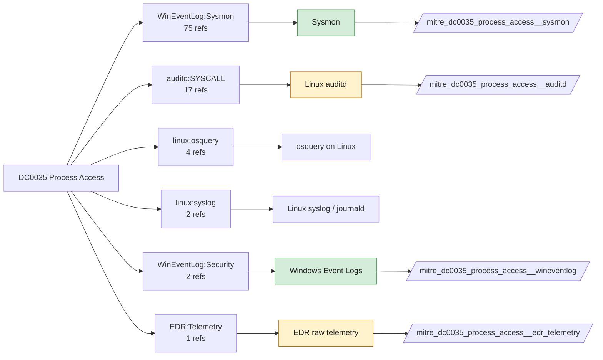

# DC0035 Process Access

[ATT&CK](https://attack.mitre.org/datacomponents/DC0035) · version 3.0 · modified 2026-10-13 · ATT&CK release 20.1

Status: **Live** · umbrella eventtype `mitre_dc0035_process_access`

> Refers to an event where one process attempts to open another process, typically to inspect or manipulate its memory, access handles, or modify execution flow. Monitoring these access attempts can provide valuable insight into both benign and malicious behaviors, such as debugging, inter-process communication (IPC), or process injection.  *Data Collection Measures:*  - Endpoint Detection and Response (EDR) Tools:     -  EDR solutions that provide telemetry on inter-process access and memory manipulation. - Sysmon (Windows):     - Event ID 10: Captures process access attempts, including:         - Source process (initiator)         - Target process (victim)         - Access rights requested         - Process ID correlation - Windows Event Logs:     - Event ID 4656 (Audit Handle to an Object): Logs access attempts to system objects.     - Event ID 4690 (Attempted Process Modification): Can help identify unauthorized process changes. - Linux/macOS Monitoring:     - AuditD: Monitors process access through syscall tracing (e.g., `ptrace`, `open`, `read`, `write`).     - eBPF/XDP: Used for low-level monitoring of kernel process access.     - OSQuery: Query process access behavior via structured SQL-like logging. - Procmon (Process Monitor) and Debugging Tools:     - Windows Procmon: Captures real-time process interactions.     - Linux strace / ptrace: Useful for tracking process behavior at the system call level.

## Why this component matters

Credential dumping, injection and process hollowing open handles to other processes. Sysmon EID 10 (with GrantedAccess and CallTrace) is the main source; 4656/4663 only fire with SACLs on the target objects.

ATT&CK v20.1 has **93 analytics** across **77 detection strategies** that read this component, covering **77 techniques**. Tactics most dependent on it: credential-access (35), stealth (32), privilege-escalation (18), discovery (8).

Analytic references by platform: Windows 72, Linux 12, macOS 9

## Where it comes from



## Requirements

Component specific:

- Sysmon ProcessAccess (EID 10) must be scoped to targets such as lsass.exe, winlogon.exe, csrss.exe; unscoped it is unusable.
- Linux equivalents (ptrace, process_vm_readv) need explicit auditd rules.

Per feed (from `config/stack.yml` and `config/log_sources.yml`):

| Feed | Status | Sourcetypes | Constraint | Origin | TA / collector |
|---|---|---|---|---|---|
| `sysmon` | live | `XmlWinEventLog:Microsoft-Windows-Sysmon/Operational` | `EventCode IN (8, 10)` | defaults | Splunk Add-on for Sysmon (TA-microsoft-sysmon) |
| `wineventlog` | live | `XmlWinEventLog:Security` | `EventCode IN (4656, 4663)` | defaults | Splunk Add-on for Microsoft Windows (Splunk_TA_windows), XML rendering |
| `auditd` | ready (tick in stack.yml) | `linux:audit` | `type IN (SYSCALL) (syscall IN (process_vm_readv, process_vm_writev, ptrace) OR SYSCALL IN (process_vm_readv, process_vm_writev, ptrace))` | defaults | Splunk Add-on for Unix and Linux (linux:audit) or auditd -> auditbeat/syslog |
| `edr_telemetry` | ready (tick in stack.yml) | `edr:telemetry` | `(whole feed)` | derived | Vendor specific |

Collection prerequisites:

- **sysmon**: Sysmon deployed with a maintained modular configuration (e.g. sysmon-modular or SwiftOnSecurity). Event IDs referenced by a data component only exist if the config includes that rule group (ProcessAccess=10, ImageLoad=7, DNS=22, FileDelete=23/26, ClipboardChange=24, ProcessTampering=25, FileBlock=27/28 are off in minimal configs).
- **sysmon**: Hashes configured (SHA256 at least, IMPHASH useful) for File/Process metadata components.
- **wineventlog**: Advanced Audit Policy configured (at minimum Process Creation, Logon, Account Management, Object Access, Policy Change, Privilege Use, Detailed Tracking). Without the matching subcategory the EventCodes below never fire.
- **wineventlog**: Include command line in process creation events enabled for 4688 (Computer Configuration > Administrative Templates > System > Audit Process Creation).
- **wineventlog**: PowerShell Script Block Logging (4104) and Module Logging (4103) enabled via GPO for the PowerShell/Operational channel.
- **wineventlog**: Object access events (4656/4663/4657/4660/4670) require SACLs on the files/keys of interest.
- **wineventlog**: Non-default channels (TaskScheduler, WMI-Activity, CodeIntegrity, Defender, Firewall, WinRM, SMBClient/Server...) must be listed as inputs in Splunk_TA_windows inputs.conf; several are disabled by default in Windows.
- **auditd**: audit rules for execve, connect, open/openat on sensitive paths, ptrace, module load, mount, setuid; a Neo23x0/auditd baseline or Florian Roth's rule set is a reasonable start.
- **auditd**: log_format = ENRICHED in auditd.conf so syscall names and uids resolve (otherwise syscall numbers are architecture dependent).

Review notes: `edr_telemetry` has 1 ATT&CK reference(s) with no usable event filter (prose channel), constraint origin is *derived*.

## Splunk

Eventtypes (literal constraints, see `dist/splunk/TA-mitre-attack-datacomponents/default/eventtypes.conf`):

```ini
[mitre_dc0035_process_access__sysmon]
search = index=sysmon sourcetype=XmlWinEventLog:Microsoft-Windows-Sysmon/Operational EventCode IN (8, 10)

[mitre_dc0035_process_access__wineventlog]
search = index=wineventlog sourcetype=XmlWinEventLog:Security EventCode IN (4656, 4663)

[mitre_dc0035_process_access__auditd]
search = index=linux sourcetype=linux:audit type IN (SYSCALL) (syscall IN (process_vm_readv, process_vm_writev, ptrace) OR SYSCALL IN (process_vm_readv, process_vm_writev, ptrace))
disabled = 1

[mitre_dc0035_process_access__edr_telemetry]
search = index=edr sourcetype=edr:telemetry
disabled = 1

[mitre_dc0035_process_access]
search = eventtype=mitre_dc0035_process_access__sysmon OR eventtype=mitre_dc0035_process_access__wineventlog OR eventtype=mitre_dc0035_process_access__auditd OR eventtype=mitre_dc0035_process_access__edr_telemetry
```

Macros for analytics: `` `mitre_dc0035` `` (umbrella), `` `mitre_dc0035_sysmon` ``, `` `mitre_dc0035_wineventlog` ``, `` `mitre_dc0035_auditd` ``, `` `mitre_dc0035_edr_telemetry` ``, `` `mitre_dc0035_filter` `` (site exclusions).
CIM: `Endpoint.Processes` via `` `mitre_dc0035_dm` `` / `` `mitre_dc0035_dm_where` `` for `tstats`. CIM tags emitted for: none (no feed is known CIM-compliant for this model).

## Sigma

Generic logsource categories scoped by this component in `dist/sigma/pipelines/splunk_mitre_dc.yml`: product `windows`: `process_access`, `create_remote_thread`.

## Dependents

Top techniques detected through this component (of 77):

| Technique | Name | Tactics | Analytics using this DC |
|---|---|---|---|
| [T1539](https://attack.mitre.org/techniques/T1539) | Steal Web Session Cookie | credential-access | 3 |
| [T1555.005](https://attack.mitre.org/techniques/T1555/005) | Password Managers | credential-access | 3 |
| [T1003](https://attack.mitre.org/techniques/T1003) | OS Credential Dumping | credential-access | 2 |
| [T1003.005](https://attack.mitre.org/techniques/T1003/005) | Cached Domain Credentials | credential-access | 2 |
| [T1027.016](https://attack.mitre.org/techniques/T1027/016) | Junk Code Insertion | stealth | 2 |
| [T1055](https://attack.mitre.org/techniques/T1055) | Process Injection | stealth, privilege-escalation | 2 |
| [T1057](https://attack.mitre.org/techniques/T1057) | Process Discovery | discovery | 2 |
| [T1106](https://attack.mitre.org/techniques/T1106) | Native API | execution | 2 |
| [T1111](https://attack.mitre.org/techniques/T1111) | Multi-Factor Authentication Interception | credential-access | 2 |
| [T1123](https://attack.mitre.org/techniques/T1123) | Audio Capture | collection | 2 |
| [T1555.002](https://attack.mitre.org/techniques/T1555/002) | Securityd Memory | credential-access | 2 |
| [T1555.003](https://attack.mitre.org/techniques/T1555/003) | Credentials from Web Browsers | credential-access | 2 |
| [T1556](https://attack.mitre.org/techniques/T1556) | Modify Authentication Process | defense-impairment, persistence, credential-access | 2 |
| [T1559](https://attack.mitre.org/techniques/T1559) | Inter-Process Communication | execution | 2 |
| [T1001.001](https://attack.mitre.org/techniques/T1001/001) | Junk Data | command-and-control | 1 |
| … | 62 more | | |

Full list: `lookups/mitre_attack_analytics.csv` filtered on `dc_ids` containing `DC0035`.
