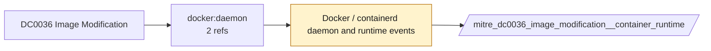

# DC0036 Image Modification

[ATT&CK](https://attack.mitre.org/datacomponents/DC0036) · version 2.0 · modified 2025-10-21 · ATT&CK release 20.1

Status: **Ready** (needs a feed you have not ticked) · umbrella eventtype `mitre_dc0036_image_modification`

> Changes made to a virtual machine image, including setting and/or control data (ex: Azure Compute Service Images PATCH)

## Why this component matters

Re-tagging or pushing over an existing image.

ATT&CK v20.1 has **2 analytics** across **1 detection strategies** that read this component, covering **1 techniques**. Tactics most dependent on it: persistence (2).

Analytic references by platform: IaaS 1, Containers 1

## Where it comes from



## Requirements

Per feed (from `config/stack.yml` and `config/log_sources.yml`):

| Feed | Status | Sourcetypes | Constraint | Origin | TA / collector |
|---|---|---|---|---|---|
| `container_runtime` | ready (tick in stack.yml) | `docker:daemon` | `(status IN (tag, untag, push))` | defaults | docker events scripted input or OpenTelemetry (docker:events, containerd) |

Review notes: `container_runtime` has 2 ATT&CK reference(s) with no usable event filter (prose channel), constraint origin is *defaults*.

## Splunk

Eventtypes (literal constraints, see `dist/splunk/TA-mitre-attack-datacomponents/default/eventtypes.conf`):

```ini
[mitre_dc0036_image_modification__container_runtime]
search = index=k8s sourcetype=docker:daemon (status IN (tag, untag, push))
disabled = 1

[mitre_dc0036_image_modification]
search = eventtype=mitre_dc0036_image_modification__container_runtime
```

Macros for analytics: `` `mitre_dc0036` `` (umbrella), `` `mitre_dc0036_container_runtime` ``, `` `mitre_dc0036_filter` `` (site exclusions).
CIM: no data model mapping; analytics on this component run as raw eventtype searches.

## Sigma

No generic Sigma category maps to this component; rules use `product`/`service` logsources, which the pipeline maps to index and sourcetype.

## Dependents

Top techniques detected through this component (of 1):

| Technique | Name | Tactics | Analytics using this DC |
|---|---|---|---|
| [T1525](https://attack.mitre.org/techniques/T1525) | Implant Internal Image | persistence | 2 |

Full list: `lookups/mitre_attack_analytics.csv` filtered on `dc_ids` containing `DC0036`.
