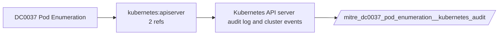

# DC0037 Pod Enumeration

[ATT&CK](https://attack.mitre.org/datacomponents/DC0037) · version 2.0 · modified 2025-10-21 · ATT&CK release 20.1

Umbrella eventtype `mitre_dc0037_pod_enumeration` over 1 feed(s)

> Extracting a list of running or existing pods within a containerized cluster environment. Pods are the smallest deployable units in a Kubernetes cluster and typically represent an application or workload. Enumeration of pods provides insight into the structure and state of applications running in the cluster, such as the names of pods, their namespaces, and their associated metadata.  *Data Collection Measures:*  - Kubernetes API Server Audit Logs:     - Enable Audit Logging in Kubernetes to capture API requests, such as GET `/api/v1/pods`. - Container Runtime Logs:     - Collect runtime-level logs from tools like CRI-O, containerd, or Docker, which might show relevant API calls for pod enumeration. - EDR and SIEM:     - Endpoint Detection and Response (EDR) tools, if configured with cluster-level visibility, can monitor user commands like `kubectl get pods`.     - SIEM platforms (e.g., Splunk) can ingest Kubernetes API logs to detect enumeration patterns. - Host-Based Monitoring:     - Monitor processes and commands executed on nodes where `kubectl` is installed using tools like auditd, Sysmon for Linux, or kernel modules.

## Why this component matters

list/get/watch on pods via API audit, typically from compromised service accounts.

ATT&CK v20.1 has **1 analytics** across **1 detection strategies** that read this component, covering **1 techniques**. Tactics most dependent on it: discovery (1).

Analytic references by platform: Containers 1

## Where it comes from



## Requirements

Per feed (from `config/stack.yml` and `config/log_sources.yml`):

| Feed | Schedule | Sourcetype or source | Constraint | Origin | TA / collector |
|---|---|---|---|---|---|
| `kubernetes_audit` | scheduled | sourcetype=`kube:apiserver-audit` | `verb IN (get, list, watch) (objectRef.resource=pods)` | defaults | Splunk OpenTelemetry Collector for Kubernetes / Splunk Connect for Kubernetes |

Collection prerequisites:

- **kubernetes_audit**: Audit policy at Metadata level minimum
- **kubernetes_audit**: RequestResponse for secrets/pods/exec; ship the audit log file from control-plane nodes.

## Splunk

Eventtypes (literal constraints, see `dist/splunk/TA-mitre-attack-datacomponents/default/eventtypes.conf`):

```ini
[mitre_dc0037_pod_enumeration__kubernetes_audit]
search = index=k8s sourcetype="kube:apiserver-audit" verb IN (get, list, watch) (objectRef.resource=pods)

[mitre_dc0037_pod_enumeration]
search = eventtype=mitre_dc0037_pod_enumeration__kubernetes_audit
```

Macros for analytics: `` `mitre_dc0037` `` (umbrella), `` `mitre_dc0037_kubernetes_audit` ``, `` `mitre_dc0037_filter` `` (site exclusions).
CIM: no data model mapping; analytics on this component run as raw eventtype searches.

## Sigma

No generic Sigma category maps to this component; rules use `product`/`service` logsources, which the pipeline maps to index and sourcetype.

## Dependents

Top techniques detected through this component (of 1):

| Technique | Name | Tactics | Analytics using this DC |
|---|---|---|---|
| [T1613](https://attack.mitre.org/techniques/T1613) | Container and Resource Discovery | discovery | 1 |

Full list: `lookups/mitre_attack_analytics.csv` filtered on `dc_ids` containing `DC0037`.
