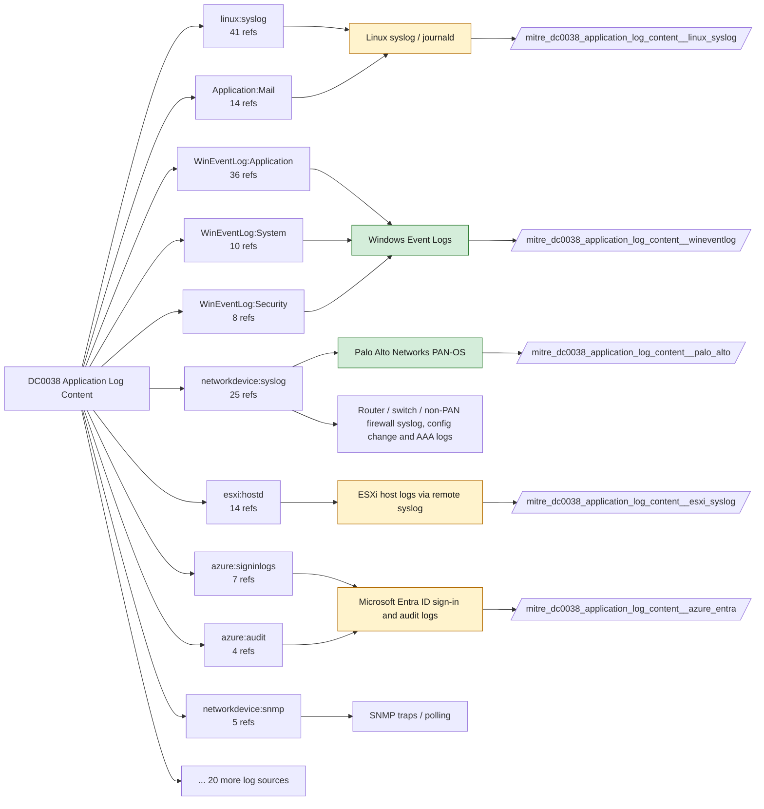

# DC0038 Application Log Content

[ATT&CK](https://attack.mitre.org/datacomponents/DC0038) · version 3.1 · modified 2026-10-13 · ATT&CK release 20.1

Status: **Live** · umbrella eventtype `mitre_dc0038_application_log_content`

> Application Log Content refers to logs generated by applications or services, providing a record of their activity. These logs may include metrics, errors, performance data, and operational alerts from web, mail, or other applications. These logs are vital for monitoring application behavior and detecting malicious activities or anomalies. Examples:   - Web Application Logs: These logs include information about requests, responses, errors, and security events (e.g., unauthorized access attempts). - Email Application Logs: Logs contain metadata about emails sent, received, or blocked (e.g., sender/receiver addresses, message IDs). - SaaS Application Logs: Activity logs include user logins, configuration changes, and access to sensitive resources. - Cloud Application Logs: Logs detail control plane activities, including API calls, instance modifications, and network changes. - System/Application Monitoring Logs: Logs provide insights into application performance, errors, and anomalies.

## Why this component matters

The broadest component (209 analytics): application-specific events from Windows Application/System channels, IIS, web servers, mail, PAN-OS threat/system, ESXi daemons, Entra audit. Each analytic needs a specific application; the eventtype is deliberately wide and should be narrowed per analytic.

ATT&CK v20.1 has **209 analytics** across **104 detection strategies** that read this component, covering **104 techniques**. Tactics most dependent on it: initial-access (39), persistence (29), stealth (28), impact (26).

Analytic references by platform: Windows 41, SaaS 33, Linux 33, Office Suite 31, macOS 26, Identity Provider 15, ESXi 10, Containers 6, PRE 6, IaaS 5, Network Devices 3

## Where it comes from



## Requirements

Component specific:

- Treat this as a routing component; phase-2 analytics should pin sourcetype and event IDs explicitly.

Per feed (from `config/stack.yml` and `config/log_sources.yml`):

| Feed | Status | Sourcetype or source | Constraint | Origin | TA / collector |
|---|---|---|---|---|---|
| `corelight` | live | sourcetype=`corelight_http`, sourcetype=`corelight_notice`, sourcetype=`corelight_smtp`, sourcetype=`corelight_ssh` | `(whole feed)` | defaults | Corelight App for Splunk (corelight_<log>). For TA_zeek use prefix zeek: and suffix :json. |
| `palo_alto` | live | sourcetype=`pan:globalprotect`, sourcetype=`pan:system`, sourcetype=`pan:threat` | `(whole feed)` | defaults | Splunk Add-on for Palo Alto Networks (pan:*) |
| `trellix_epo` | live | sourcetype=`mcafee:epo:syslog` | `(whole feed)` | defaults | Splunk Add-on for McAfee ePO Syslog (sourcetype mcafee:epo:syslog, documented by Splunk). If ePO data arrives another way (DB Connect pull, a community Trellix REST add-on such as trellix_epo:threat_events), change the sourcetype here. |
| `wineventlog` | live | source=`XmlWinEventLog:Application`, source=`XmlWinEventLog:Security`, source=`XmlWinEventLog:System` | `EventCode IN (104, 1000, 1020, 1063, 1102, 1341, 1342, 6416)` | defaults | Splunk Add-on for Microsoft Windows (Splunk_TA_windows), XML rendering (renderXml = true) |
| `azure_activity` | ready (tick in stack.yml) | sourcetype=`mscs:azure:audit` | `(whole feed)` | derived | Splunk Add-on for Microsoft Cloud Services (mscs:azure:audit) |
| `azure_entra` | ready (tick in stack.yml) | sourcetype=`azure:aad:audit`, sourcetype=`azure:aad:signin` | `(whole feed)` | defaults | Splunk Add-on for Microsoft Azure (azure:aad:signin, azure:aad:audit) or Microsoft Cloud Services add-on via Event Hub |
| `container_runtime` | ready (tick in stack.yml) | sourcetype=`docker:daemon`, sourcetype=`docker:events` | `(whole feed)` | derived | docker events scripted input or OpenTelemetry (docker:events, containerd) |
| `esxi_syslog` | ready (tick in stack.yml) | sourcetype=`vmware:esxlog:esxupdate`, sourcetype=`vmware:esxlog:hostd`, sourcetype=`vmware:esxlog:vmkernel` | `(whole feed)` | defaults | Splunk Add-on for VMware ESXi Logs (vmware:esxlog:<log>) |
| `iis` | ready (tick in stack.yml) | sourcetype=`ms:iis:auto` | `(whole feed)` | derived | Splunk Add-on for Microsoft IIS |
| `kubernetes_audit` | ready (tick in stack.yml) | sourcetype=`kube:apiserver-audit`, sourcetype=`kube:container:*`, sourcetype=`kube:container:ingress-nginx` | `(whole feed)` | derived | Splunk OpenTelemetry Collector for Kubernetes / Splunk Connect for Kubernetes |
| `linux_syslog` | ready (tick in stack.yml) | sourcetype=`access_combined`, sourcetype=`linux_messages_syslog`, sourcetype=`linux_secure` | `(whole feed)` | defaults | Splunk Add-on for Unix and Linux (syslog, linux_secure, linux_messages_syslog) |
| `vcenter` | ready (tick in stack.yml) | sourcetype=`vmware:vclog:vpxd` | `(whole feed)` | derived | Splunk Add-on for VMware (vmware:vclog:vpxd) |

Collection prerequisites:

- **corelight**: Sensor placement covering east-west (DC, server VLANs) and north-south; without internal taps the lateral-movement components are blind.
- **corelight**: Enable the log set above; files/pe/smb_* and ldap/kerberos/ntlm are what distinguish Corelight from flow data.
- **palo_alto**: Log forwarding profiles attached to every security rule (traffic start+end, threat, url, wildfire, data).
- **palo_alto**: System and Config logs forwarded from each firewall / Panorama; GlobalProtect logs enabled.
- **palo_alto**: URL filtering and Threat Prevention licensed for pan:threat subtypes url/vulnerability/virus/spyware.
- **palo_alto**: Operational (show/debug) commands are not in config or system logs by default. Enable administrator activity audit tracking (Device > Setup > Management > Logging and Reporting, PAN-OS 10.1+) and forward the audit log if you want CLI discovery analytics for the firewall.
- **trellix_epo**: ePO configured to forward threat events to Splunk (syslog or DB pull); confirm product_name/threat_type fields populate.
- **trellix_epo**: ENS AMSI and Exploit Prevention enabled if AMSI-type analytics are expected.
- **wineventlog**: Advanced Audit Policy configured (at minimum Process Creation, Logon, Account Management, Object Access, Policy Change, Privilege Use, Detailed Tracking). Without the matching subcategory the EventCodes below never fire.
- **wineventlog**: Include command line in process creation events enabled for 4688 (Computer Configuration > Administrative Templates > System > Audit Process Creation).
- **wineventlog**: PowerShell Script Block Logging (4104) and Module Logging (4103) enabled via GPO for the PowerShell/Operational channel.
- **wineventlog**: Object access events (4656/4663/4657/4660/4670) require SACLs on the files/keys of interest.
- **wineventlog**: Non-default channels (TaskScheduler, WMI-Activity, CodeIntegrity, Defender, Firewall, WinRM, SMBClient/Server...) must be listed as inputs in Splunk_TA_windows inputs.conf; several are disabled by default in Windows.
- **azure_activity**: Export Activity Log for every subscription to the Event Hub.
- **azure_entra**: Diagnostic settings on the tenant streaming SignInLogs
- **azure_entra**: AuditLogs
- **azure_entra**: NonInteractiveUserSignInLogs
- **azure_entra**: ServicePrincipalSignInLogs to an Event Hub or direct Graph pull.
- **esxi_syslog**: Syslog.global.logHost set on every host; ESXi Shell/SSH audit enabled; consider Syslog.global.auditRecord (ESXi 8).
- **kubernetes_audit**: Audit policy at Metadata level minimum
- **kubernetes_audit**: RequestResponse for secrets/pods/exec; ship the audit log file from control-plane nodes.

Review notes: `trellix_epo` has 3 ATT&CK reference(s) with no usable event filter (prose channel), constraint origin is *defaults*; `azure_activity` has 1 ATT&CK reference(s) with no usable event filter (prose channel), constraint origin is *derived*; `azure_entra` has 11 ATT&CK reference(s) with no usable event filter (prose channel), constraint origin is *defaults*; `container_runtime` has 6 ATT&CK reference(s) with no usable event filter (prose channel), constraint origin is *derived*; `iis` has 6 ATT&CK reference(s) with no usable event filter (prose channel), constraint origin is *derived*; `kubernetes_audit` has 6 ATT&CK reference(s) with no usable event filter (prose channel), constraint origin is *derived*; `linux_syslog` has 49 ATT&CK reference(s) with no usable event filter (prose channel), constraint origin is *defaults*; `vcenter` has 4 ATT&CK reference(s) with no usable event filter (prose channel), constraint origin is *derived*.

## Splunk

Eventtypes (literal constraints, see `dist/splunk/TA-mitre-attack-datacomponents/default/eventtypes.conf`):

```ini
[mitre_dc0038_application_log_content__corelight]
search = index=corelight sourcetype IN (corelight_http, corelight_notice, corelight_smtp, corelight_ssh)

[mitre_dc0038_application_log_content__palo_alto]
search = index=pan_logs sourcetype IN ("pan:globalprotect", "pan:system", "pan:threat")

[mitre_dc0038_application_log_content__trellix_epo]
search = index=epo sourcetype="mcafee:epo:syslog"

[mitre_dc0038_application_log_content__wineventlog]
search = index=wineventlog source IN ("XmlWinEventLog:Application", "XmlWinEventLog:Security", "XmlWinEventLog:System") EventCode IN (104, 1000, 1020, 1063, 1102, 1341, 1342, 6416)

[mitre_dc0038_application_log_content__azure_activity]
search = index=azure sourcetype="mscs:azure:audit"
disabled = 1

[mitre_dc0038_application_log_content__azure_entra]
search = index=azure sourcetype IN ("azure:aad:audit", "azure:aad:signin")
disabled = 1

[mitre_dc0038_application_log_content__container_runtime]
search = index=k8s sourcetype IN ("docker:daemon", "docker:events")
disabled = 1

[mitre_dc0038_application_log_content__esxi_syslog]
search = index=vmware sourcetype IN ("vmware:esxlog:esxupdate", "vmware:esxlog:hostd", "vmware:esxlog:vmkernel")
disabled = 1

[mitre_dc0038_application_log_content__iis]
search = index=web sourcetype="ms:iis:auto"
disabled = 1

[mitre_dc0038_application_log_content__kubernetes_audit]
search = index=k8s sourcetype IN ("kube:apiserver-audit", "kube:container:*", "kube:container:ingress-nginx")
disabled = 1

[mitre_dc0038_application_log_content__linux_syslog]
search = index=linux sourcetype IN (access_combined, linux_messages_syslog, linux_secure)
disabled = 1

[mitre_dc0038_application_log_content__vcenter]
search = index=vmware sourcetype="vmware:vclog:vpxd"
disabled = 1

[mitre_dc0038_application_log_content]
search = eventtype=mitre_dc0038_application_log_content__corelight OR eventtype=mitre_dc0038_application_log_content__palo_alto OR eventtype=mitre_dc0038_application_log_content__trellix_epo OR eventtype=mitre_dc0038_application_log_content__wineventlog OR eventtype=mitre_dc0038_application_log_content__azure_activity OR eventtype=mitre_dc0038_application_log_content__azure_entra OR eventtype=mitre_dc0038_application_log_content__container_runtime OR eventtype=mitre_dc0038_application_log_content__esxi_syslog OR eventtype=mitre_dc0038_application_log_content__iis OR eventtype=mitre_dc0038_application_log_content__kubernetes_audit OR eventtype=mitre_dc0038_application_log_content__linux_syslog OR eventtype=mitre_dc0038_application_log_content__vcenter
```

Macros for analytics: `` `mitre_dc0038` `` (umbrella), `` `mitre_dc0038_corelight` ``, `` `mitre_dc0038_palo_alto` ``, `` `mitre_dc0038_trellix_epo` ``, `` `mitre_dc0038_wineventlog` ``, `` `mitre_dc0038_azure_activity` ``, `` `mitre_dc0038_azure_entra` ``, `` `mitre_dc0038_container_runtime` ``, `` `mitre_dc0038_esxi_syslog` ``, `` `mitre_dc0038_iis` ``, `` `mitre_dc0038_kubernetes_audit` ``, `` `mitre_dc0038_linux_syslog` ``, `` `mitre_dc0038_vcenter` ``, `` `mitre_dc0038_filter` `` (site exclusions).
CIM: no data model mapping; analytics on this component run as raw eventtype searches.

## Sigma

Generic logsource categories scoped by this component in `dist/sigma/pipelines/splunk_mitre_dc.yml`: product `windows`: `webserver`.

## Dependents

Top techniques detected through this component (of 104):

| Technique | Name | Tactics | Analytics using this DC |
|---|---|---|---|
| [T1190](https://attack.mitre.org/techniques/T1190) | Exploit Public-Facing Application | initial-access | 8 |
| [T1199](https://attack.mitre.org/techniques/T1199) | Trusted Relationship | initial-access | 7 |
| [T1566](https://attack.mitre.org/techniques/T1566) | Phishing | initial-access | 7 |
| [T1684.001](https://attack.mitre.org/techniques/T1684/001) | Impersonation | stealth | 7 |
| [T1070](https://attack.mitre.org/techniques/T1070) | Indicator Removal | stealth | 6 |
| [T1189](https://attack.mitre.org/techniques/T1189) | Drive-by Compromise | initial-access | 6 |
| [T1210](https://attack.mitre.org/techniques/T1210) | Exploitation of Remote Services | lateral-movement | 6 |
| [T1211](https://attack.mitre.org/techniques/T1211) | Exploitation for Stealth | stealth | 6 |
| [T1499](https://attack.mitre.org/techniques/T1499) | Endpoint Denial of Service | impact | 6 |
| [T1499.003](https://attack.mitre.org/techniques/T1499/003) | Application Exhaustion Flood | impact | 6 |
| [T1499.004](https://attack.mitre.org/techniques/T1499/004) | Application or System Exploitation | impact | 6 |
| [T1534](https://attack.mitre.org/techniques/T1534) | Internal Spearphishing | lateral-movement | 6 |
| [T1566.002](https://attack.mitre.org/techniques/T1566/002) | Spearphishing Link | initial-access | 6 |
| [T1566.004](https://attack.mitre.org/techniques/T1566/004) | Spearphishing Voice | initial-access | 6 |
| [T1657](https://attack.mitre.org/techniques/T1657) | Financial Theft | impact | 6 |
| … | 89 more | | |

Full list: `lookups/mitre_attack_analytics.csv` filtered on `dc_ids` containing `DC0038`.
