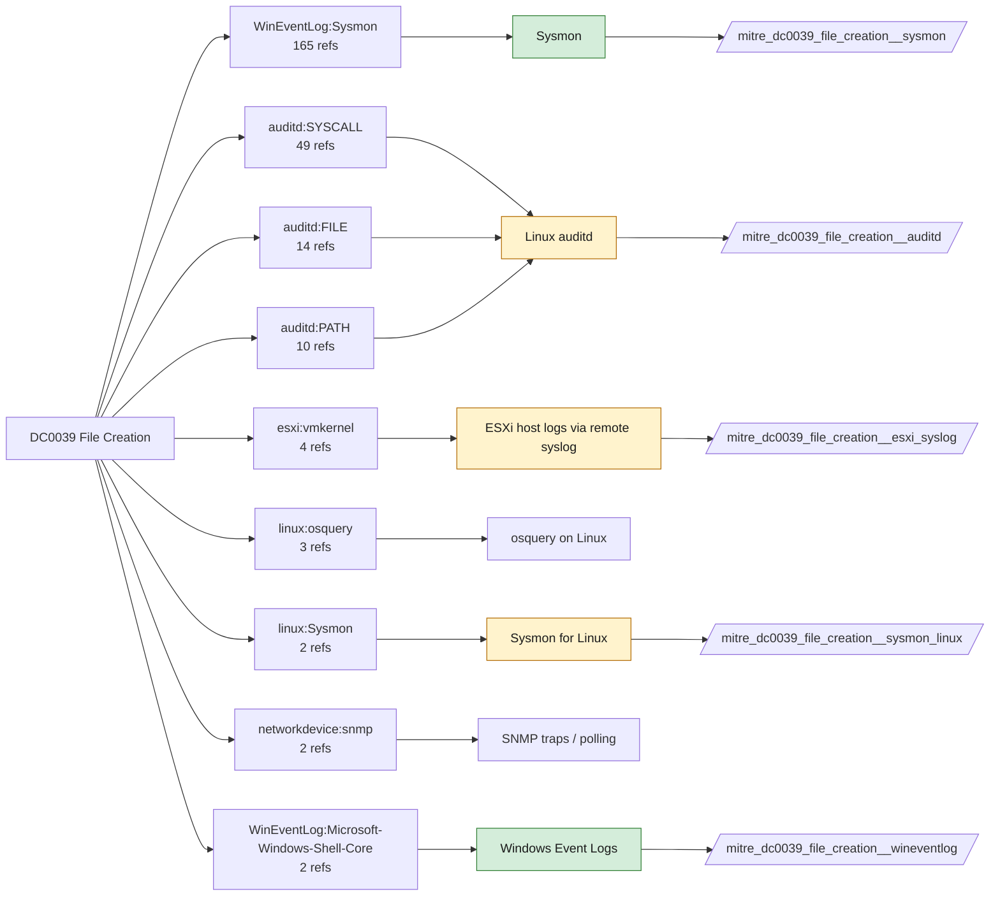

# DC0039 File Creation

[ATT&CK](https://attack.mitre.org/datacomponents/DC0039) · version 3.1 · modified 2026-11-03 · ATT&CK release 20.1

Status: **Live** · umbrella eventtype `mitre_dc0039_file_creation`

> A new file is created on a system or network storage. This action often signifies an operation such as saving a document, writing data, or deploying a file. Logging these events helps identify legitimate or potentially malicious file creation activities. Examples include logging file creation events (e.g., Sysmon Event ID 11 or Linux auditd logs).

## Why this component matters

Dropped payloads, staged archives, web shells, LNK/startup persistence and ransomware notes are file creations. Sysmon EID 11 (plus 15 for ADS) is the workhorse; Solidcore Change Control adds integrity-monitored directories; 4663 covers SACL-protected paths.

ATT&CK v20.1 has **254 analytics** across **176 detection strategies** that read this component, covering **176 techniques**. Tactics most dependent on it: stealth (80), persistence (48), execution (36), collection (31).

Analytic references by platform: Windows 156, Linux 46, macOS 46, ESXi 2, IaaS 2, SaaS 1, Network Devices 1

## Where it comes from



## Requirements

Component specific:

- Sysmon FileCreate (EID 11) should be scoped to interesting paths and extensions in the config; FileCreateStreamHash (EID 15) for downloads with Zone.Identifier.
- Solidcore file monitoring rules must list the directories; verify the field carrying FILE_CREATED in your ePO TA.
- Linux: auditd watch rules (-w /path -p wa) or open/creat syscall rules on sensitive directories.

Per feed (from `config/stack.yml` and `config/log_sources.yml`):

| Feed | Status | Sourcetype or source | Constraint | Origin | TA / collector |
|---|---|---|---|---|---|
| `solidcore` | live | sourcetype=`mcafee:epo:syslog` | `(threat_name IN (FILE_CREATED, FILE_RENAMED) OR event_description IN (FILE_CREATED, FILE_RENAMED)) (product_name="Solidcore*")` | defaults | Arrives through the ePO TA; Solidcore events carry event names such as FILE_CREATED, FILE_MODIFIED, FILE_DELETED, EXECUTION_DENIED, REG_VALUE_MODIFIED, PROCESS_HIJACK_ATTEMPTED. Verify field names (threat_name / event_description) in your data. |
| `sysmon` | live | source=`XmlWinEventLog:Microsoft-Windows-Sysmon/Operational` | `EventCode IN (11, 15)` | defaults | Splunk Add-on for Sysmon (needs Splunk_TA_windows for XML parsing) |
| `wineventlog` | live | source=`XmlWinEventLog:Security` | `EventCode IN (4656, 4663)` | defaults | Splunk Add-on for Microsoft Windows (Splunk_TA_windows), XML rendering (renderXml = true) |
| `auditd` | ready (tick in stack.yml) | sourcetype=`linux:audit` | `type IN (PATH, SYSCALL) (syscall IN (creat, link, mkdir, mkdirat, open, openat, openat2, rename, renameat, symlink) OR SYSCALL IN (creat, link, mkdir, mkdirat, open, openat, openat2, rename, renameat, symlink))` | defaults | Splunk Add-on for Unix and Linux (linux:audit) or auditd -> auditbeat/syslog |
| `esxi_syslog` | ready (tick in stack.yml) | sourcetype=`vmware:esxlog:hostd`, sourcetype=`vmware:esxlog:vmkernel` | `(whole feed)` | defaults | Splunk Add-on for VMware ESXi Logs (vmware:esxlog:<log>) |
| `sysmon_linux` | ready (tick in stack.yml) | sourcetype=`sysmon:linux` | `EventCode IN (11)` | defaults | Splunk Add-on for Sysmon for Linux |

Collection prerequisites:

- **solidcore**: Change Control file and registry monitoring rules scoped to the paths/keys of interest; Application Control in Enabled (not Observe) mode for EXECUTION_DENIED.
- **sysmon**: Sysmon deployed with a maintained modular configuration (e.g. sysmon-modular or SwiftOnSecurity). Event IDs referenced by a data component only exist if the config includes that rule group (ProcessAccess=10, ImageLoad=7, DNS=22, FileDelete=23/26, ClipboardChange=24, ProcessTampering=25, FileBlock=27/28 are off in minimal configs).
- **sysmon**: Hashes configured (SHA256 at least, IMPHASH useful) for File/Process metadata components.
- **wineventlog**: Advanced Audit Policy configured (at minimum Process Creation, Logon, Account Management, Object Access, Policy Change, Privilege Use, Detailed Tracking). Without the matching subcategory the EventCodes below never fire.
- **wineventlog**: Include command line in process creation events enabled for 4688 (Computer Configuration > Administrative Templates > System > Audit Process Creation).
- **wineventlog**: PowerShell Script Block Logging (4104) and Module Logging (4103) enabled via GPO for the PowerShell/Operational channel.
- **wineventlog**: Object access events (4656/4663/4657/4660/4670) require SACLs on the files/keys of interest.
- **wineventlog**: Non-default channels (TaskScheduler, WMI-Activity, CodeIntegrity, Defender, Firewall, WinRM, SMBClient/Server...) must be listed as inputs in Splunk_TA_windows inputs.conf; several are disabled by default in Windows.
- **auditd**: audit rules for execve, connect, open/openat on sensitive paths, ptrace, module load, mount, setuid; a Neo23x0/auditd baseline or Florian Roth's rule set is a reasonable start.
- **auditd**: log_format = ENRICHED in auditd.conf so syscall names and uids resolve (otherwise syscall numbers are architecture dependent).
- **esxi_syslog**: Syslog.global.logHost set on every host; ESXi Shell/SSH audit enabled; consider Syslog.global.auditRecord (ESXi 8).

Review notes: `wineventlog` has 2 ATT&CK reference(s) with no usable event filter (prose channel), constraint origin is *defaults*; `sysmon_linux` has 2 ATT&CK reference(s) with no usable event filter (prose channel), constraint origin is *defaults*.

## Splunk

Eventtypes (literal constraints, see `dist/splunk/TA-mitre-attack-datacomponents/default/eventtypes.conf`):

```ini
[mitre_dc0039_file_creation__solidcore]
search = index=epo sourcetype="mcafee:epo:syslog" (threat_name IN (FILE_CREATED, FILE_RENAMED) OR event_description IN (FILE_CREATED, FILE_RENAMED)) (product_name="Solidcore*")

[mitre_dc0039_file_creation__sysmon]
search = index=sysmon source="XmlWinEventLog:Microsoft-Windows-Sysmon/Operational" EventCode IN (11, 15)

[mitre_dc0039_file_creation__wineventlog]
search = index=wineventlog source="XmlWinEventLog:Security" EventCode IN (4656, 4663)

[mitre_dc0039_file_creation__auditd]
search = index=linux sourcetype="linux:audit" type IN (PATH, SYSCALL) (syscall IN (creat, link, mkdir, mkdirat, open, openat, openat2, rename, renameat, symlink) OR SYSCALL IN (creat, link, mkdir, mkdirat, open, openat, openat2, rename, renameat, symlink))
disabled = 1

[mitre_dc0039_file_creation__esxi_syslog]
search = index=vmware sourcetype IN ("vmware:esxlog:hostd", "vmware:esxlog:vmkernel")
disabled = 1

[mitre_dc0039_file_creation__sysmon_linux]
search = index=linux sourcetype="sysmon:linux" EventCode IN (11)
disabled = 1

[mitre_dc0039_file_creation]
search = eventtype=mitre_dc0039_file_creation__solidcore OR eventtype=mitre_dc0039_file_creation__sysmon OR eventtype=mitre_dc0039_file_creation__wineventlog OR eventtype=mitre_dc0039_file_creation__auditd OR eventtype=mitre_dc0039_file_creation__esxi_syslog OR eventtype=mitre_dc0039_file_creation__sysmon_linux
```

Macros for analytics: `` `mitre_dc0039` `` (umbrella), `` `mitre_dc0039_solidcore` ``, `` `mitre_dc0039_sysmon` ``, `` `mitre_dc0039_wineventlog` ``, `` `mitre_dc0039_auditd` ``, `` `mitre_dc0039_esxi_syslog` ``, `` `mitre_dc0039_sysmon_linux` ``, `` `mitre_dc0039_filter` `` (site exclusions).
CIM: `Endpoint.Filesystem` via `` `mitre_dc0039_dm` `` / `` `mitre_dc0039_dm_where` `` for `tstats`. CIM tags emitted for: `sysmon`.

## Sigma

Generic logsource categories scoped by this component in `dist/sigma/pipelines/splunk_mitre_dc.yml`: product `windows`: `file_event`, `create_stream_hash`; product `linux`: `file_event`.

## Dependents

Top techniques detected through this component (of 176):

| Technique | Name | Tactics | Analytics using this DC |
|---|---|---|---|
| [T1105](https://attack.mitre.org/techniques/T1105) | Ingress Tool Transfer | command-and-control | 5 |
| [T1027.001](https://attack.mitre.org/techniques/T1027/001) | Binary Padding | stealth | 3 |
| [T1027.004](https://attack.mitre.org/techniques/T1027/004) | Compile After Delivery | stealth | 3 |
| [T1027.006](https://attack.mitre.org/techniques/T1027/006) | HTML Smuggling | stealth | 3 |
| [T1027.015](https://attack.mitre.org/techniques/T1027/015) | Compression | stealth | 3 |
| [T1074.002](https://attack.mitre.org/techniques/T1074/002) | Remote Data Staging | collection | 3 |
| [T1080](https://attack.mitre.org/techniques/T1080) | Taint Shared Content | lateral-movement | 3 |
| [T1092](https://attack.mitre.org/techniques/T1092) | Communication Through Removable Media | command-and-control | 3 |
| [T1123](https://attack.mitre.org/techniques/T1123) | Audio Capture | collection | 3 |
| [T1176](https://attack.mitre.org/techniques/T1176) | Software Extensions | persistence | 3 |
| [T1176.002](https://attack.mitre.org/techniques/T1176/002) | IDE Extensions | persistence | 3 |
| [T1189](https://attack.mitre.org/techniques/T1189) | Drive-by Compromise | initial-access | 3 |
| [T1204](https://attack.mitre.org/techniques/T1204) | User Execution | execution | 3 |
| [T1204.001](https://attack.mitre.org/techniques/T1204/001) | Malicious Link | execution | 3 |
| [T1204.002](https://attack.mitre.org/techniques/T1204/002) | Malicious File | execution | 3 |
| … | 161 more | | |

Full list: `lookups/mitre_attack_analytics.csv` filtered on `dc_ids` containing `DC0039`.
