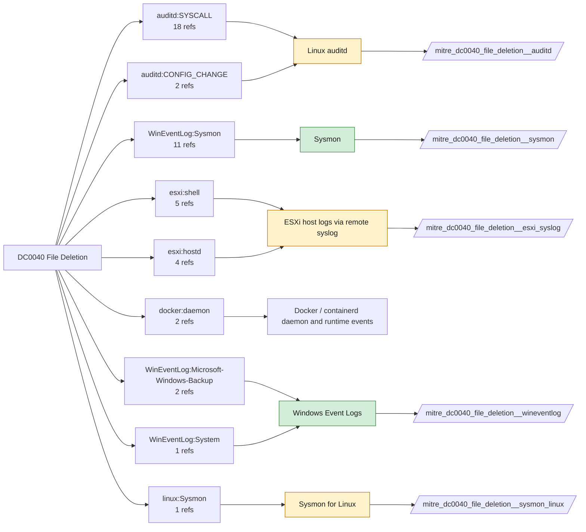

# DC0040 File Deletion

[ATT&CK](https://attack.mitre.org/datacomponents/DC0040) · version 3.0 · modified 2026-10-13 · ATT&CK release 20.1

Status: **Live** · umbrella eventtype `mitre_dc0040_file_deletion`

> Refers to events where files are removed from a system or storage device. These events can indicate legitimate housekeeping activities or malicious actions such as attackers attempting to cover their tracks. Monitoring file deletions helps organizations identify unauthorized or suspicious activities.

## Why this component matters

Anti-forensics and ransomware both delete. Sysmon EID 23 (with archive) and 26 are the richest; 4660 needs SACLs; Solidcore FILE_DELETED covers monitored paths.

ATT&CK v20.1 has **29 analytics** across **12 detection strategies** that read this component, covering **12 techniques**. Tactics most dependent on it: stealth (18), impact (9), defense-impairment (2).

Analytic references by platform: Windows 9, Linux 9, macOS 5, ESXi 4, Containers 2

## Where it comes from



## Requirements

Component specific:

- Sysmon FileDelete (EID 23) archives copies to disk; size the ArchiveDirectory or use EID 26 (FileDeleteDetected) without archiving.

Per feed (from `config/stack.yml` and `config/log_sources.yml`):

| Feed | Status | Sourcetype or source | Constraint | Origin | TA / collector |
|---|---|---|---|---|---|
| `solidcore` | live | sourcetype=`mcafee:epo:syslog` | `(threat_name=FILE_DELETED OR event_description=FILE_DELETED) (product_name="Solidcore*")` | defaults | Arrives through the ePO TA; Solidcore events carry event names such as FILE_CREATED, FILE_MODIFIED, FILE_DELETED, EXECUTION_DENIED, REG_VALUE_MODIFIED, PROCESS_HIJACK_ATTEMPTED. Verify field names (threat_name / event_description) in your data. |
| `sysmon` | live | source=`XmlWinEventLog:Microsoft-Windows-Sysmon/Operational` | `EventCode IN (23, 26)` | defaults | Splunk Add-on for Sysmon (needs Splunk_TA_windows for XML parsing) |
| `wineventlog` | live | source=`XmlWinEventLog:Security` | `EventCode IN (4660, 4663)` | defaults | Splunk Add-on for Microsoft Windows (Splunk_TA_windows), XML rendering (renderXml = true) |
| `auditd` | ready (tick in stack.yml) | sourcetype=`linux:audit` | `type IN (PATH, SYSCALL) (syscall IN (rename, renameat, rmdir, unlink, unlinkat) OR SYSCALL IN (rename, renameat, rmdir, unlink, unlinkat))` | defaults | Splunk Add-on for Unix and Linux (linux:audit) or auditd -> auditbeat/syslog |
| `esxi_syslog` | ready (tick in stack.yml) | sourcetype=`vmware:esxlog:hostd`, sourcetype=`vmware:esxlog:shell` | `(whole feed)` | defaults | Splunk Add-on for VMware ESXi Logs (vmware:esxlog:<log>) |
| `sysmon_linux` | ready (tick in stack.yml) | sourcetype=`sysmon:linux` | `EventCode IN (23)` | defaults | Splunk Add-on for Sysmon for Linux |

Collection prerequisites:

- **solidcore**: Change Control file and registry monitoring rules scoped to the paths/keys of interest; Application Control in Enabled (not Observe) mode for EXECUTION_DENIED.
- **sysmon**: Sysmon deployed with a maintained modular configuration (e.g. sysmon-modular or SwiftOnSecurity). Event IDs referenced by a data component only exist if the config includes that rule group (ProcessAccess=10, ImageLoad=7, DNS=22, FileDelete=23/26, ClipboardChange=24, ProcessTampering=25, FileBlock=27/28 are off in minimal configs).
- **sysmon**: Hashes configured (SHA256 at least, IMPHASH useful) for File/Process metadata components.
- **wineventlog**: Advanced Audit Policy configured (at minimum Process Creation, Logon, Account Management, Object Access, Policy Change, Privilege Use, Detailed Tracking). Without the matching subcategory the EventCodes below never fire.
- **wineventlog**: Include command line in process creation events enabled for 4688 (Computer Configuration > Administrative Templates > System > Audit Process Creation).
- **wineventlog**: PowerShell Script Block Logging (4104) and Module Logging (4103) enabled via GPO for the PowerShell/Operational channel.
- **wineventlog**: Object access events (4656/4663/4657/4660/4670) require SACLs on the files/keys of interest.
- **wineventlog**: Non-default channels (TaskScheduler, WMI-Activity, CodeIntegrity, Defender, Firewall, WinRM, SMBClient/Server...) must be listed as inputs in Splunk_TA_windows inputs.conf; several are disabled by default in Windows.
- **auditd**: audit rules for execve, connect, open/openat on sensitive paths, ptrace, module load, mount, setuid; a Neo23x0/auditd baseline or Florian Roth's rule set is a reasonable start.
- **auditd**: log_format = ENRICHED in auditd.conf so syscall names and uids resolve (otherwise syscall numbers are architecture dependent).
- **esxi_syslog**: Syslog.global.logHost set on every host; ESXi Shell/SSH audit enabled; consider Syslog.global.auditRecord (ESXi 8).

Review notes: `wineventlog` has 2 ATT&CK reference(s) with no usable event filter (prose channel), constraint origin is *defaults*.

## Splunk

Eventtypes (literal constraints, see `dist/splunk/TA-mitre-attack-datacomponents/default/eventtypes.conf`):

```ini
[mitre_dc0040_file_deletion__solidcore]
search = index=epo sourcetype="mcafee:epo:syslog" (threat_name=FILE_DELETED OR event_description=FILE_DELETED) (product_name="Solidcore*")

[mitre_dc0040_file_deletion__sysmon]
search = index=sysmon source="XmlWinEventLog:Microsoft-Windows-Sysmon/Operational" EventCode IN (23, 26)

[mitre_dc0040_file_deletion__wineventlog]
search = index=wineventlog source="XmlWinEventLog:Security" EventCode IN (4660, 4663)

[mitre_dc0040_file_deletion__auditd]
search = index=linux sourcetype="linux:audit" type IN (PATH, SYSCALL) (syscall IN (rename, renameat, rmdir, unlink, unlinkat) OR SYSCALL IN (rename, renameat, rmdir, unlink, unlinkat))
disabled = 1

[mitre_dc0040_file_deletion__esxi_syslog]
search = index=vmware sourcetype IN ("vmware:esxlog:hostd", "vmware:esxlog:shell")
disabled = 1

[mitre_dc0040_file_deletion__sysmon_linux]
search = index=linux sourcetype="sysmon:linux" EventCode IN (23)
disabled = 1

[mitre_dc0040_file_deletion]
search = eventtype=mitre_dc0040_file_deletion__solidcore OR eventtype=mitre_dc0040_file_deletion__sysmon OR eventtype=mitre_dc0040_file_deletion__wineventlog OR eventtype=mitre_dc0040_file_deletion__auditd OR eventtype=mitre_dc0040_file_deletion__esxi_syslog OR eventtype=mitre_dc0040_file_deletion__sysmon_linux
```

Macros for analytics: `` `mitre_dc0040` `` (umbrella), `` `mitre_dc0040_solidcore` ``, `` `mitre_dc0040_sysmon` ``, `` `mitre_dc0040_wineventlog` ``, `` `mitre_dc0040_auditd` ``, `` `mitre_dc0040_esxi_syslog` ``, `` `mitre_dc0040_sysmon_linux` ``, `` `mitre_dc0040_filter` `` (site exclusions).
CIM: `Endpoint.Filesystem` via `` `mitre_dc0040_dm` `` / `` `mitre_dc0040_dm_where` `` for `tstats`. CIM tags emitted for: `sysmon`.

## Sigma

Generic logsource categories scoped by this component in `dist/sigma/pipelines/splunk_mitre_dc.yml`: product `windows`: `file_delete`; product `linux`: `file_delete`.

## Dependents

Top techniques detected through this component (of 12):

| Technique | Name | Tactics | Analytics using this DC |
|---|---|---|---|
| [T1070](https://attack.mitre.org/techniques/T1070) | Indicator Removal | stealth | 5 |
| [T1485](https://attack.mitre.org/techniques/T1485) | Data Destruction | impact | 4 |
| [T1070.003](https://attack.mitre.org/techniques/T1070/003) | Clear Command History | stealth | 3 |
| [T1070.004](https://attack.mitre.org/techniques/T1070/004) | File Deletion | stealth | 3 |
| [T1070.008](https://attack.mitre.org/techniques/T1070/008) | Clear Mailbox Data | stealth | 3 |
| [T1070.009](https://attack.mitre.org/techniques/T1070/009) | Clear Persistence | stealth | 3 |
| [T1490](https://attack.mitre.org/techniques/T1490) | Inhibit System Recovery | impact | 2 |
| [T1565.001](https://attack.mitre.org/techniques/T1565/001) | Stored Data Manipulation | impact | 2 |
| [T1070.010](https://attack.mitre.org/techniques/T1070/010) | Relocate Malware | stealth | 1 |
| [T1489](https://attack.mitre.org/techniques/T1489) | Service Stop | impact | 1 |
| [T1685.005](https://attack.mitre.org/techniques/T1685/005) | Clear Windows Event Logs | defense-impairment | 1 |
| [T1685.006](https://attack.mitre.org/techniques/T1685/006) | Clear Linux or Mac System Logs | defense-impairment | 1 |

Full list: `lookups/mitre_attack_analytics.csv` filtered on `dc_ids` containing `DC0040`.
