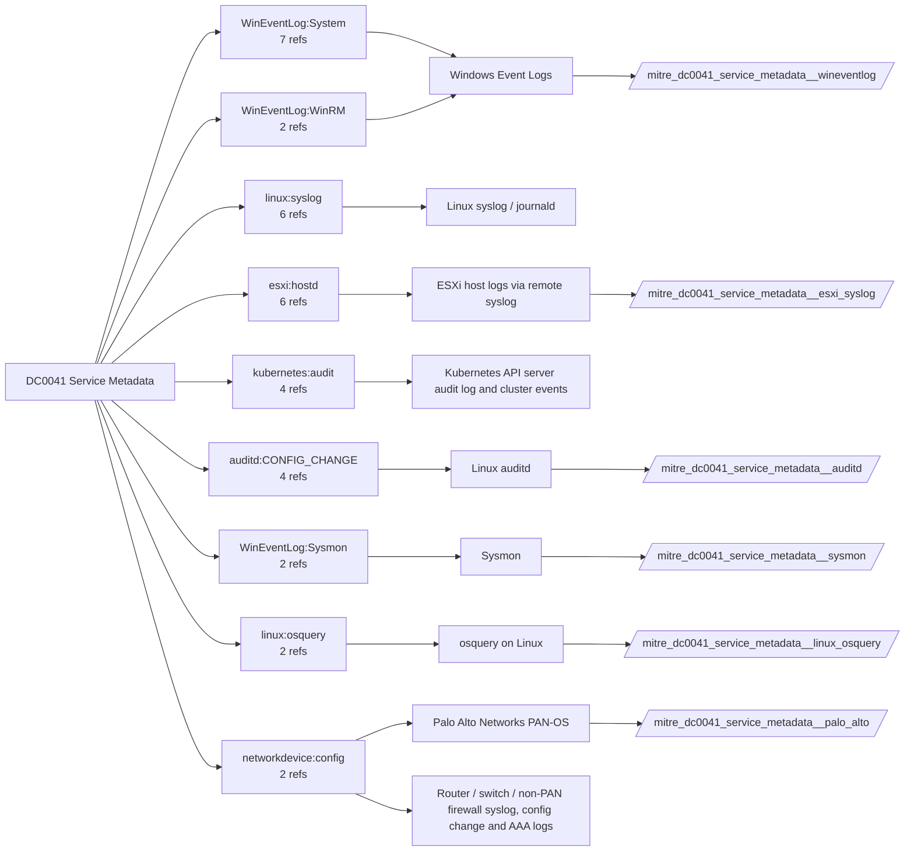

# DC0041 Service Metadata

[ATT&CK](https://attack.mitre.org/datacomponents/DC0041) · version 2.0 · modified 2026-10-13 · ATT&CK release 20.1

Umbrella eventtype `mitre_dc0041_service_metadata` over 6 feed(s)

> Contextual data about a service/daemon, which may include information such as name, service executable, start type, etc.

## Why this component matters

Service state transitions (7034/7035/7036) and Sysmon's own state (EID 4) reveal security tooling stopped, crash loops and unexpected starts; osquery systemd_units supplies the Linux inventory.

ATT&CK v20.1 has **22 analytics** across **13 detection strategies** that read this component, covering **13 techniques**. Tactics most dependent on it: defense-impairment (8), impact (5), stealth (5), persistence (2).

Analytic references by platform: Linux 6, Windows 5, macOS 5, ESXi 3, Containers 2, Network Devices 1

## Where it comes from



## Requirements

Per feed (from `config/stack.yml` and `config/log_sources.yml`):

| Feed | Schedule | Sourcetype or source | Constraint | Origin | TA / collector |
|---|---|---|---|---|---|
| `auditd` | scheduled | sourcetype=`linux:audit` | `type IN (CONFIG_CHANGE)` | derived | Splunk Add-on for Unix and Linux (linux:audit) or auditd -> auditbeat/syslog |
| `esxi_syslog` | scheduled | sourcetype=`vmware:esxlog:hostd` | `(whole feed)` | derived | Splunk Add-on for VMware ESXi Logs (vmware:esxlog:<log>) |
| `linux_osquery` | scheduled | sourcetype=`osquery:results` | `(name=systemd_units OR name=startup_items)` | defaults | osquery TA |
| `palo_alto` | scheduled | sourcetype=`pan:config`, sourcetype=`pan:system` | `(whole feed)` | defaults | Splunk Add-on for Palo Alto Networks (pan:*) |
| `sysmon` | scheduled | source=`XmlWinEventLog:Microsoft-Windows-Sysmon/Operational` | `EventCode IN (4)` | defaults | Splunk Add-on for Sysmon (needs Splunk_TA_windows for XML parsing) |
| `wineventlog` | scheduled | source=`XmlWinEventLog:System` | `EventCode IN (7034, 7035, 7036, 7040)` | defaults | Splunk Add-on for Microsoft Windows (Splunk_TA_windows), XML rendering (renderXml = true) |

Collection prerequisites:

- **auditd**: audit rules for execve, connect, open/openat on sensitive paths, ptrace, module load, mount, setuid; a Neo23x0/auditd baseline or Florian Roth's rule set is a reasonable start.
- **auditd**: log_format = ENRICHED in auditd.conf so syscall names and uids resolve (otherwise syscall numbers are architecture dependent).
- **esxi_syslog**: Syslog.global.logHost set on every host; ESXi Shell/SSH audit enabled; consider Syslog.global.auditRecord (ESXi 8).
- **palo_alto**: Log forwarding profiles attached to every security rule (traffic start+end, threat, url, wildfire, data).
- **palo_alto**: System and Config logs forwarded from each firewall / Panorama; GlobalProtect logs enabled.
- **palo_alto**: URL filtering and Threat Prevention licensed for pan:threat subtypes url/vulnerability/virus/spyware.
- **palo_alto**: Operational (show/debug) commands are not in config or system logs by default. Enable administrator activity audit tracking (Device > Setup > Management > Logging and Reporting, PAN-OS 10.1+) and forward the audit log if you want CLI discovery analytics for the firewall.
- **sysmon**: Sysmon deployed with a maintained modular configuration (e.g. sysmon-modular or SwiftOnSecurity). Event IDs referenced by a data component only exist if the config includes that rule group (ProcessAccess=10, ImageLoad=7, DNS=22, FileDelete=23/26, ClipboardChange=24, ProcessTampering=25, FileBlock=27/28 are off in minimal configs).
- **sysmon**: Hashes configured (SHA256 at least, IMPHASH useful) for File/Process metadata components.
- **wineventlog**: Advanced Audit Policy configured (at minimum Process Creation, Logon, Account Management, Object Access, Policy Change, Privilege Use, Detailed Tracking). Without the matching subcategory the EventCodes below never fire.
- **wineventlog**: Include command line in process creation events enabled for 4688 (Computer Configuration > Administrative Templates > System > Audit Process Creation).
- **wineventlog**: PowerShell Script Block Logging (4104) and Module Logging (4103) enabled via GPO for the PowerShell/Operational channel.
- **wineventlog**: Object access events (4656/4663/4657/4660/4670) require SACLs on the files/keys of interest.
- **wineventlog**: Non-default channels (TaskScheduler, WMI-Activity, CodeIntegrity, Defender, Firewall, WinRM, SMBClient/Server...) must be listed as inputs in Splunk_TA_windows inputs.conf; several are disabled by default in Windows.

Review notes: `linux_osquery` has 2 ATT&CK reference(s) with no usable event filter (prose channel), constraint origin is *defaults*.

## Splunk

Eventtypes (literal constraints, see `dist/splunk/TA-mitre-attack-datacomponents/default/eventtypes.conf`):

```ini
[mitre_dc0041_service_metadata__auditd]
search = index=linux sourcetype="linux:audit" type IN (CONFIG_CHANGE)

[mitre_dc0041_service_metadata__esxi_syslog]
search = index=vmware sourcetype="vmware:esxlog:hostd"

[mitre_dc0041_service_metadata__linux_osquery]
search = index=osquery sourcetype="osquery:results" (name=systemd_units OR name=startup_items)

[mitre_dc0041_service_metadata__palo_alto]
search = index=pan_logs sourcetype IN ("pan:config", "pan:system")

[mitre_dc0041_service_metadata__sysmon]
search = index=sysmon source="XmlWinEventLog:Microsoft-Windows-Sysmon/Operational" EventCode IN (4)

[mitre_dc0041_service_metadata__wineventlog]
search = index=wineventlog source="XmlWinEventLog:System" EventCode IN (7034, 7035, 7036, 7040)

[mitre_dc0041_service_metadata]
search = eventtype=mitre_dc0041_service_metadata__auditd OR eventtype=mitre_dc0041_service_metadata__esxi_syslog OR eventtype=mitre_dc0041_service_metadata__linux_osquery OR eventtype=mitre_dc0041_service_metadata__palo_alto OR eventtype=mitre_dc0041_service_metadata__sysmon OR eventtype=mitre_dc0041_service_metadata__wineventlog
```

Macros for analytics: `` `mitre_dc0041` `` (umbrella), `` `mitre_dc0041_auditd` ``, `` `mitre_dc0041_esxi_syslog` ``, `` `mitre_dc0041_linux_osquery` ``, `` `mitre_dc0041_palo_alto` ``, `` `mitre_dc0041_sysmon` ``, `` `mitre_dc0041_wineventlog` ``, `` `mitre_dc0041_filter` `` (site exclusions).
CIM: `Endpoint.Services` via `` `mitre_dc0041_dm` `` / `` `mitre_dc0041_dm_where` `` for `tstats`. CIM tags emitted for: `wineventlog`.

## Sigma

No generic Sigma category maps to this component; rules use `product`/`service` logsources, which the pipeline maps to index and sourcetype.

## Dependents

Top techniques detected through this component (of 13):

| Technique | Name | Tactics | Analytics using this DC |
|---|---|---|---|
| [T1489](https://attack.mitre.org/techniques/T1489) | Service Stop | impact | 5 |
| [T1685](https://attack.mitre.org/techniques/T1685) | Disable or Modify Tools | defense-impairment | 5 |
| [T1036.004](https://attack.mitre.org/techniques/T1036/004) | Masquerade Task or Service | stealth | 3 |
| [T1687](https://attack.mitre.org/techniques/T1687) | Exploitation for Defense Impairment | defense-impairment | 3 |
| [T1021.006](https://attack.mitre.org/techniques/T1021/006) | Windows Remote Management | lateral-movement | 2 |
| [T1036](https://attack.mitre.org/techniques/T1036) | Masquerading | stealth | 2 |
| [T1036.005](https://attack.mitre.org/techniques/T1036/005) | Match Legitimate Resource Name or Location | stealth | 2 |
| [T1037](https://attack.mitre.org/techniques/T1037) | Boot or Logon Initialization Scripts | persistence, privilege-escalation | 2 |
| [T1490](https://attack.mitre.org/techniques/T1490) | Inhibit System Recovery | impact | 2 |
| [T1547](https://attack.mitre.org/techniques/T1547) | Boot or Logon Autostart Execution | persistence, privilege-escalation | 2 |
| [T1574](https://attack.mitre.org/techniques/T1574) | Hijack Execution Flow | stealth, execution | 2 |
| [T1685.001](https://attack.mitre.org/techniques/T1685/001) | Disable or Modify Windows Event Log | defense-impairment | 2 |
| [T1685.004](https://attack.mitre.org/techniques/T1685/004) | Disable or Modify Linux Audit System Log | defense-impairment | 2 |

Full list: `lookups/mitre_attack_analytics.csv` filtered on `dc_ids` containing `DC0041`.
