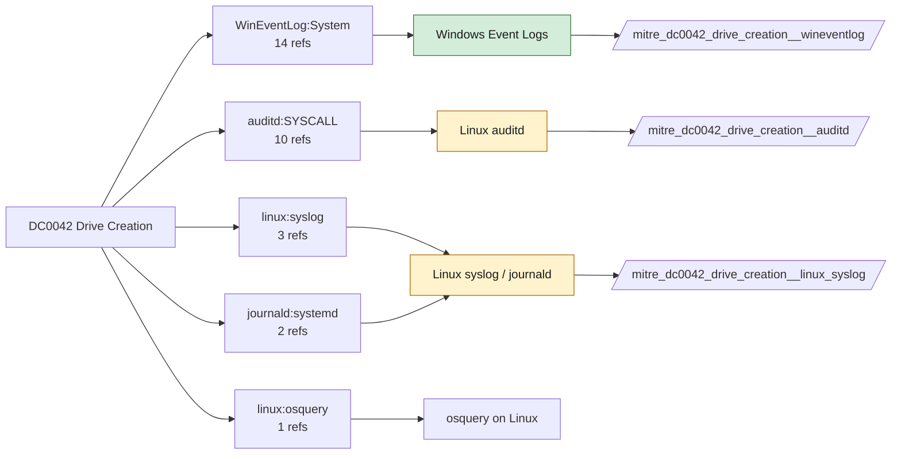

# DC0042 Drive Creation

[ATT&CK](https://attack.mitre.org/datacomponents/DC0042) · version 2.0 · modified 2026-10-13 · ATT&CK release 20.1

Status: **Live** · umbrella eventtype `mitre_dc0042_drive_creation`

> The activity of assigning a new drive letter or creating a mount point for a data storage device, such as a USB, network share, or external hard drive, enabling access to its content on a host system. Examples:   - USB Drive Insertion: A USB drive is plugged in and automatically assigned the letter `E:\` on a Windows machine. - Network Drive Mapping: A network share `\\server\share` is mapped to the drive `Z:\`. - Virtual Drive Creation: A virtual disk is mounted on `/mnt/virtualdrive` using an ISO image or a virtual hard disk (VHD). - Cloud Storage Mounting: Google Drive is mounted as `G:\` on a Windows machine using a cloud sync tool. - External Storage Integration: An external HDD or SSD is connected and assigned `/mnt/external` on a Linux system..

## Why this component matters

USB mass storage and new volume events (System 2003/2100-2106, 1006, DriverFrameworks 10000/20001) and Linux mount syscalls for removable-media detection.

ATT&CK v20.1 has **22 analytics** across **8 detection strategies** that read this component, covering **8 techniques**. Tactics most dependent on it: command-and-control (6), exfiltration (6), initial-access (4), execution (3).

Analytic references by platform: Windows 8, Linux 7, macOS 7

## Where it comes from



## Requirements

Component specific:

- Enable the Microsoft-Windows-DriverFrameworks-UserMode/Operational channel for device arrival events if needed.

Per feed (from `config/stack.yml` and `config/log_sources.yml`):

| Feed | Status | Sourcetypes | Constraint | Origin | TA / collector |
|---|---|---|---|---|---|
| `wineventlog` | live | `XmlWinEventLog:Security`, `XmlWinEventLog:System` | `EventCode IN (1006, 2003, 2100, 2101, 2102, 2105, 2106, 6416, 10000, 10001, 20001, 20003)` | defaults | Splunk Add-on for Microsoft Windows (Splunk_TA_windows), XML rendering |
| `auditd` | ready (tick in stack.yml) | `linux:audit` | `type IN (SYSCALL) (syscall IN (mount) OR SYSCALL IN (mount))` | defaults | Splunk Add-on for Unix and Linux (linux:audit) or auditd -> auditbeat/syslog |
| `linux_syslog` | ready (tick in stack.yml) | `linux_messages_syslog`, `linux_secure`, `syslog` | `(kernel usb OR process=udisksd OR "New USB device")` | defaults | Splunk Add-on for Unix and Linux (syslog, linux_secure, linux_messages_syslog) |

Collection prerequisites:

- **wineventlog**: Advanced Audit Policy configured (at minimum Process Creation, Logon, Account Management, Object Access, Policy Change, Privilege Use, Detailed Tracking). Without the matching subcategory the EventCodes below never fire.
- **wineventlog**: Include command line in process creation events enabled for 4688 (Computer Configuration > Administrative Templates > System > Audit Process Creation).
- **wineventlog**: PowerShell Script Block Logging (4104) and Module Logging (4103) enabled via GPO for the PowerShell/Operational channel.
- **wineventlog**: Object access events (4656/4663/4657/4660/4670) require SACLs on the files/keys of interest.
- **wineventlog**: Non-default channels (TaskScheduler, WMI-Activity, CodeIntegrity, Defender, Firewall, WinRM, SMBClient/Server...) must be listed as inputs in Splunk_TA_windows inputs.conf; several are disabled by default in Windows.
- **auditd**: audit rules for execve, connect, open/openat on sensitive paths, ptrace, module load, mount, setuid; a Neo23x0/auditd baseline or Florian Roth's rule set is a reasonable start.
- **auditd**: log_format = ENRICHED in auditd.conf so syscall names and uids resolve (otherwise syscall numbers are architecture dependent).

Review notes: `linux_syslog` has 3 ATT&CK reference(s) with no usable event filter (prose channel), constraint origin is *defaults*.

## Splunk

Eventtypes (literal constraints, see `dist/splunk/TA-mitre-attack-datacomponents/default/eventtypes.conf`):

```ini
[mitre_dc0042_drive_creation__wineventlog]
search = index=wineventlog sourcetype IN ("XmlWinEventLog:Security", "XmlWinEventLog:System") EventCode IN (1006, 2003, 2100, 2101, 2102, 2105, 2106, 6416, 10000, 10001, 20001, 20003)

[mitre_dc0042_drive_creation__auditd]
search = index=linux sourcetype=linux:audit type IN (SYSCALL) (syscall IN (mount) OR SYSCALL IN (mount))
disabled = 1

[mitre_dc0042_drive_creation__linux_syslog]
search = index=linux sourcetype IN (linux_messages_syslog, linux_secure, syslog) (kernel usb OR process=udisksd OR "New USB device")
disabled = 1

[mitre_dc0042_drive_creation]
search = eventtype=mitre_dc0042_drive_creation__wineventlog OR eventtype=mitre_dc0042_drive_creation__auditd OR eventtype=mitre_dc0042_drive_creation__linux_syslog
```

Macros for analytics: `` `mitre_dc0042` `` (umbrella), `` `mitre_dc0042_wineventlog` ``, `` `mitre_dc0042_auditd` ``, `` `mitre_dc0042_linux_syslog` ``, `` `mitre_dc0042_filter` `` (site exclusions).
CIM: no data model mapping; analytics on this component run as raw eventtype searches.

## Sigma

No generic Sigma category maps to this component; rules use `product`/`service` logsources, which the pipeline maps to index and sourcetype.

## Dependents

Top techniques detected through this component (of 8):

| Technique | Name | Tactics | Analytics using this DC |
|---|---|---|---|
| [T1025](https://attack.mitre.org/techniques/T1025) | Data from Removable Media | collection | 3 |
| [T1052](https://attack.mitre.org/techniques/T1052) | Exfiltration Over Physical Medium | exfiltration | 3 |
| [T1052.001](https://attack.mitre.org/techniques/T1052/001) | Exfiltration over USB | exfiltration | 3 |
| [T1092](https://attack.mitre.org/techniques/T1092) | Communication Through Removable Media | command-and-control | 3 |
| [T1200](https://attack.mitre.org/techniques/T1200) | Hardware Additions | initial-access | 3 |
| [T1219.003](https://attack.mitre.org/techniques/T1219/003) | Remote Access Hardware | command-and-control | 3 |
| [T1674](https://attack.mitre.org/techniques/T1674) | Input Injection | execution | 3 |
| [T1091](https://attack.mitre.org/techniques/T1091) | Replication Through Removable Media | lateral-movement, initial-access | 1 |

Full list: `lookups/mitre_attack_analytics.csv` filtered on `dc_ids` containing `DC0042`.
