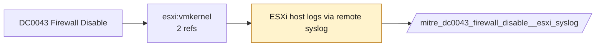

# DC0043 Firewall Disable

[ATT&CK](https://attack.mitre.org/datacomponents/DC0043) · version 2.0 · modified 2025-10-21 · ATT&CK release 20.1

Status: **Live** · umbrella eventtype `mitre_dc0043_firewall_disable`

> The deactivation, misconfiguration, or complete stoppage of firewall services, either on a host or in a cloud control plane. Such activity may involve turning off firewalls, modifying rules to disable protection, or deleting firewall-related configurations and activity logs. Examples:   - Disabling Host-Based Firewalls: Stopping the Windows Defender Firewall service or using `iptables -F` to flush all rules on a Linux system. - Cloud Firewall Modification or Deactivation: Modifying or deleting security group rules in AWS or disabling a network firewall in Azure. - Activity Log Deletion: Writing or deleting entries in Azure Firewall Activity Logs to hide unauthorized firewall changes. - Temporary Disable for Malicious Operations: Temporarily disabling a firewall to allow malicious files or traffic, then re-enabling it to avoid detection. - Using Command-Line Tools to Stop Firewalls: Running commands like `Set-NetFirewallProfile -Enabled False on Windows or systemctl stop ufw` on Linux.  This data component can be collected through the following measures:  Cloud Control Plane  - Azure Activity Logs:     - Enable logging of administrative actions, such as stopping or modifying Azure Firewall configurations.     - Use Azure Monitor to track specific firewall-related actions, including disabling or rule deletion. - AWS CloudTrail Logs:     - Monitor `RevokeSecurityGroupIngress` or `RevokeSecurityGroupEgress` events to detect rule changes in AWS Security Groups. - Google Cloud Platform Logs:     - Collect logs from the Firewall Rules resource in Google Cloud Operations Suite to detect rule deletions or modifications.  Host-Level Firewalls  - Windows Firewall Event Logs:     - Enable logging of firewall state changes:         - Security Event ID 2004: Firewall service stopped.         - Security Event ID 2005: Firewall service started.     - Use Sysmon for process creation events tied to firewall commands or scripts (Sysmon Event ID 1). - Linux Firewall Logs: Use auditd to track commands like iptables, firewalld, or ufw: `auditctl -a always,exit -F arch=b64 -S execve -k firewall_disable` - macOS Firewall: Monitor changes to the macOS Application Firewall using the log show command.  Network-Level Monitoring  - IDS/IPS Alerts: Deploy IDS/IPS systems to monitor abnormal traffic flows that could indicate firewall disablement. - NetFlow Data: Analyze NetFlow or packet capture data for traffic patterns inconsistent with firewall enforcement.  SIEM and CSPM Tools  - SIEM Integration: Use tools like Splunk or QRadar to centralize and analyze firewall disablement events from both hosts and cloud platforms. - Cloud Security Posture Management (CSPM): Use CSPM solutions to monitor misconfigurations and track deactivation of critical cloud services like firewalls.

## Why this component matters

Firewall profile or service turned off (Windows 2003/2008/5025, PAN-OS system log, ESXi esxcli network firewall set).

ATT&CK v20.1 has **2 analytics** across **1 detection strategies** that read this component, covering **1 techniques**. Tactics most dependent on it: defense-impairment (1).

Analytic references by platform: ESXi 1, IaaS 1

## Where it comes from



## Requirements

Per feed (from `config/stack.yml` and `config/log_sources.yml`):

| Feed | Status | Sourcetypes | Constraint | Origin | TA / collector |
|---|---|---|---|---|---|
| `palo_alto` | live | `pan:config`, `pan:system` | `(whole feed)` | defaults | Splunk Add-on for Palo Alto Networks (pan:*) |
| `wineventlog` | live | `XmlWinEventLog:Microsoft-Windows-Windows Firewall With Advanced Security/Firewall`, `XmlWinEventLog:Security` | `EventCode IN (2003, 2008, 4950, 5025)` | defaults | Splunk Add-on for Microsoft Windows (Splunk_TA_windows), XML rendering |
| `esxi_syslog` | ready (tick in stack.yml) | `vmware:esxlog:hostd` | `(firewall)` | defaults | Splunk Add-on for VMware ESXi Logs (vmware:esxlog:<log>) |

Collection prerequisites:

- **palo_alto**: Log forwarding profiles attached to every security rule (traffic start+end, threat, url, wildfire, data).
- **palo_alto**: System and Config logs forwarded from each firewall / Panorama; GlobalProtect logs enabled.
- **palo_alto**: URL filtering and Threat Prevention licensed for pan:threat subtypes url/vulnerability/virus/spyware.
- **wineventlog**: Advanced Audit Policy configured (at minimum Process Creation, Logon, Account Management, Object Access, Policy Change, Privilege Use, Detailed Tracking). Without the matching subcategory the EventCodes below never fire.
- **wineventlog**: Include command line in process creation events enabled for 4688 (Computer Configuration > Administrative Templates > System > Audit Process Creation).
- **wineventlog**: PowerShell Script Block Logging (4104) and Module Logging (4103) enabled via GPO for the PowerShell/Operational channel.
- **wineventlog**: Object access events (4656/4663/4657/4660/4670) require SACLs on the files/keys of interest.
- **wineventlog**: Non-default channels (TaskScheduler, WMI-Activity, CodeIntegrity, Defender, Firewall, WinRM, SMBClient/Server...) must be listed as inputs in Splunk_TA_windows inputs.conf; several are disabled by default in Windows.
- **esxi_syslog**: Syslog.global.logHost set on every host; ESXi Shell/SSH audit enabled; consider Syslog.global.auditRecord (ESXi 8).

## Splunk

Eventtypes (literal constraints, see `dist/splunk/TA-mitre-attack-datacomponents/default/eventtypes.conf`):

```ini
[mitre_dc0043_firewall_disable__palo_alto]
search = index=pan_logs sourcetype IN ("pan:config", "pan:system")

[mitre_dc0043_firewall_disable__wineventlog]
search = index=wineventlog sourcetype IN ("XmlWinEventLog:Microsoft-Windows-Windows Firewall With Advanced Security/Firewall", "XmlWinEventLog:Security") EventCode IN (2003, 2008, 4950, 5025)

[mitre_dc0043_firewall_disable__esxi_syslog]
search = index=vmware sourcetype=vmware:esxlog:hostd (firewall)
disabled = 1

[mitre_dc0043_firewall_disable]
search = eventtype=mitre_dc0043_firewall_disable__palo_alto OR eventtype=mitre_dc0043_firewall_disable__wineventlog OR eventtype=mitre_dc0043_firewall_disable__esxi_syslog
```

Macros for analytics: `` `mitre_dc0043` `` (umbrella), `` `mitre_dc0043_palo_alto` ``, `` `mitre_dc0043_wineventlog` ``, `` `mitre_dc0043_esxi_syslog` ``, `` `mitre_dc0043_filter` `` (site exclusions).
CIM: `Change.Network_Changes` via `` `mitre_dc0043_dm` `` / `` `mitre_dc0043_dm_where` `` for `tstats`. CIM tags emitted for: `palo_alto`.

## Sigma

No generic Sigma category maps to this component; rules use `product`/`service` logsources, which the pipeline maps to index and sourcetype.

## Dependents

Top techniques detected through this component (of 1):

| Technique | Name | Tactics | Analytics using this DC |
|---|---|---|---|
| [T1686.001](https://attack.mitre.org/techniques/T1686/001) | Cloud Firewall | defense-impairment | 2 |

Full list: `lookups/mitre_attack_analytics.csv` filtered on `dc_ids` containing `DC0043`.
