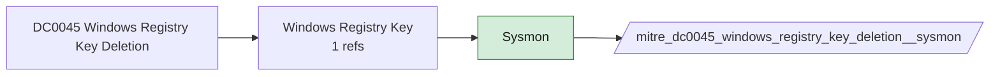

# DC0045 Windows Registry Key Deletion

[ATT&CK](https://attack.mitre.org/datacomponents/DC0045) · version 2.0 · modified 2025-10-21 · ATT&CK release 20.1

Status: **Live** · umbrella eventtype `mitre_dc0045_windows_registry_key_deletion`

> The removal of a registry key within the Windows operating system.  *Data Collection Measures:*  - Windows Event Logs     - Event ID 4658 - Registry Key Handle Closed: Captures when a handle to a registry key is closed, which may indicate deletion.     - Event ID 4660 - Object Deleted: Logs when a registry key is deleted. - Sysmon (System Monitor) for Windows     - Sysmon Event ID 12 - Registry Key Deleted: Logs when a registry key is removed.     - Sysmon Event ID 13 - Registry Value Deleted: Captures removal of specific registry values. - Endpoint Detection and Response (EDR) Solutions     - Monitor registry deletions for suspicious behavior.

## Why this component matters

No v20.1 analytic references it yet, but Sysmon EID 12 (DeleteKey/DeleteValue) and 4660 observe it; kept live so phase-2 content can use it without a config change.

ATT&CK v20.1 has **0 analytics** across **0 detection strategies** that read this component, covering **0 techniques**. Tactics most dependent on it: none.

## Where it comes from



## Requirements

Per feed (from `config/stack.yml` and `config/log_sources.yml`):

| Feed | Status | Sourcetypes | Constraint | Origin | TA / collector |
|---|---|---|---|---|---|
| `solidcore` | live | `mcafee:epo` | `(threat_name IN (REG_KEY_DELETED, REG_VALUE_DELETED) OR event_description IN (REG_KEY_DELETED, REG_VALUE_DELETED)) (product_name="Solidcore*")` | defaults | Arrives through the ePO TA; Solidcore events carry event names such as FILE_CREATED, FILE_MODIFIED, FILE_DELETED, EXECUTION_DENIED, REG_VALUE_MODIFIED, PROCESS_HIJACK_ATTEMPTED. Verify field names (threat_name / event_description) in your data. |
| `sysmon` | live | `XmlWinEventLog:Microsoft-Windows-Sysmon/Operational` | `EventCode IN (12)` | defaults | Splunk Add-on for Sysmon (TA-microsoft-sysmon) |
| `wineventlog` | live | `XmlWinEventLog:Security` | `EventCode IN (4657, 4660, 4663)` | defaults | Splunk Add-on for Microsoft Windows (Splunk_TA_windows), XML rendering |

Collection prerequisites:

- **solidcore**: Change Control file and registry monitoring rules scoped to the paths/keys of interest; Application Control in Enabled (not Observe) mode for EXECUTION_DENIED.
- **sysmon**: Sysmon deployed with a maintained modular configuration (e.g. sysmon-modular or SwiftOnSecurity). Event IDs referenced by a data component only exist if the config includes that rule group (ProcessAccess=10, ImageLoad=7, DNS=22, FileDelete=23/26, ClipboardChange=24, ProcessTampering=25, FileBlock=27/28 are off in minimal configs).
- **sysmon**: Hashes configured (SHA256 at least, IMPHASH useful) for File/Process metadata components.
- **wineventlog**: Advanced Audit Policy configured (at minimum Process Creation, Logon, Account Management, Object Access, Policy Change, Privilege Use, Detailed Tracking). Without the matching subcategory the EventCodes below never fire.
- **wineventlog**: Include command line in process creation events enabled for 4688 (Computer Configuration > Administrative Templates > System > Audit Process Creation).
- **wineventlog**: PowerShell Script Block Logging (4104) and Module Logging (4103) enabled via GPO for the PowerShell/Operational channel.
- **wineventlog**: Object access events (4656/4663/4657/4660/4670) require SACLs on the files/keys of interest.
- **wineventlog**: Non-default channels (TaskScheduler, WMI-Activity, CodeIntegrity, Defender, Firewall, WinRM, SMBClient/Server...) must be listed as inputs in Splunk_TA_windows inputs.conf; several are disabled by default in Windows.

## Splunk

Eventtypes (literal constraints, see `dist/splunk/TA-mitre-attack-datacomponents/default/eventtypes.conf`):

```ini
[mitre_dc0045_windows_registry_key_deletion__solidcore]
search = index=epo sourcetype=mcafee:epo (threat_name IN (REG_KEY_DELETED, REG_VALUE_DELETED) OR event_description IN (REG_KEY_DELETED, REG_VALUE_DELETED)) (product_name="Solidcore*")

[mitre_dc0045_windows_registry_key_deletion__sysmon]
search = index=sysmon sourcetype=XmlWinEventLog:Microsoft-Windows-Sysmon/Operational EventCode IN (12)

[mitre_dc0045_windows_registry_key_deletion__wineventlog]
search = index=wineventlog sourcetype=XmlWinEventLog:Security EventCode IN (4657, 4660, 4663)

[mitre_dc0045_windows_registry_key_deletion]
search = eventtype=mitre_dc0045_windows_registry_key_deletion__solidcore OR eventtype=mitre_dc0045_windows_registry_key_deletion__sysmon OR eventtype=mitre_dc0045_windows_registry_key_deletion__wineventlog
```

Macros for analytics: `` `mitre_dc0045` `` (umbrella), `` `mitre_dc0045_solidcore` ``, `` `mitre_dc0045_sysmon` ``, `` `mitre_dc0045_wineventlog` ``, `` `mitre_dc0045_filter` `` (site exclusions).
CIM: `Endpoint.Registry` via `` `mitre_dc0045_dm` `` / `` `mitre_dc0045_dm_where` `` for `tstats`. CIM tags emitted for: `sysmon`.

## Sigma

Generic logsource categories scoped by this component in `dist/sigma/pipelines/splunk_mitre_dc.yml`: product `windows`: `registry_event`, `registry_delete`.

## Dependents

Top techniques detected through this component (of 0):

| Technique | Name | Tactics | Analytics using this DC |
|---|---|---|---|

Full list: `lookups/mitre_attack_analytics.csv` filtered on `dc_ids` containing `DC0045`.
