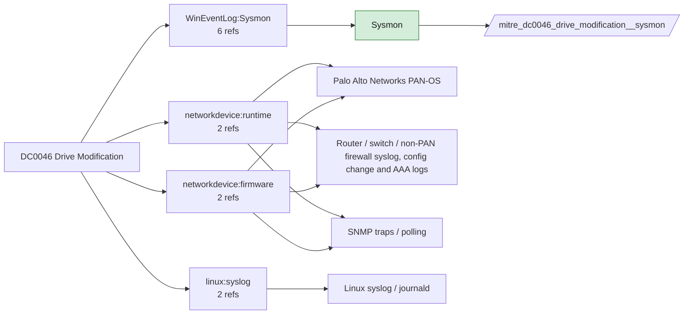

# DC0046 Drive Modification

[ATT&CK](https://attack.mitre.org/datacomponents/DC0046) · version 2.0 · modified 2025-11-12 · ATT&CK release 20.1

Status: **Live** · umbrella eventtype `mitre_dc0046_drive_modification`

> The alteration of a drive letter, mount point, or other attributes of a data storage device, which could involve reassignment, renaming, permissions changes, or other modifications. Examples:   - Drive Letter Reassignment: A USB drive previously assigned `E:\` is reassigned to `D:\` on a Windows machine. - Mount Point Change: On a Linux system, a mounted storage device at `/mnt/external` is moved to `/mnt/storage`. - Drive Permission Changes: A shared drive's permissions are modified to allow write access for unauthorized users or processes. - Renaming of a Drive: A network drive labeled "HR_Share" is renamed to "Shared_Resources." - Modification of Cloud-Integrated Drives: A cloud storage mount such as Google Drive is modified to sync only specific folders.  This data component can be collected through the following measures:  Windows Event Logs  - Relevant Events:     - Event ID 98: Indicates changes to a volume (e.g., drive letter reassignment).     - Event ID 1006: Logs permission modifications or changes to removable storage. - Configuration: Enable "Storage Operational Logs" in the Event Viewer: `Applications and Services Logs > Microsoft > Windows > Storage-Tiering > Operational`  Linux System Logs  - Auditd Configuration: Add audit rules to track changes to mounted drives: `auditctl -w /mnt/ -p w -k drive_modification` - Command-Line Monitoring: Use `dmesg` or `journalctl` to observe drive modifications.  macOS System Logs  - Unified Logs: Collect mount or drive modification events: `log show --info | grep "Volume modified"` - Command-Line Monitoring: Use `diskutil` to track changes:  Endpoint Detection and Response (EDR) Tools  - Configure policies in EDR solutions to monitor and log changes to drive configurations or attributes.  SIEM Tools  - Aggregate logs from multiple systems into a centralized platform like Splunk to correlate events and alert on suspicious drive modification activities.

## Why this component matters

Raw disk writes (Sysmon EID 9) for bootkits and wipers; PAN-OS and device syslog for firmware/storage changes on appliances.

ATT&CK v20.1 has **9 analytics** across **6 detection strategies** that read this component, covering **6 techniques**. Tactics most dependent on it: impact (6), stealth (3), persistence (3).

Analytic references by platform: macOS 3, Windows 3, Network Devices 2, Linux 1

## Where it comes from



## Requirements

Per feed (from `config/stack.yml` and `config/log_sources.yml`):

| Feed | Status | Sourcetype or source | Constraint | Origin | TA / collector |
|---|---|---|---|---|---|
| `sysmon` | live | source=`XmlWinEventLog:Microsoft-Windows-Sysmon/Operational` | `EventCode IN (9)` | defaults | Splunk Add-on for Sysmon (needs Splunk_TA_windows for XML parsing) |
| `wineventlog` | live | source=`XmlWinEventLog:System` | `EventCode IN (1006, 2003, 20001)` | defaults | Splunk Add-on for Microsoft Windows (Splunk_TA_windows), XML rendering (renderXml = true) |

Collection prerequisites:

- **sysmon**: Sysmon deployed with a maintained modular configuration (e.g. sysmon-modular or SwiftOnSecurity). Event IDs referenced by a data component only exist if the config includes that rule group (ProcessAccess=10, ImageLoad=7, DNS=22, FileDelete=23/26, ClipboardChange=24, ProcessTampering=25, FileBlock=27/28 are off in minimal configs).
- **sysmon**: Hashes configured (SHA256 at least, IMPHASH useful) for File/Process metadata components.
- **wineventlog**: Advanced Audit Policy configured (at minimum Process Creation, Logon, Account Management, Object Access, Policy Change, Privilege Use, Detailed Tracking). Without the matching subcategory the EventCodes below never fire.
- **wineventlog**: Include command line in process creation events enabled for 4688 (Computer Configuration > Administrative Templates > System > Audit Process Creation).
- **wineventlog**: PowerShell Script Block Logging (4104) and Module Logging (4103) enabled via GPO for the PowerShell/Operational channel.
- **wineventlog**: Object access events (4656/4663/4657/4660/4670) require SACLs on the files/keys of interest.
- **wineventlog**: Non-default channels (TaskScheduler, WMI-Activity, CodeIntegrity, Defender, Firewall, WinRM, SMBClient/Server...) must be listed as inputs in Splunk_TA_windows inputs.conf; several are disabled by default in Windows.

Review notes: `sysmon` has 6 ATT&CK reference(s) with no usable event filter (prose channel), constraint origin is *defaults*.

## Splunk

Eventtypes (literal constraints, see `dist/splunk/TA-mitre-attack-datacomponents/default/eventtypes.conf`):

```ini
[mitre_dc0046_drive_modification__sysmon]
search = index=sysmon source="XmlWinEventLog:Microsoft-Windows-Sysmon/Operational" EventCode IN (9)

[mitre_dc0046_drive_modification__wineventlog]
search = index=wineventlog source="XmlWinEventLog:System" EventCode IN (1006, 2003, 20001)

[mitre_dc0046_drive_modification]
search = eventtype=mitre_dc0046_drive_modification__sysmon OR eventtype=mitre_dc0046_drive_modification__wineventlog
```

Macros for analytics: `` `mitre_dc0046` `` (umbrella), `` `mitre_dc0046_sysmon` ``, `` `mitre_dc0046_wineventlog` ``, `` `mitre_dc0046_filter` `` (site exclusions).
CIM: no data model mapping; analytics on this component run as raw eventtype searches.

## Sigma

No generic Sigma category maps to this component; rules use `product`/`service` logsources, which the pipeline maps to index and sourcetype.

## Dependents

Top techniques detected through this component (of 6):

| Technique | Name | Tactics | Analytics using this DC |
|---|---|---|---|
| [T1561](https://attack.mitre.org/techniques/T1561) | Disk Wipe | impact | 2 |
| [T1561.001](https://attack.mitre.org/techniques/T1561/001) | Disk Content Wipe | impact | 2 |
| [T1561.002](https://attack.mitre.org/techniques/T1561/002) | Disk Structure Wipe | impact | 2 |
| [T1542](https://attack.mitre.org/techniques/T1542) | Pre-OS Boot | stealth, persistence | 1 |
| [T1542.001](https://attack.mitre.org/techniques/T1542/001) | System Firmware | stealth, persistence | 1 |
| [T1542.003](https://attack.mitre.org/techniques/T1542/003) | Bootkit | stealth, persistence | 1 |

Full list: `lookups/mitre_attack_analytics.csv` filtered on `dc_ids` containing `DC0046`.
