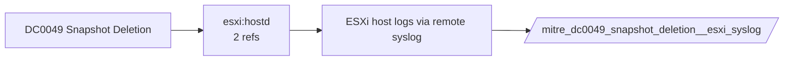

# DC0049 Snapshot Deletion

[ATT&CK](https://attack.mitre.org/datacomponents/DC0049) · version 2.0 · modified 2025-10-21 · ATT&CK release 20.1

Umbrella eventtype `mitre_dc0049_snapshot_deletion` over 2 feed(s)

> The removal of a point-in-time backup of a cloud storage volume, virtual machine (VM), or database.  *Data Collection Measures:*  - AWS CloudTrail     - Logs `DeleteSnapshot` API calls in EC2, RDS, and EBS services. - Azure Monitor Logs     - Tracks snapshot deletions via `Microsoft.Compute/snapshots/delete` API calls. - Google Cloud Logging     - Detects snapshot removal through `compute.disks.deleteSnapshot` events.

## Why this component matters

Snapshot removal on ESXi/Azure precedes ransomware encryption of VMs.

ATT&CK v20.1 has **3 analytics** across **2 detection strategies** that read this component, covering **2 techniques**. Tactics most dependent on it: impact (2), defense-impairment (1).

Analytic references by platform: IaaS 2, ESXi 1

## Where it comes from



## Requirements

Per feed (from `config/stack.yml` and `config/log_sources.yml`):

| Feed | Schedule | Sourcetype or source | Constraint | Origin | TA / collector |
|---|---|---|---|---|---|
| `azure_activity` | scheduled | sourcetype=`mscs:azure:audit` | `(operationName="Microsoft.Compute/snapshots/delete")` | defaults | Splunk Add-on for Microsoft Cloud Services (mscs:azure:audit) |
| `esxi_syslog` | scheduled | sourcetype=`vmware:esxlog:hostd` | `(snapshot)` | defaults | Splunk Add-on for VMware ESXi Logs (vmware:esxlog:<log>) |

Collection prerequisites:

- **azure_activity**: Export Activity Log for every subscription to the Event Hub.
- **esxi_syslog**: Syslog.global.logHost set on every host; ESXi Shell/SSH audit enabled; consider Syslog.global.auditRecord (ESXi 8).

## Splunk

Eventtypes (literal constraints, see `dist/splunk/TA-mitre-attack-datacomponents/default/eventtypes.conf`):

```ini
[mitre_dc0049_snapshot_deletion__azure_activity]
search = index=azure sourcetype="mscs:azure:audit" (operationName="Microsoft.Compute/snapshots/delete")

[mitre_dc0049_snapshot_deletion__esxi_syslog]
search = index=vmware sourcetype="vmware:esxlog:hostd" (snapshot)

[mitre_dc0049_snapshot_deletion]
search = eventtype=mitre_dc0049_snapshot_deletion__azure_activity OR eventtype=mitre_dc0049_snapshot_deletion__esxi_syslog
```

Macros for analytics: `` `mitre_dc0049` `` (umbrella), `` `mitre_dc0049_azure_activity` ``, `` `mitre_dc0049_esxi_syslog` ``, `` `mitre_dc0049_filter` `` (site exclusions).
CIM: no data model mapping; analytics on this component run as raw eventtype searches.

## Sigma

No generic Sigma category maps to this component; rules use `product`/`service` logsources, which the pipeline maps to index and sourcetype.

## Dependents

Top techniques detected through this component (of 2):

| Technique | Name | Tactics | Analytics using this DC |
|---|---|---|---|
| [T1490](https://attack.mitre.org/techniques/T1490) | Inhibit System Recovery | impact | 2 |
| [T1578](https://attack.mitre.org/techniques/T1578) | Modify Cloud Compute Infrastructure | defense-impairment | 1 |

Full list: `lookups/mitre_attack_analytics.csv` filtered on `dc_ids` containing `DC0049`.
