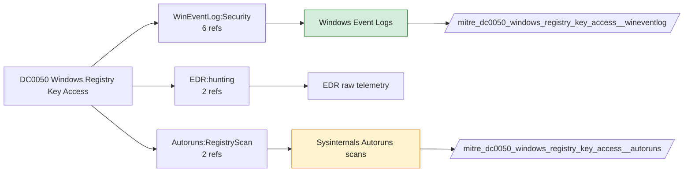

# DC0050 Windows Registry Key Access

[ATT&CK](https://attack.mitre.org/datacomponents/DC0050) · version 2.0 · modified 2025-11-12 · ATT&CK release 20.1

Status: **Live** · umbrella eventtype `mitre_dc0050_windows_registry_key_access`

> The action of opening a specific Windows Registry key, typically to read its associated value. This activity can be used for system configuration, application settings retrieval, and security policies.

## Why this component matters

Reads of SAM/SECURITY hives and credential keys. Only object-access auditing (4656/4663 with SACLs) sees reads; Sysmon does not.

ATT&CK v20.1 has **6 analytics** across **6 detection strategies** that read this component, covering **6 techniques**. Tactics most dependent on it: credential-access (2), execution (2), discovery (1), persistence (1).

Analytic references by platform: Windows 6

## Where it comes from



## Requirements

Component specific:

- SACLs on HKLM\SAM, HKLM\SECURITY and vendor credential keys.

Per feed (from `config/stack.yml` and `config/log_sources.yml`):

| Feed | Status | Sourcetypes | Constraint | Origin | TA / collector |
|---|---|---|---|---|---|
| `wineventlog` | live | `XmlWinEventLog:Security` | `EventCode IN (4656, 4663)` | defaults | Splunk Add-on for Microsoft Windows (Splunk_TA_windows), XML rendering |
| `autoruns` | ready (tick in stack.yml) | `autoruns` | `(whole feed)` | derived | TA-autoruns (scripted input) |

Collection prerequisites:

- **wineventlog**: Advanced Audit Policy configured (at minimum Process Creation, Logon, Account Management, Object Access, Policy Change, Privilege Use, Detailed Tracking). Without the matching subcategory the EventCodes below never fire.
- **wineventlog**: Include command line in process creation events enabled for 4688 (Computer Configuration > Administrative Templates > System > Audit Process Creation).
- **wineventlog**: PowerShell Script Block Logging (4104) and Module Logging (4103) enabled via GPO for the PowerShell/Operational channel.
- **wineventlog**: Object access events (4656/4663/4657/4660/4670) require SACLs on the files/keys of interest.
- **wineventlog**: Non-default channels (TaskScheduler, WMI-Activity, CodeIntegrity, Defender, Firewall, WinRM, SMBClient/Server...) must be listed as inputs in Splunk_TA_windows inputs.conf; several are disabled by default in Windows.

Review notes: `autoruns` has 2 ATT&CK reference(s) with no usable event filter (prose channel), constraint origin is *derived*.

## Splunk

Eventtypes (literal constraints, see `dist/splunk/TA-mitre-attack-datacomponents/default/eventtypes.conf`):

```ini
[mitre_dc0050_windows_registry_key_access__wineventlog]
search = index=wineventlog sourcetype=XmlWinEventLog:Security EventCode IN (4656, 4663)

[mitre_dc0050_windows_registry_key_access__autoruns]
search = index=wineventlog sourcetype=autoruns
disabled = 1

[mitre_dc0050_windows_registry_key_access]
search = eventtype=mitre_dc0050_windows_registry_key_access__wineventlog OR eventtype=mitre_dc0050_windows_registry_key_access__autoruns
```

Macros for analytics: `` `mitre_dc0050` `` (umbrella), `` `mitre_dc0050_wineventlog` ``, `` `mitre_dc0050_autoruns` ``, `` `mitre_dc0050_filter` `` (site exclusions).
CIM: `Endpoint.Registry` via `` `mitre_dc0050_dm` `` / `` `mitre_dc0050_dm_where` `` for `tstats`. CIM tags emitted for: none (no feed is known CIM-compliant for this model).

## Sigma

No generic Sigma category maps to this component; rules use `product`/`service` logsources, which the pipeline maps to index and sourcetype.

## Dependents

Top techniques detected through this component (of 6):

| Technique | Name | Tactics | Analytics using this DC |
|---|---|---|---|
| [T1547.004](https://attack.mitre.org/techniques/T1547/004) | Winlogon Helper DLL | persistence, privilege-escalation | 1 |
| [T1552.002](https://attack.mitre.org/techniques/T1552/002) | Credentials in Registry | credential-access | 1 |
| [T1559.001](https://attack.mitre.org/techniques/T1559/001) | Component Object Model | execution | 1 |
| [T1559.002](https://attack.mitre.org/techniques/T1559/002) | Dynamic Data Exchange | execution | 1 |
| [T1614.001](https://attack.mitre.org/techniques/T1614/001) | System Language Discovery | discovery | 1 |
| [T1649](https://attack.mitre.org/techniques/T1649) | Steal or Forge Authentication Certificates | credential-access | 1 |

Full list: `lookups/mitre_attack_analytics.csv` filtered on `dc_ids` containing `DC0050`.
