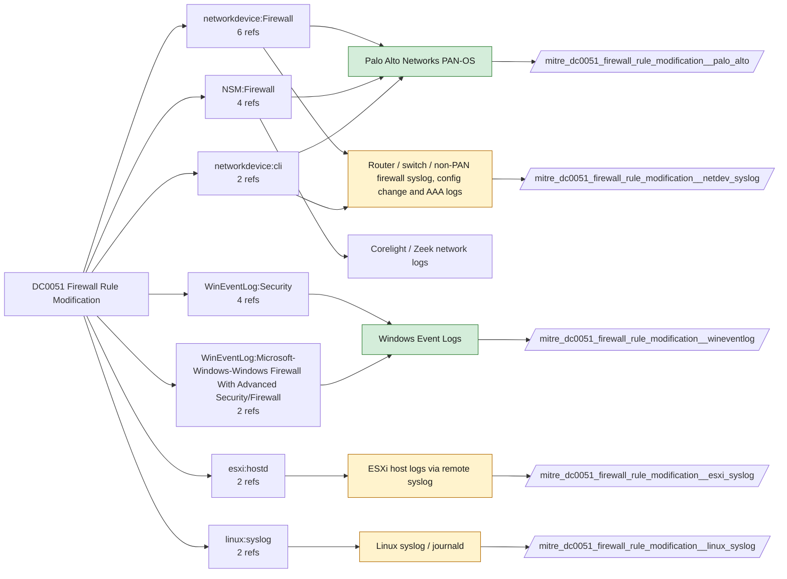

# DC0051 Firewall Rule Modification

[ATT&CK](https://attack.mitre.org/datacomponents/DC0051) · version 2.0 · modified 2026-10-13 · ATT&CK release 20.1

Status: **Live** · umbrella eventtype `mitre_dc0051_firewall_rule_modification`

> The creation, deletion, or alteration of firewall rules to allow or block specific network traffic. Monitoring changes to these rules is critical for detecting misconfigurations, unauthorized access, or malicious attempts to bypass network protections. Examples:   - Rule Creation: Adding a new rule to allow inbound traffic on port 3389 (RDP). - Rule Deletion: Deleting a rule that blocks inbound traffic from untrusted IP ranges. - Rule Modification: Changing a rule to allow traffic from "any" source IP instead of a specific trusted range. - Audit Log Metadata: Logs indicating "Firewall rule modified by admin@domain.com." - Platform-Specific Scenarios     - Azure: Altering rules in an Azure Network Security Group (NSG).     - AWS: Modifying Security Group rules to allow traffic.     - Windows: Changes tracked in Security Event Logs (EID 4950 or 4951).  This data component can be collected through the following measures:  Cloud Control Plane  - Azure: Collect rule modification logs from Azure Firewall Activity Logs.     - Example Command: `az network firewall policy rule-collection-group rule-collection list --policy-name <policy-name>` - AWS: Use CloudTrail to track `AuthorizeSecurityGroupIngress` or `RevokeSecurityGroupIngress` actions.     Example: `aws ec2 describe-security-groups` - Google Cloud: Use gcloud commands to extract firewall rules: `gcloud compute firewall-rules list --format=json`  Host-Based Firewalls  - Windows:      - Collect events from the Windows Security Event Log (EID 4950: A rule has been modified).     - Use PowerShell to track rule changes: `Get-NetFirewallRule -PolicyStore PersistentStore` - Linux:     - Monitor iptables or nftables rule modifications: `iptables -L -v`     - Use auditd for real-time monitoring: `auditctl -w /etc/iptables.rules -p wa` - macOS: Use pfctl to monitor rule changes: `sudo pfctl -sr`  SIEM Integration  - Collect logs from cloud platforms, host systems, and network appliances for centralized monitoring.  API Monitoring  - Monitor API calls for firewall rule modifications.

## Why this component matters

PAN-OS config logs are authoritative for the perimeter; Windows Firewall/Firewall channel 2004-2006 and 4946-4950 for host rules; ESXi hostd for the hypervisor firewall.

ATT&CK v20.1 has **14 analytics** across **12 detection strategies** that read this component, covering **12 techniques**. Tactics most dependent on it: defense-impairment (5), command-and-control (4), impact (2), initial-access (1).

Analytic references by platform: Network Devices 6, IaaS 4, Windows 2, Linux 1, ESXi 1

## Where it comes from



## Requirements

Component specific:

- PAN-OS config log forwarding; Windows Audit MPSSVC Rule-Level Policy Change.

Per feed (from `config/stack.yml` and `config/log_sources.yml`):

| Feed | Status | Sourcetypes | Constraint | Origin | TA / collector |
|---|---|---|---|---|---|
| `palo_alto` | live | `pan:config` | `(whole feed)` | defaults | Splunk Add-on for Palo Alto Networks (pan:*) |
| `wineventlog` | live | `XmlWinEventLog:Microsoft-Windows-Windows Firewall With Advanced Security/Firewall`, `XmlWinEventLog:Security` | `EventCode IN (2004, 2005, 2006, 2033, 4946, 4947, 4948, 4950)` | defaults | Splunk Add-on for Microsoft Windows (Splunk_TA_windows), XML rendering |
| `esxi_syslog` | ready (tick in stack.yml) | `vmware:esxlog:hostd` | `(firewall)` | defaults | Splunk Add-on for VMware ESXi Logs (vmware:esxlog:<log>) |
| `linux_syslog` | ready (tick in stack.yml) | `linux_messages_syslog`, `linux_secure`, `syslog` | `(iptables OR nftables OR ufw OR firewalld)` | defaults | Splunk Add-on for Unix and Linux (syslog, linux_secure, linux_messages_syslog) |
| `netdev_syslog` | ready (tick in stack.yml) | `cisco:asa`, `cisco:ios`, `syslog` | `(whole feed)` | derived | Cisco Networks Add-on (cisco:ios, cisco:asa), Juniper/Arista TAs, or generic syslog |

Collection prerequisites:

- **palo_alto**: Log forwarding profiles attached to every security rule (traffic start+end, threat, url, wildfire, data).
- **palo_alto**: System and Config logs forwarded from each firewall / Panorama; GlobalProtect logs enabled.
- **palo_alto**: URL filtering and Threat Prevention licensed for pan:threat subtypes url/vulnerability/virus/spyware.
- **palo_alto**: Operational (show/debug) commands are not in config or system logs by default. Enable administrator activity audit tracking (Device > Setup > Management > Logging and Reporting, PAN-OS 10.1+) and forward the audit log if you want CLI discovery analytics for the firewall.
- **wineventlog**: Advanced Audit Policy configured (at minimum Process Creation, Logon, Account Management, Object Access, Policy Change, Privilege Use, Detailed Tracking). Without the matching subcategory the EventCodes below never fire.
- **wineventlog**: Include command line in process creation events enabled for 4688 (Computer Configuration > Administrative Templates > System > Audit Process Creation).
- **wineventlog**: PowerShell Script Block Logging (4104) and Module Logging (4103) enabled via GPO for the PowerShell/Operational channel.
- **wineventlog**: Object access events (4656/4663/4657/4660/4670) require SACLs on the files/keys of interest.
- **wineventlog**: Non-default channels (TaskScheduler, WMI-Activity, CodeIntegrity, Defender, Firewall, WinRM, SMBClient/Server...) must be listed as inputs in Splunk_TA_windows inputs.conf; several are disabled by default in Windows.
- **esxi_syslog**: Syslog.global.logHost set on every host; ESXi Shell/SSH audit enabled; consider Syslog.global.auditRecord (ESXi 8).
- **netdev_syslog**: Enable config-change archive logging and AAA command accounting; forward at informational level.

Review notes: `wineventlog` has 6 ATT&CK reference(s) with no usable event filter (prose channel), constraint origin is *defaults*; `linux_syslog` has 2 ATT&CK reference(s) with no usable event filter (prose channel), constraint origin is *defaults*; `netdev_syslog` has 8 ATT&CK reference(s) with no usable event filter (prose channel), constraint origin is *derived*.

## Splunk

Eventtypes (literal constraints, see `dist/splunk/TA-mitre-attack-datacomponents/default/eventtypes.conf`):

```ini
[mitre_dc0051_firewall_rule_modification__palo_alto]
search = index=pan_logs sourcetype=pan:config

[mitre_dc0051_firewall_rule_modification__wineventlog]
search = index=wineventlog sourcetype IN ("XmlWinEventLog:Microsoft-Windows-Windows Firewall With Advanced Security/Firewall", "XmlWinEventLog:Security") EventCode IN (2004, 2005, 2006, 2033, 4946, 4947, 4948, 4950)

[mitre_dc0051_firewall_rule_modification__esxi_syslog]
search = index=vmware sourcetype=vmware:esxlog:hostd (firewall)
disabled = 1

[mitre_dc0051_firewall_rule_modification__linux_syslog]
search = index=linux sourcetype IN (linux_messages_syslog, linux_secure, syslog) (iptables OR nftables OR ufw OR firewalld)
disabled = 1

[mitre_dc0051_firewall_rule_modification__netdev_syslog]
search = index=netops sourcetype IN ("cisco:asa", "cisco:ios", syslog)
disabled = 1

[mitre_dc0051_firewall_rule_modification]
search = eventtype=mitre_dc0051_firewall_rule_modification__palo_alto OR eventtype=mitre_dc0051_firewall_rule_modification__wineventlog OR eventtype=mitre_dc0051_firewall_rule_modification__esxi_syslog OR eventtype=mitre_dc0051_firewall_rule_modification__linux_syslog OR eventtype=mitre_dc0051_firewall_rule_modification__netdev_syslog
```

Macros for analytics: `` `mitre_dc0051` `` (umbrella), `` `mitre_dc0051_palo_alto` ``, `` `mitre_dc0051_wineventlog` ``, `` `mitre_dc0051_esxi_syslog` ``, `` `mitre_dc0051_linux_syslog` ``, `` `mitre_dc0051_netdev_syslog` ``, `` `mitre_dc0051_filter` `` (site exclusions).
CIM: `Change.Network_Changes` via `` `mitre_dc0051_dm` `` / `` `mitre_dc0051_dm_where` `` for `tstats`. CIM tags emitted for: `palo_alto`.

## Sigma

No generic Sigma category maps to this component; rules use `product`/`service` logsources, which the pipeline maps to index and sourcetype.

## Dependents

Top techniques detected through this component (of 12):

| Technique | Name | Tactics | Analytics using this DC |
|---|---|---|---|
| [T1686](https://attack.mitre.org/techniques/T1686) | Disable or Modify System Firewall | defense-impairment | 3 |
| [T1070.007](https://attack.mitre.org/techniques/T1070/007) | Clear Network Connection History and Configurations | stealth | 2 |
| [T1090](https://attack.mitre.org/techniques/T1090) | Proxy | command-and-control | 2 |
| [T1090.001](https://attack.mitre.org/techniques/T1090/001) | Internal Proxy | command-and-control | 2 |
| [T1090.002](https://attack.mitre.org/techniques/T1090/002) | External Proxy | command-and-control | 2 |
| [T1219.002](https://attack.mitre.org/techniques/T1219/002) | Remote Desktop Software | command-and-control | 2 |
| [T1498.002](https://attack.mitre.org/techniques/T1498/002) | Reflection Amplification | impact | 2 |
| [T1499.002](https://attack.mitre.org/techniques/T1499/002) | Service Exhaustion Flood | impact | 2 |
| [T1669](https://attack.mitre.org/techniques/T1669) | Wi-Fi Networks | initial-access | 2 |
| [T1686.001](https://attack.mitre.org/techniques/T1686/001) | Cloud Firewall | defense-impairment | 2 |
| [T1686.002](https://attack.mitre.org/techniques/T1686/002) | Network Device Firewall | defense-impairment | 2 |
| [T1687](https://attack.mitre.org/techniques/T1687) | Exploitation for Defense Impairment | defense-impairment | 2 |

Full list: `lookups/mitre_attack_analytics.csv` filtered on `dc_ids` containing `DC0051`.
