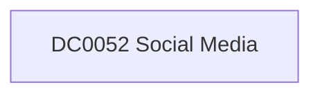

# DC0052 Social Media

[ATT&CK](https://attack.mitre.org/datacomponents/DC0052) · version 2.0 · modified 2025-10-21 · ATT&CK release 20.1

**Out of scope** for the current platform set

> Established, compromised, or otherwise acquired by adversaries to conduct reconnaissance, influence operations, social engineering, or other cyber threats.  *Data Collection Measures:*  - API Monitoring	     - Social media APIs (e.g., Twitter API, Facebook Graph API) can extract behavioral patterns of accounts. - Web Scraping     - Extracts public profile data, friend lists, or interactions to identify impersonation attempts. - Threat Intelligence Feeds	     - External feeds track malicious personas linked to disinformation campaigns or phishing. - OSINT Tools     - Maltego, SpiderFoot, and OpenCTI can map social media persona relationships. - Endpoint Detection	     - EDR logs user behavior and alerts on suspicious social media interactions. - SIEM Logging     - Detects access to known phishing pages or social media abuse via proxy logs. - Dark Web Monitoring	     - Identifies compromised social media credentials being sold.

## Why this component matters

ATT&CK v20.1 has **4 analytics** across **4 detection strategies** that read this component, covering **4 techniques**. Tactics most dependent on it: resource-development (4).

Analytic references by platform: PRE 4

## Where it comes from

## Requirements

Per feed (from `config/stack.yml` and `config/log_sources.yml`):

| Feed | Schedule | Sourcetype or source | Constraint | Origin | TA / collector |
|---|---|---|---|---|---|

## Splunk

No eventtypes rendered: none of this component's log sources belong to an in-scope platform feed. See [gaps](../gaps.md).

## Sigma

No generic Sigma category maps to this component; rules use `product`/`service` logsources, which the pipeline maps to index and sourcetype.

## Dependents

Top techniques detected through this component (of 4):

| Technique | Name | Tactics | Analytics using this DC |
|---|---|---|---|
| [T1585](https://attack.mitre.org/techniques/T1585) | Establish Accounts | resource-development | 1 |
| [T1585.001](https://attack.mitre.org/techniques/T1585/001) | Social Media Accounts | resource-development | 1 |
| [T1586](https://attack.mitre.org/techniques/T1586) | Compromise Accounts | resource-development | 1 |
| [T1586.001](https://attack.mitre.org/techniques/T1586/001) | Social Media Accounts | resource-development | 1 |

Full list: `lookups/mitre_attack_analytics.csv` filtered on `dc_ids` containing `DC0052`.
