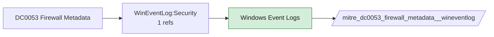

# DC0053 Firewall Metadata

[ATT&CK](https://attack.mitre.org/datacomponents/DC0053) · version 2.0 · modified 2026-10-13 · ATT&CK release 20.1

Status: **Live** · umbrella eventtype `mitre_dc0053_firewall_metadata`

> Contextual information about firewalls, including their configurations, policies, status, and other details such as names and associated rules. This metadata provides valuable insights into the operational state and configurations of firewalls, both in cloud control planes and host systems. Examples:   - Firewall Name and Configuration: The name, type, and purpose of a firewall such as "Azure Firewall - Production Environment." - Policy Details: Capturing firewall policy details, such as "Allow inbound TCP 443 to web servers." - Firewall Status: Status indicators like "Active," "Disabled," or "Pending Updates." - Audit Log Metadata: Log entries showing administrative changes, such as "Policy modified by admin@domain.com." - Rules Associated with Firewalls: Rules specifying source/destination IP ranges, protocols, and ports. - Tagging Information: Tags like "Environment: Production" or "Owner: NetworkOps."  This data component can be collected through the following measures:  Cloud Control Plane  - Azure: Use Azure Activity Logs and Network Watcher to collect metadata for Azure Firewall.     - Example: `az network firewall show --name <firewall-name>` - AWS: Use AWS CloudTrail and describe commands: `aws ec2 describe-security-groups` - Google Cloud: Use gcloud commands to extract metadata: `gcloud compute firewall-rules list --format=json`  Host-Based Firewalls  - Windows: Use PowerShell to gather metadata: `Get-NetFirewallRule -PolicyStore PersistentStore` - Linux: Query iptables or nftables rulesets: `iptables -S` - macOS: Use pfctl to extract metadata: `sudo pfctl -sr`  SIEM Integration  - Collect logs from cloud platforms, host systems, and network appliances.  API Monitoring  - Monitor API calls for metadata requests. Example (AWS): `Capture DescribeSecurityGroups or DescribeNetworkAcls` calls via CloudTrail.  Endpoint Detection and Response (EDR)  - Use EDR solutions to monitor firewall management tools for configuration changes or queries.

## Why this component matters

Current rule set and profile state (PAN-OS config, Windows firewall rule events); no v20.1 analytic yet but used for baselines.

ATT&CK v20.1 has **0 analytics** across **0 detection strategies** that read this component, covering **0 techniques**. Tactics most dependent on it: none.

## Where it comes from



## Requirements

Per feed (from `config/stack.yml` and `config/log_sources.yml`):

| Feed | Status | Sourcetypes | Constraint | Origin | TA / collector |
|---|---|---|---|---|---|
| `palo_alto` | live | `pan:config`, `pan:system` | `(whole feed)` | defaults | Splunk Add-on for Palo Alto Networks (pan:*) |
| `wineventlog` | live | `XmlWinEventLog:Microsoft-Windows-Windows Firewall With Advanced Security/Firewall`, `XmlWinEventLog:Security` | `EventCode IN (2004, 2005, 2006, 4946, 4947, 4948)` | defaults | Splunk Add-on for Microsoft Windows (Splunk_TA_windows), XML rendering |

Collection prerequisites:

- **palo_alto**: Log forwarding profiles attached to every security rule (traffic start+end, threat, url, wildfire, data).
- **palo_alto**: System and Config logs forwarded from each firewall / Panorama; GlobalProtect logs enabled.
- **palo_alto**: URL filtering and Threat Prevention licensed for pan:threat subtypes url/vulnerability/virus/spyware.
- **wineventlog**: Advanced Audit Policy configured (at minimum Process Creation, Logon, Account Management, Object Access, Policy Change, Privilege Use, Detailed Tracking). Without the matching subcategory the EventCodes below never fire.
- **wineventlog**: Include command line in process creation events enabled for 4688 (Computer Configuration > Administrative Templates > System > Audit Process Creation).
- **wineventlog**: PowerShell Script Block Logging (4104) and Module Logging (4103) enabled via GPO for the PowerShell/Operational channel.
- **wineventlog**: Object access events (4656/4663/4657/4660/4670) require SACLs on the files/keys of interest.
- **wineventlog**: Non-default channels (TaskScheduler, WMI-Activity, CodeIntegrity, Defender, Firewall, WinRM, SMBClient/Server...) must be listed as inputs in Splunk_TA_windows inputs.conf; several are disabled by default in Windows.

Review notes: `wineventlog` has 1 ATT&CK reference(s) with no usable event filter (prose channel), constraint origin is *defaults*.

## Splunk

Eventtypes (literal constraints, see `dist/splunk/TA-mitre-attack-datacomponents/default/eventtypes.conf`):

```ini
[mitre_dc0053_firewall_metadata__palo_alto]
search = index=pan_logs sourcetype IN ("pan:config", "pan:system")

[mitre_dc0053_firewall_metadata__wineventlog]
search = index=wineventlog sourcetype IN ("XmlWinEventLog:Microsoft-Windows-Windows Firewall With Advanced Security/Firewall", "XmlWinEventLog:Security") EventCode IN (2004, 2005, 2006, 4946, 4947, 4948)

[mitre_dc0053_firewall_metadata]
search = eventtype=mitre_dc0053_firewall_metadata__palo_alto OR eventtype=mitre_dc0053_firewall_metadata__wineventlog
```

Macros for analytics: `` `mitre_dc0053` `` (umbrella), `` `mitre_dc0053_palo_alto` ``, `` `mitre_dc0053_wineventlog` ``, `` `mitre_dc0053_filter` `` (site exclusions).
CIM: no data model mapping; analytics on this component run as raw eventtype searches.

## Sigma

No generic Sigma category maps to this component; rules use `product`/`service` logsources, which the pipeline maps to index and sourcetype.

## Dependents

Top techniques detected through this component (of 0):

| Technique | Name | Tactics | Analytics using this DC |
|---|---|---|---|

Full list: `lookups/mitre_attack_analytics.csv` filtered on `dc_ids` containing `DC0053`.
