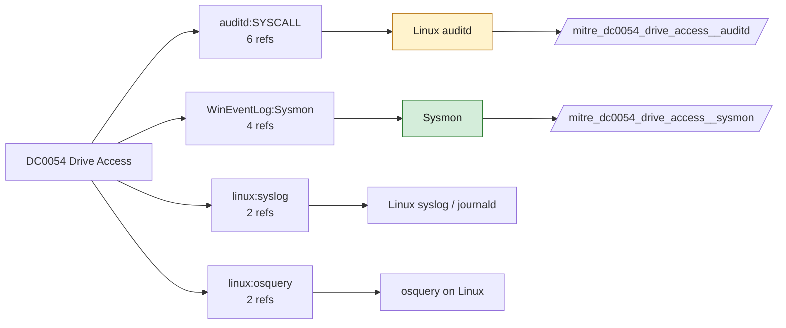

# DC0054 Drive Access

[ATT&CK](https://attack.mitre.org/datacomponents/DC0054) · version 2.0 · modified 2025-11-12 · ATT&CK release 20.1

Status: **Live** · umbrella eventtype `mitre_dc0054_drive_access`

> Refers to the act of accessing a data storage device, such as a hard drive, SSD, USB, or network-mounted drive. This data component logs the opening or mounting of drives, capturing activities such as reading, writing, or executing files within an assigned drive letter (e.g., `C:\`, `/mnt/drive`) or mount point. Examples:   - Removable Drive Insertion: A USB drive is inserted, assigned the letter `F:\`, and files are accessed. - Network Drive Mounting: A network share `\\server\share` is mapped to the drive `Z:\`. - External Hard Drive Access: An external drive is connected, mounted at `/mnt/backup`, and accessed for copying files. - System Volume Access: The system volume `C:\` is accessed for modifications to critical files. - Cloud-Synced Drives: Cloud storage drives like OneDrive or Google Drive are accessed via local mounts.

## Why this component matters

Sysmon EID 9 (RawAccessRead) catches volume-shadow and NTFS raw reads used to copy locked files such as ntds.dit.

ATT&CK v20.1 has **10 analytics** across **8 detection strategies** that read this component, covering **8 techniques**. Tactics most dependent on it: impact (3), stealth (3), persistence (3), collection (2).

Analytic references by platform: Linux 5, Windows 3, macOS 2

## Where it comes from



## Requirements

Component specific:

- Sysmon RawAccessRead (EID 9) enabled; exclude backup agents by process.

Per feed (from `config/stack.yml` and `config/log_sources.yml`):

| Feed | Status | Sourcetypes | Constraint | Origin | TA / collector |
|---|---|---|---|---|---|
| `sysmon` | live | `XmlWinEventLog:Microsoft-Windows-Sysmon/Operational` | `EventCode IN (9)` | defaults | Splunk Add-on for Sysmon (TA-microsoft-sysmon) |
| `auditd` | ready (tick in stack.yml) | `linux:audit` | `type IN (PATH, SYSCALL) (syscall IN (open, openat, read, write) OR SYSCALL IN (open, openat, read, write)) (name="/dev/sd*" OR name="/dev/nvme*" OR name="/dev/mapper/*")` | defaults | Splunk Add-on for Unix and Linux (linux:audit) or auditd -> auditbeat/syslog |

Collection prerequisites:

- **sysmon**: Sysmon deployed with a maintained modular configuration (e.g. sysmon-modular or SwiftOnSecurity). Event IDs referenced by a data component only exist if the config includes that rule group (ProcessAccess=10, ImageLoad=7, DNS=22, FileDelete=23/26, ClipboardChange=24, ProcessTampering=25, FileBlock=27/28 are off in minimal configs).
- **sysmon**: Hashes configured (SHA256 at least, IMPHASH useful) for File/Process metadata components.
- **auditd**: audit rules for execve, connect, open/openat on sensitive paths, ptrace, module load, mount, setuid; a Neo23x0/auditd baseline or Florian Roth's rule set is a reasonable start.
- **auditd**: log_format = ENRICHED in auditd.conf so syscall names and uids resolve (otherwise syscall numbers are architecture dependent).

## Splunk

Eventtypes (literal constraints, see `dist/splunk/TA-mitre-attack-datacomponents/default/eventtypes.conf`):

```ini
[mitre_dc0054_drive_access__sysmon]
search = index=sysmon sourcetype=XmlWinEventLog:Microsoft-Windows-Sysmon/Operational EventCode IN (9)

[mitre_dc0054_drive_access__auditd]
search = index=linux sourcetype=linux:audit type IN (PATH, SYSCALL) (syscall IN (open, openat, read, write) OR SYSCALL IN (open, openat, read, write)) (name="/dev/sd*" OR name="/dev/nvme*" OR name="/dev/mapper/*")
disabled = 1

[mitre_dc0054_drive_access]
search = eventtype=mitre_dc0054_drive_access__sysmon OR eventtype=mitre_dc0054_drive_access__auditd
```

Macros for analytics: `` `mitre_dc0054` `` (umbrella), `` `mitre_dc0054_sysmon` ``, `` `mitre_dc0054_auditd` ``, `` `mitre_dc0054_filter` `` (site exclusions).
CIM: no data model mapping; analytics on this component run as raw eventtype searches.

## Sigma

Generic logsource categories scoped by this component in `dist/sigma/pipelines/splunk_mitre_dc.yml`: product `windows`: `raw_access_thread`.

## Dependents

Top techniques detected through this component (of 8):

| Technique | Name | Tactics | Analytics using this DC |
|---|---|---|---|
| [T1039](https://attack.mitre.org/techniques/T1039) | Data from Network Shared Drive | collection | 2 |
| [T1120](https://attack.mitre.org/techniques/T1120) | Peripheral Device Discovery | discovery | 2 |
| [T1542](https://attack.mitre.org/techniques/T1542) | Pre-OS Boot | stealth, persistence | 1 |
| [T1542.001](https://attack.mitre.org/techniques/T1542/001) | System Firmware | stealth, persistence | 1 |
| [T1542.003](https://attack.mitre.org/techniques/T1542/003) | Bootkit | stealth, persistence | 1 |
| [T1561](https://attack.mitre.org/techniques/T1561) | Disk Wipe | impact | 1 |
| [T1561.001](https://attack.mitre.org/techniques/T1561/001) | Disk Content Wipe | impact | 1 |
| [T1561.002](https://attack.mitre.org/techniques/T1561/002) | Disk Structure Wipe | impact | 1 |

Full list: `lookups/mitre_attack_analytics.csv` filtered on `dc_ids` containing `DC0054`.
