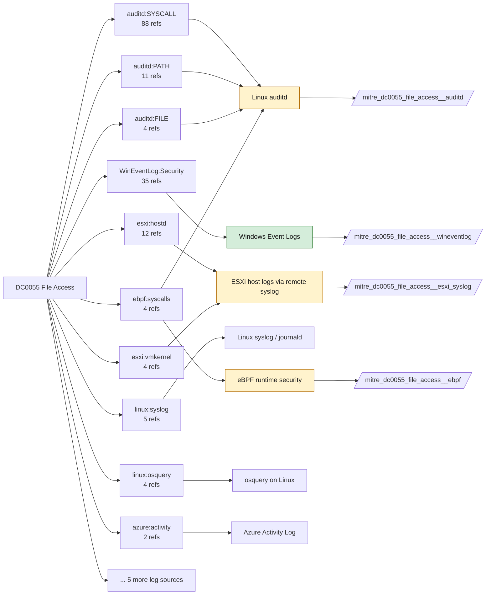

# DC0055 File Access

[ATT&CK](https://attack.mitre.org/datacomponents/DC0055) · version 3.1 · modified 2026-10-13 · ATT&CK release 20.1

Status: **Live** · umbrella eventtype `mitre_dc0055_file_access`

> To events where a file is opened or accessed, making its contents available to the requester. This includes reading, executing, or interacting with files by authorized or unauthorized entities. Examples include logging file access events (e.g., Windows Event ID 4663), monitoring file reads, and detecting unusual file access patterns. Examples:   - File Read Operations: A user opens a sensitive document (e.g., financial_report.xlsx) on a shared drive. - File Execution: A script or executable file is accessed and executed (e.g., malware.exe is run from a temporary directory). - Unauthorized File Access: An unauthorized user attempts to access a protected configuration file (e.g., `/etc/passwd` on Linux or `System32` files on Windows). - File Access Patterns: Bulk access to multiple files in a short time (e.g., mass access to documents on a file server). - File Access via Network: Files on a network share are accessed remotely (e.g., logs of SMB file access).

## Why this component matters

Reads of credential stores, SSH keys, browser databases, ntds.dit and Kubernetes service-account tokens. Windows needs SACL-driven 4663 ReadData; Sysmon does not record reads, so it is excluded here; Linux needs auditd open/read watches; Solidcore READ_DENIED fires on protected files.

ATT&CK v20.1 has **168 analytics** across **94 detection strategies** that read this component, covering **94 techniques**. Tactics most dependent on it: credential-access (46), exfiltration (37), collection (30), stealth (26).

Analytic references by platform: Linux 70, macOS 48, Windows 32, ESXi 10, IaaS 3, Containers 3, SaaS 1, Office Suite 1

## Where it comes from



## Requirements

Component specific:

- Deploy SACLs (or a Defender/EDR equivalent) on the specific files from mitre_sensitive_paths; broad object-access auditing is unusable.
- Linux: -w /etc/shadow -p r style rules, and k8s audit at RequestResponse level for secrets.

Per feed (from `config/stack.yml` and `config/log_sources.yml`):

| Feed | Status | Sourcetype or source | Constraint | Origin | TA / collector |
|---|---|---|---|---|---|
| `solidcore` | live | sourcetype=`mcafee:epo` | `(threat_name=READ_DENIED OR event_description=READ_DENIED) (product_name="Solidcore*")` | defaults | Arrives through the ePO TA; Solidcore events carry event names such as FILE_CREATED, FILE_MODIFIED, FILE_DELETED, EXECUTION_DENIED, REG_VALUE_MODIFIED, PROCESS_HIJACK_ATTEMPTED. Verify field names (threat_name / event_description) in your data. |
| `wineventlog` | live | source=`XmlWinEventLog:Security` | `EventCode IN (4656, 4663)` | defaults | Splunk Add-on for Microsoft Windows (Splunk_TA_windows), XML rendering (renderXml = true) |
| `auditd` | ready (tick in stack.yml) | sourcetype=`linux:audit` | `type IN (PATH, SYSCALL) (syscall IN (access, open, openat, openat2, read, readlink, stat) OR SYSCALL IN (access, open, openat, openat2, read, readlink, stat))` | defaults | Splunk Add-on for Unix and Linux (linux:audit) or auditd -> auditbeat/syslog |
| `ebpf` | ready (tick in stack.yml) | sourcetype=`falco` | `(whole feed)` | derived | Vendor specific (falco JSON, tetragon) |
| `esxi_syslog` | ready (tick in stack.yml) | sourcetype=`vmware:esxlog:hostd`, sourcetype=`vmware:esxlog:vmkernel` | `(whole feed)` | defaults | Splunk Add-on for VMware ESXi Logs (vmware:esxlog:<log>) |
| `kubernetes_audit` | ready (tick in stack.yml) | sourcetype=`kube:apiserver-audit` | `verb IN (get, list) (objectRef.resource=secrets OR objectRef.resource=configmaps)` | defaults | Splunk OpenTelemetry Collector for Kubernetes / Splunk Connect for Kubernetes |

Collection prerequisites:

- **solidcore**: Change Control file and registry monitoring rules scoped to the paths/keys of interest; Application Control in Enabled (not Observe) mode for EXECUTION_DENIED.
- **wineventlog**: Advanced Audit Policy configured (at minimum Process Creation, Logon, Account Management, Object Access, Policy Change, Privilege Use, Detailed Tracking). Without the matching subcategory the EventCodes below never fire.
- **wineventlog**: Include command line in process creation events enabled for 4688 (Computer Configuration > Administrative Templates > System > Audit Process Creation).
- **wineventlog**: PowerShell Script Block Logging (4104) and Module Logging (4103) enabled via GPO for the PowerShell/Operational channel.
- **wineventlog**: Object access events (4656/4663/4657/4660/4670) require SACLs on the files/keys of interest.
- **wineventlog**: Non-default channels (TaskScheduler, WMI-Activity, CodeIntegrity, Defender, Firewall, WinRM, SMBClient/Server...) must be listed as inputs in Splunk_TA_windows inputs.conf; several are disabled by default in Windows.
- **auditd**: audit rules for execve, connect, open/openat on sensitive paths, ptrace, module load, mount, setuid; a Neo23x0/auditd baseline or Florian Roth's rule set is a reasonable start.
- **auditd**: log_format = ENRICHED in auditd.conf so syscall names and uids resolve (otherwise syscall numbers are architecture dependent).
- **esxi_syslog**: Syslog.global.logHost set on every host; ESXi Shell/SSH audit enabled; consider Syslog.global.auditRecord (ESXi 8).
- **kubernetes_audit**: Audit policy at Metadata level minimum
- **kubernetes_audit**: RequestResponse for secrets/pods/exec; ship the audit log file from control-plane nodes.

Review notes: `wineventlog` has 2 ATT&CK reference(s) with no usable event filter (prose channel), constraint origin is *defaults*; `ebpf` has 4 ATT&CK reference(s) with no usable event filter (prose channel), constraint origin is *derived*.

## Splunk

Eventtypes (literal constraints, see `dist/splunk/TA-mitre-attack-datacomponents/default/eventtypes.conf`):

```ini
[mitre_dc0055_file_access__solidcore]
search = index=epo sourcetype="mcafee:epo" (threat_name=READ_DENIED OR event_description=READ_DENIED) (product_name="Solidcore*")

[mitre_dc0055_file_access__wineventlog]
search = index=wineventlog source="XmlWinEventLog:Security" EventCode IN (4656, 4663)

[mitre_dc0055_file_access__auditd]
search = index=linux sourcetype="linux:audit" type IN (PATH, SYSCALL) (syscall IN (access, open, openat, openat2, read, readlink, stat) OR SYSCALL IN (access, open, openat, openat2, read, readlink, stat))
disabled = 1

[mitre_dc0055_file_access__ebpf]
search = index=linux sourcetype=falco
disabled = 1

[mitre_dc0055_file_access__esxi_syslog]
search = index=vmware sourcetype IN ("vmware:esxlog:hostd", "vmware:esxlog:vmkernel")
disabled = 1

[mitre_dc0055_file_access__kubernetes_audit]
search = index=k8s sourcetype="kube:apiserver-audit" verb IN (get, list) (objectRef.resource=secrets OR objectRef.resource=configmaps)
disabled = 1

[mitre_dc0055_file_access]
search = eventtype=mitre_dc0055_file_access__solidcore OR eventtype=mitre_dc0055_file_access__wineventlog OR eventtype=mitre_dc0055_file_access__auditd OR eventtype=mitre_dc0055_file_access__ebpf OR eventtype=mitre_dc0055_file_access__esxi_syslog OR eventtype=mitre_dc0055_file_access__kubernetes_audit
```

Macros for analytics: `` `mitre_dc0055` `` (umbrella), `` `mitre_dc0055_solidcore` ``, `` `mitre_dc0055_wineventlog` ``, `` `mitre_dc0055_auditd` ``, `` `mitre_dc0055_ebpf` ``, `` `mitre_dc0055_esxi_syslog` ``, `` `mitre_dc0055_kubernetes_audit` ``, `` `mitre_dc0055_filter` `` (site exclusions).
CIM: `Endpoint.Filesystem` via `` `mitre_dc0055_dm` `` / `` `mitre_dc0055_dm_where` `` for `tstats`. CIM tags emitted for: none (no feed is known CIM-compliant for this model).

## Sigma

Generic logsource categories scoped by this component in `dist/sigma/pipelines/splunk_mitre_dc.yml`: product `windows`: `file_access`; product `linux`: `file_access`.

## Dependents

Top techniques detected through this component (of 94):

| Technique | Name | Tactics | Analytics using this DC |
|---|---|---|---|
| [T1654](https://attack.mitre.org/techniques/T1654) | Log Enumeration | discovery | 5 |
| [T1074](https://attack.mitre.org/techniques/T1074) | Data Staged | collection | 4 |
| [T1552.001](https://attack.mitre.org/techniques/T1552/001) | Credentials In Files | credential-access | 4 |
| [T1567.001](https://attack.mitre.org/techniques/T1567/001) | Exfiltration to Code Repository | exfiltration | 4 |
| [T1567.002](https://attack.mitre.org/techniques/T1567/002) | Exfiltration to Cloud Storage | exfiltration | 4 |
| [T1567.003](https://attack.mitre.org/techniques/T1567/003) | Exfiltration to Text Storage Sites | exfiltration | 4 |
| [T1567.004](https://attack.mitre.org/techniques/T1567/004) | Exfiltration Over Webhook | exfiltration | 4 |
| [T1003](https://attack.mitre.org/techniques/T1003) | OS Credential Dumping | credential-access | 3 |
| [T1005](https://attack.mitre.org/techniques/T1005) | Data from Local System | collection | 3 |
| [T1025](https://attack.mitre.org/techniques/T1025) | Data from Removable Media | collection | 3 |
| [T1027.003](https://attack.mitre.org/techniques/T1027/003) | Steganography | stealth | 3 |
| [T1048.002](https://attack.mitre.org/techniques/T1048/002) | Exfiltration Over Asymmetric Encrypted Non-C2 Protocol | exfiltration | 3 |
| [T1052](https://attack.mitre.org/techniques/T1052) | Exfiltration Over Physical Medium | exfiltration | 3 |
| [T1052.001](https://attack.mitre.org/techniques/T1052/001) | Exfiltration over USB | exfiltration | 3 |
| [T1074.001](https://attack.mitre.org/techniques/T1074/001) | Local Data Staging | collection | 3 |
| … | 79 more | | |

Full list: `lookups/mitre_attack_analytics.csv` filtered on `dc_ids` containing `DC0055`.
