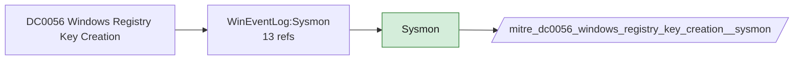

# DC0056 Windows Registry Key Creation

[ATT&CK](https://attack.mitre.org/datacomponents/DC0056) · version 2.0 · modified 2025-11-12 · ATT&CK release 20.1

Status: **Live** · umbrella eventtype `mitre_dc0056_windows_registry_key_creation`

> Initial construction of a new registry key within the Windows operating system.

## Why this component matters

Run keys, services, COM objects and WMI persistence are registry creations. Sysmon EID 12 is the source; Solidcore registry tracking adds change-control coverage.

ATT&CK v20.1 has **12 analytics** across **11 detection strategies** that read this component, covering **11 techniques**. Tactics most dependent on it: stealth (4), persistence (3), privilege-escalation (3), defense-impairment (3).

Analytic references by platform: Windows 12

## Where it comes from



## Requirements

Component specific:

- Sysmon RegistryEvent rules must include the persistence hives; the default modular configs do.

Per feed (from `config/stack.yml` and `config/log_sources.yml`):

| Feed | Status | Sourcetype or source | Constraint | Origin | TA / collector |
|---|---|---|---|---|---|
| `solidcore` | live | sourcetype=`mcafee:epo` | `(threat_name=REG_KEY_CREATED OR event_description=REG_KEY_CREATED) (product_name="Solidcore*")` | defaults | Arrives through the ePO TA; Solidcore events carry event names such as FILE_CREATED, FILE_MODIFIED, FILE_DELETED, EXECUTION_DENIED, REG_VALUE_MODIFIED, PROCESS_HIJACK_ATTEMPTED. Verify field names (threat_name / event_description) in your data. |
| `sysmon` | live | source=`XmlWinEventLog:Microsoft-Windows-Sysmon/Operational` | `EventCode IN (12)` | defaults | Splunk Add-on for Sysmon (needs Splunk_TA_windows for XML parsing) |
| `wineventlog` | live | source=`XmlWinEventLog:Security` | `EventCode IN (4657, 4663)` | defaults | Splunk Add-on for Microsoft Windows (Splunk_TA_windows), XML rendering (renderXml = true) |

Collection prerequisites:

- **solidcore**: Change Control file and registry monitoring rules scoped to the paths/keys of interest; Application Control in Enabled (not Observe) mode for EXECUTION_DENIED.
- **sysmon**: Sysmon deployed with a maintained modular configuration (e.g. sysmon-modular or SwiftOnSecurity). Event IDs referenced by a data component only exist if the config includes that rule group (ProcessAccess=10, ImageLoad=7, DNS=22, FileDelete=23/26, ClipboardChange=24, ProcessTampering=25, FileBlock=27/28 are off in minimal configs).
- **sysmon**: Hashes configured (SHA256 at least, IMPHASH useful) for File/Process metadata components.
- **wineventlog**: Advanced Audit Policy configured (at minimum Process Creation, Logon, Account Management, Object Access, Policy Change, Privilege Use, Detailed Tracking). Without the matching subcategory the EventCodes below never fire.
- **wineventlog**: Include command line in process creation events enabled for 4688 (Computer Configuration > Administrative Templates > System > Audit Process Creation).
- **wineventlog**: PowerShell Script Block Logging (4104) and Module Logging (4103) enabled via GPO for the PowerShell/Operational channel.
- **wineventlog**: Object access events (4656/4663/4657/4660/4670) require SACLs on the files/keys of interest.
- **wineventlog**: Non-default channels (TaskScheduler, WMI-Activity, CodeIntegrity, Defender, Firewall, WinRM, SMBClient/Server...) must be listed as inputs in Splunk_TA_windows inputs.conf; several are disabled by default in Windows.

## Splunk

Eventtypes (literal constraints, see `dist/splunk/TA-mitre-attack-datacomponents/default/eventtypes.conf`):

```ini
[mitre_dc0056_windows_registry_key_creation__solidcore]
search = index=epo sourcetype="mcafee:epo" (threat_name=REG_KEY_CREATED OR event_description=REG_KEY_CREATED) (product_name="Solidcore*")

[mitre_dc0056_windows_registry_key_creation__sysmon]
search = index=sysmon source="XmlWinEventLog:Microsoft-Windows-Sysmon/Operational" EventCode IN (12)

[mitre_dc0056_windows_registry_key_creation__wineventlog]
search = index=wineventlog source="XmlWinEventLog:Security" EventCode IN (4657, 4663)

[mitre_dc0056_windows_registry_key_creation]
search = eventtype=mitre_dc0056_windows_registry_key_creation__solidcore OR eventtype=mitre_dc0056_windows_registry_key_creation__sysmon OR eventtype=mitre_dc0056_windows_registry_key_creation__wineventlog
```

Macros for analytics: `` `mitre_dc0056` `` (umbrella), `` `mitre_dc0056_solidcore` ``, `` `mitre_dc0056_sysmon` ``, `` `mitre_dc0056_wineventlog` ``, `` `mitre_dc0056_filter` `` (site exclusions).
CIM: `Endpoint.Registry` via `` `mitre_dc0056_dm` `` / `` `mitre_dc0056_dm_where` `` for `tstats`. CIM tags emitted for: `sysmon`.

## Sigma

Generic logsource categories scoped by this component in `dist/sigma/pipelines/splunk_mitre_dc.yml`: product `windows`: `registry_event`, `registry_add`.

## Dependents

Top techniques detected through this component (of 11):

| Technique | Name | Tactics | Analytics using this DC |
|---|---|---|---|
| [T1218.002](https://attack.mitre.org/techniques/T1218/002) | Control Panel | stealth | 2 |
| [T1218.003](https://attack.mitre.org/techniques/T1218/003) | CMSTP | stealth | 2 |
| [T1218.009](https://attack.mitre.org/techniques/T1218/009) | Regsvcs/Regasm | stealth | 2 |
| [T1218.014](https://attack.mitre.org/techniques/T1218/014) | MMC | stealth | 2 |
| [T1219](https://attack.mitre.org/techniques/T1219) | Remote Access Tools | command-and-control | 2 |
| [T1546.012](https://attack.mitre.org/techniques/T1546/012) | Image File Execution Options Injection | privilege-escalation, persistence | 2 |
| [T1547.008](https://attack.mitre.org/techniques/T1547/008) | LSASS Driver | persistence, privilege-escalation | 2 |
| [T1547.014](https://attack.mitre.org/techniques/T1547/014) | Active Setup | persistence, privilege-escalation | 2 |
| [T1553.004](https://attack.mitre.org/techniques/T1553/004) | Install Root Certificate | defense-impairment | 2 |
| [T1686.003](https://attack.mitre.org/techniques/T1686/003) | Windows Host Firewall | defense-impairment | 2 |
| [T1688](https://attack.mitre.org/techniques/T1688) | Safe Mode Boot | defense-impairment | 2 |

Full list: `lookups/mitre_attack_analytics.csv` filtered on `dc_ids` containing `DC0056`.
