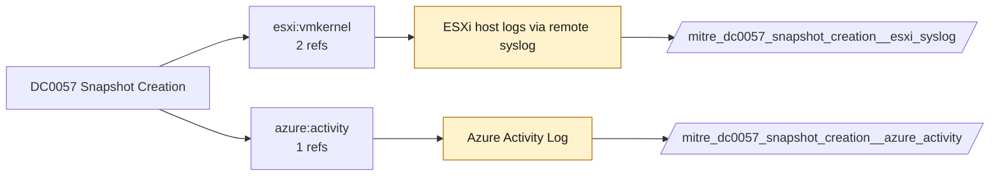

# DC0057 Snapshot Creation

[ATT&CK](https://attack.mitre.org/datacomponents/DC0057) · version 2.0 · modified 2025-11-12 · ATT&CK release 20.1

Status: **Ready** (needs a feed you have not ticked) · umbrella eventtype `mitre_dc0057_snapshot_creation`

> The process of taking a point-in-time copy of a cloud storage volume (files, settings, configurations, etc.), virtual machine (VM), or database that can be created and deployed in cloud environments.

## Why this component matters

VM snapshots on ESXi (vmkernel/hostd) and Azure disk snapshots; attackers snapshot domain controllers to steal ntds.dit offline.

ATT&CK v20.1 has **4 analytics** across **4 detection strategies** that read this component, covering **4 techniques**. Tactics most dependent on it: defense-impairment (2), collection (1), exfiltration (1).

Analytic references by platform: IaaS 3, ESXi 1

## Where it comes from



## Requirements

Per feed (from `config/stack.yml` and `config/log_sources.yml`):

| Feed | Status | Sourcetype or source | Constraint | Origin | TA / collector |
|---|---|---|---|---|---|
| `azure_activity` | ready (tick in stack.yml) | sourcetype=`mscs:azure:audit` | `(operationName="Microsoft.Compute/snapshots/write")` | defaults | Splunk Add-on for Microsoft Cloud Services (mscs:azure:audit) |
| `esxi_syslog` | ready (tick in stack.yml) | sourcetype=`vmware:esxlog:hostd`, sourcetype=`vmware:esxlog:vmkernel` | `(snapshot)` | defaults | Splunk Add-on for VMware ESXi Logs (vmware:esxlog:<log>) |

Collection prerequisites:

- **azure_activity**: Export Activity Log for every subscription to the Event Hub.
- **esxi_syslog**: Syslog.global.logHost set on every host; ESXi Shell/SSH audit enabled; consider Syslog.global.auditRecord (ESXi 8).

Review notes: `azure_activity` has 1 ATT&CK reference(s) with no usable event filter (prose channel), constraint origin is *defaults*.

## Splunk

Eventtypes (literal constraints, see `dist/splunk/TA-mitre-attack-datacomponents/default/eventtypes.conf`):

```ini
[mitre_dc0057_snapshot_creation__azure_activity]
search = index=azure sourcetype="mscs:azure:audit" (operationName="Microsoft.Compute/snapshots/write")
disabled = 1

[mitre_dc0057_snapshot_creation__esxi_syslog]
search = index=vmware sourcetype IN ("vmware:esxlog:hostd", "vmware:esxlog:vmkernel") (snapshot)
disabled = 1

[mitre_dc0057_snapshot_creation]
search = eventtype=mitre_dc0057_snapshot_creation__azure_activity OR eventtype=mitre_dc0057_snapshot_creation__esxi_syslog
```

Macros for analytics: `` `mitre_dc0057` `` (umbrella), `` `mitre_dc0057_azure_activity` ``, `` `mitre_dc0057_esxi_syslog` ``, `` `mitre_dc0057_filter` `` (site exclusions).
CIM: no data model mapping; analytics on this component run as raw eventtype searches.

## Sigma

No generic Sigma category maps to this component; rules use `product`/`service` logsources, which the pipeline maps to index and sourcetype.

## Dependents

Top techniques detected through this component (of 4):

| Technique | Name | Tactics | Analytics using this DC |
|---|---|---|---|
| [T1074.001](https://attack.mitre.org/techniques/T1074/001) | Local Data Staging | collection | 1 |
| [T1537](https://attack.mitre.org/techniques/T1537) | Transfer Data to Cloud Account | exfiltration | 1 |
| [T1578](https://attack.mitre.org/techniques/T1578) | Modify Cloud Compute Infrastructure | defense-impairment | 1 |
| [T1578.001](https://attack.mitre.org/techniques/T1578/001) | Create Snapshot | defense-impairment | 1 |

Full list: `lookups/mitre_attack_analytics.csv` filtered on `dc_ids` containing `DC0057`.
