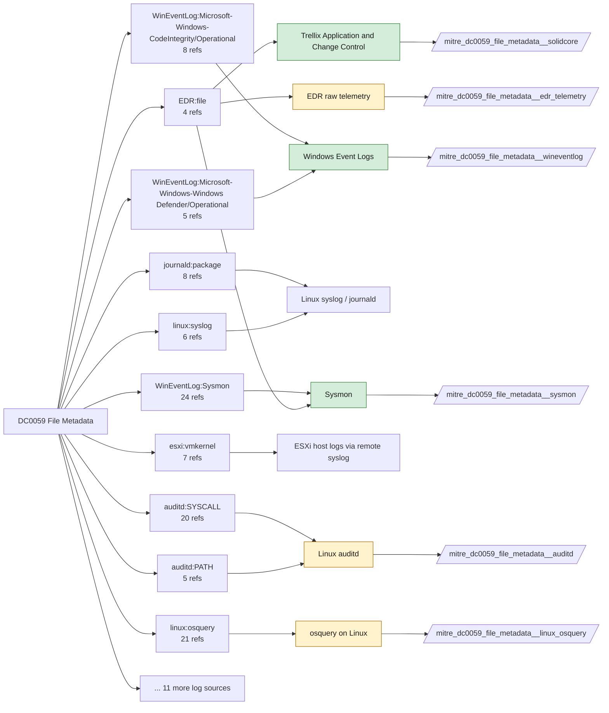

# DC0059 File Metadata

[ATT&CK](https://attack.mitre.org/datacomponents/DC0059) · version 2.1 · modified 2026-10-13 · ATT&CK release 20.1

Status: **Live** · umbrella eventtype `mitre_dc0059_file_metadata`

> contextual information about a file, including attributes such as the file's name, size, type, content (e.g., signatures, headers, media), user/owner, permissions, timestamps, and other related properties. File metadata provides insights into a file's characteristics and can be used to detect malicious activity, unauthorized modifications, or other anomalies. Examples:   - File Ownership and Permissions: Checking the owner and permissions of a critical configuration file like /etc/passwd on Linux or C:\Windows\System32\config\SAM on Windows. - Timestamps: Analyzing the creation, modification, and access timestamps of a file. - File Content and Signatures: Extracting the headers of an executable file to verify its signature or detect packing/obfuscation. - File Attributes: Analyzing attributes like hidden, system, or read-only flags in Windows. - File Hashes: Generating MD5, SHA-1, or SHA-256 hashes of files to compare against threat intelligence feeds. - File Location: Monitoring files located in unusual directories or paths, such as temporary or user folders.

## Why this component matters

Hashes, signatures, attributes, ownership and permission changes. Sysmon EID 11/15/2 and CodeIntegrity carry hash/signature data; Solidcore FILE_ATTR_MODIFIED and auditd chmod/chown/setxattr cover attribute changes; Corelight files/pe logs give metadata for files crossing the network; PAN-OS WildFire verdicts add a reputation signal.

ATT&CK v20.1 has **95 analytics** across **65 detection strategies** that read this component, covering **65 techniques**. Tactics most dependent on it: stealth (46), defense-impairment (13), initial-access (12), execution (9).

Analytic references by platform: Windows 30, Linux 30, macOS 27, ESXi 5, SaaS 1, Network Devices 1, Containers 1

## Where it comes from



## Requirements

Component specific:

- Corelight files.log needs file extraction enabled for hashes; pe.log for PE headers.

Per feed (from `config/stack.yml` and `config/log_sources.yml`):

| Feed | Status | Sourcetype or source | Constraint | Origin | TA / collector |
|---|---|---|---|---|---|
| `corelight` | live | sourcetype=`corelight_files`, sourcetype=`corelight_pe` | `(whole feed)` | defaults | Corelight App for Splunk (corelight_<log>). For TA_zeek use prefix zeek: and suffix :json. |
| `palo_alto` | live | sourcetype=`pan:threat` | `(log_subtype=wildfire OR log_subtype=virus)` | defaults | Splunk Add-on for Palo Alto Networks (pan:*) |
| `solidcore` | live | sourcetype=`mcafee:epo` | `(threat_name IN (FILE_ATTR_MODIFIED, FILE_SOLIDIFIED, FILE_UNSOLIDIFIED) OR event_description IN (FILE_ATTR_MODIFIED, FILE_SOLIDIFIED, FILE_UNSOLIDIFIED)) (product_name="Solidcore*")` | defaults | Arrives through the ePO TA; Solidcore events carry event names such as FILE_CREATED, FILE_MODIFIED, FILE_DELETED, EXECUTION_DENIED, REG_VALUE_MODIFIED, PROCESS_HIJACK_ATTEMPTED. Verify field names (threat_name / event_description) in your data. |
| `sysmon` | live | source=`XmlWinEventLog:Microsoft-Windows-Sysmon/Operational` | `EventCode IN (2, 11, 15)` | defaults | Splunk Add-on for Sysmon (needs Splunk_TA_windows for XML parsing) |
| `trellix_epo` | live | sourcetype=`mcafee:epo` | `(whole feed)` | derived | Splunk Add-on for McAfee ePO (mcafee:epo). Verify the sourcetype against your installed TA version. |
| `wineventlog` | live | source=`XmlWinEventLog:Microsoft-Windows-CodeIntegrity/Operational`, source=`XmlWinEventLog:Microsoft-Windows-Windows Defender/Operational`, source=`XmlWinEventLog:Security` | `EventCode IN (1116, 1117, 3033, 4663, 4670)` | defaults | Splunk Add-on for Microsoft Windows (Splunk_TA_windows), XML rendering (renderXml = true) |
| `auditd` | ready (tick in stack.yml) | sourcetype=`linux:audit` | `type IN (PATH, SYSCALL) (syscall IN (chmod, chown, fchmod, fchmodat, fchown, fchownat, fsetxattr, lchown, lsetxattr, removexattr, setxattr) OR SYSCALL IN (chmod, chown, fchmod, fchmodat, fchown, fchownat, fsetxattr, lchown, lsetxattr, removexattr, setxattr))` | defaults | Splunk Add-on for Unix and Linux (linux:audit) or auditd -> auditbeat/syslog |
| `ebpf` | ready (tick in stack.yml) | sourcetype=`falco` | `(whole feed)` | derived | Vendor specific (falco JSON, tetragon) |
| `edr_telemetry` | ready (tick in stack.yml) | sourcetype=`edr:telemetry` | `(whole feed)` | derived | Vendor specific |
| `linux_osquery` | ready (tick in stack.yml) | sourcetype=`osquery:results` | `(name=file OR name=hash OR name=file_events)` | defaults | osquery TA |

Collection prerequisites:

- **corelight**: Sensor placement covering east-west (DC, server VLANs) and north-south; without internal taps the lateral-movement components are blind.
- **corelight**: Enable the log set above; files/pe/smb_* and ldap/kerberos/ntlm are what distinguish Corelight from flow data.
- **palo_alto**: Log forwarding profiles attached to every security rule (traffic start+end, threat, url, wildfire, data).
- **palo_alto**: System and Config logs forwarded from each firewall / Panorama; GlobalProtect logs enabled.
- **palo_alto**: URL filtering and Threat Prevention licensed for pan:threat subtypes url/vulnerability/virus/spyware.
- **palo_alto**: Operational (show/debug) commands are not in config or system logs by default. Enable administrator activity audit tracking (Device > Setup > Management > Logging and Reporting, PAN-OS 10.1+) and forward the audit log if you want CLI discovery analytics for the firewall.
- **solidcore**: Change Control file and registry monitoring rules scoped to the paths/keys of interest; Application Control in Enabled (not Observe) mode for EXECUTION_DENIED.
- **sysmon**: Sysmon deployed with a maintained modular configuration (e.g. sysmon-modular or SwiftOnSecurity). Event IDs referenced by a data component only exist if the config includes that rule group (ProcessAccess=10, ImageLoad=7, DNS=22, FileDelete=23/26, ClipboardChange=24, ProcessTampering=25, FileBlock=27/28 are off in minimal configs).
- **sysmon**: Hashes configured (SHA256 at least, IMPHASH useful) for File/Process metadata components.
- **trellix_epo**: ePO configured to forward threat events to Splunk (syslog or DB pull); confirm product_name/threat_type fields populate.
- **trellix_epo**: ENS AMSI and Exploit Prevention enabled if AMSI-type analytics are expected.
- **wineventlog**: Advanced Audit Policy configured (at minimum Process Creation, Logon, Account Management, Object Access, Policy Change, Privilege Use, Detailed Tracking). Without the matching subcategory the EventCodes below never fire.
- **wineventlog**: Include command line in process creation events enabled for 4688 (Computer Configuration > Administrative Templates > System > Audit Process Creation).
- **wineventlog**: PowerShell Script Block Logging (4104) and Module Logging (4103) enabled via GPO for the PowerShell/Operational channel.
- **wineventlog**: Object access events (4656/4663/4657/4660/4670) require SACLs on the files/keys of interest.
- **wineventlog**: Non-default channels (TaskScheduler, WMI-Activity, CodeIntegrity, Defender, Firewall, WinRM, SMBClient/Server...) must be listed as inputs in Splunk_TA_windows inputs.conf; several are disabled by default in Windows.
- **auditd**: audit rules for execve, connect, open/openat on sensitive paths, ptrace, module load, mount, setuid; a Neo23x0/auditd baseline or Florian Roth's rule set is a reasonable start.
- **auditd**: log_format = ENRICHED in auditd.conf so syscall names and uids resolve (otherwise syscall numbers are architecture dependent).

Review notes: `corelight` has 2 ATT&CK reference(s) with no usable event filter (prose channel), constraint origin is *defaults*; `solidcore` has 5 ATT&CK reference(s) with no usable event filter (prose channel), constraint origin is *defaults*; `trellix_epo` has 2 ATT&CK reference(s) with no usable event filter (prose channel), constraint origin is *derived*; `wineventlog` has 14 ATT&CK reference(s) with no usable event filter (prose channel), constraint origin is *defaults*; `ebpf` has 2 ATT&CK reference(s) with no usable event filter (prose channel), constraint origin is *derived*; `edr_telemetry` has 6 ATT&CK reference(s) with no usable event filter (prose channel), constraint origin is *derived*; `linux_osquery` has 21 ATT&CK reference(s) with no usable event filter (prose channel), constraint origin is *defaults*.

## Splunk

Eventtypes (literal constraints, see `dist/splunk/TA-mitre-attack-datacomponents/default/eventtypes.conf`):

```ini
[mitre_dc0059_file_metadata__corelight]
search = index=corelight sourcetype IN (corelight_files, corelight_pe)

[mitre_dc0059_file_metadata__palo_alto]
search = index=pan_logs sourcetype="pan:threat" (log_subtype=wildfire OR log_subtype=virus)

[mitre_dc0059_file_metadata__solidcore]
search = index=epo sourcetype="mcafee:epo" (threat_name IN (FILE_ATTR_MODIFIED, FILE_SOLIDIFIED, FILE_UNSOLIDIFIED) OR event_description IN (FILE_ATTR_MODIFIED, FILE_SOLIDIFIED, FILE_UNSOLIDIFIED)) (product_name="Solidcore*")

[mitre_dc0059_file_metadata__sysmon]
search = index=sysmon source="XmlWinEventLog:Microsoft-Windows-Sysmon/Operational" EventCode IN (2, 11, 15)

[mitre_dc0059_file_metadata__trellix_epo]
search = index=epo sourcetype="mcafee:epo"

[mitre_dc0059_file_metadata__wineventlog]
search = index=wineventlog source IN ("XmlWinEventLog:Microsoft-Windows-CodeIntegrity/Operational", "XmlWinEventLog:Microsoft-Windows-Windows Defender/Operational", "XmlWinEventLog:Security") EventCode IN (1116, 1117, 3033, 4663, 4670)

[mitre_dc0059_file_metadata__auditd]
search = index=linux sourcetype="linux:audit" type IN (PATH, SYSCALL) (syscall IN (chmod, chown, fchmod, fchmodat, fchown, fchownat, fsetxattr, lchown, lsetxattr, removexattr, setxattr) OR SYSCALL IN (chmod, chown, fchmod, fchmodat, fchown, fchownat, fsetxattr, lchown, lsetxattr, removexattr, setxattr))
disabled = 1

[mitre_dc0059_file_metadata__ebpf]
search = index=linux sourcetype=falco
disabled = 1

[mitre_dc0059_file_metadata__edr_telemetry]
search = index=edr sourcetype="edr:telemetry"
disabled = 1

[mitre_dc0059_file_metadata__linux_osquery]
search = index=osquery sourcetype="osquery:results" (name=file OR name=hash OR name=file_events)
disabled = 1

[mitre_dc0059_file_metadata]
search = eventtype=mitre_dc0059_file_metadata__corelight OR eventtype=mitre_dc0059_file_metadata__palo_alto OR eventtype=mitre_dc0059_file_metadata__solidcore OR eventtype=mitre_dc0059_file_metadata__sysmon OR eventtype=mitre_dc0059_file_metadata__trellix_epo OR eventtype=mitre_dc0059_file_metadata__wineventlog OR eventtype=mitre_dc0059_file_metadata__auditd OR eventtype=mitre_dc0059_file_metadata__ebpf OR eventtype=mitre_dc0059_file_metadata__edr_telemetry OR eventtype=mitre_dc0059_file_metadata__linux_osquery
```

Macros for analytics: `` `mitre_dc0059` `` (umbrella), `` `mitre_dc0059_corelight` ``, `` `mitre_dc0059_palo_alto` ``, `` `mitre_dc0059_solidcore` ``, `` `mitre_dc0059_sysmon` ``, `` `mitre_dc0059_trellix_epo` ``, `` `mitre_dc0059_wineventlog` ``, `` `mitre_dc0059_auditd` ``, `` `mitre_dc0059_ebpf` ``, `` `mitre_dc0059_edr_telemetry` ``, `` `mitre_dc0059_linux_osquery` ``, `` `mitre_dc0059_filter` `` (site exclusions).
CIM: `Endpoint.Filesystem` via `` `mitre_dc0059_dm` `` / `` `mitre_dc0059_dm_where` `` for `tstats`. CIM tags emitted for: `sysmon`.

## Sigma

No generic Sigma category maps to this component; rules use `product`/`service` logsources, which the pipeline maps to index and sourcetype.

## Dependents

Top techniques detected through this component (of 65):

| Technique | Name | Tactics | Analytics using this DC |
|---|---|---|---|
| [T1222](https://attack.mitre.org/techniques/T1222) | File and Directory Permissions Modification | defense-impairment | 4 |
| [T1027.008](https://attack.mitre.org/techniques/T1027/008) | Stripped Payloads | stealth | 3 |
| [T1027.009](https://attack.mitre.org/techniques/T1027/009) | Embedded Payloads | stealth | 3 |
| [T1036.002](https://attack.mitre.org/techniques/T1036/002) | Right-to-Left Override | stealth | 3 |
| [T1070.006](https://attack.mitre.org/techniques/T1070/006) | Timestomp | stealth | 3 |
| [T1195](https://attack.mitre.org/techniques/T1195) | Supply Chain Compromise | initial-access | 3 |
| [T1195.001](https://attack.mitre.org/techniques/T1195/001) | Compromise Software Dependencies and Development Tools | initial-access | 3 |
| [T1195.002](https://attack.mitre.org/techniques/T1195/002) | Compromise Software Supply Chain | initial-access | 3 |
| [T1195.003](https://attack.mitre.org/techniques/T1195/003) | Compromise Hardware Supply Chain | initial-access | 3 |
| [T1001.002](https://attack.mitre.org/techniques/T1001/002) | Steganography | command-and-control | 2 |
| [T1027.005](https://attack.mitre.org/techniques/T1027/005) | Indicator Removal from Tools | stealth | 2 |
| [T1027.006](https://attack.mitre.org/techniques/T1027/006) | HTML Smuggling | stealth | 2 |
| [T1036](https://attack.mitre.org/techniques/T1036) | Masquerading | stealth | 2 |
| [T1036.001](https://attack.mitre.org/techniques/T1036/001) | Invalid Code Signature | stealth | 2 |
| [T1036.005](https://attack.mitre.org/techniques/T1036/005) | Match Legitimate Resource Name or Location | stealth | 2 |
| … | 50 more | | |

Full list: `lookups/mitre_attack_analytics.csv` filtered on `dc_ids` containing `DC0059`.
