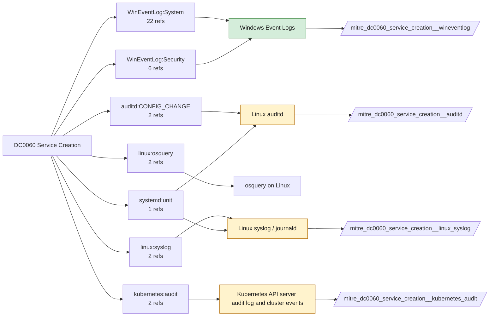

# DC0060 Service Creation

[ATT&CK](https://attack.mitre.org/datacomponents/DC0060) · version 2.0 · modified 2026-10-13 · ATT&CK release 20.1

Status: **Live** · umbrella eventtype `mitre_dc0060_service_creation`

> The registration of a new service or daemon on an operating system.  *Data Collection Measures:*  - Windows Event Logs     - Event ID 4697 - Captures the creation of a new Windows service.     - Event ID 7045 - Captures services installed by administrators or adversaries.     - Event ID 7034 - Could indicate malicious service modification or exploitation. - Sysmon Logs     - Sysmon Event ID 1 - Process Creation (captures service executables).     - Sysmon Event ID 4 - Service state changes (detects service installation).     - Sysmon Event ID 13 - Registry modifications (captures service persistence changes). - PowerShell Logging     - Monitor `New-Service` and `Set-Service` PowerShell cmdlets in Event ID 4104 (Script Block Logging). - Linux/macOS Collection Methods     - AuditD & Syslog Daemon Logs (`/var/log/syslog`, `/var/log/messages`, `/var/log/daemon.log`)     - AuditD Rules:         - `auditctl -w /etc/systemd/system -p wa -k service_creation`         - Detects changes to `systemd` service configurations. - Systemd Journals (`journalctl -u <service_name>`)     - Captures newly created systemd services. - LaunchDaemons & LaunchAgents (macOS)     - Monitor `/Library/LaunchDaemons/` and `/Library/LaunchAgents/` for new plist files.

## Why this component matters

7045 (System) and 4697 (Security) are among the highest-signal Windows events: PsExec, malicious drivers, persistence. On Linux the equivalent is a new systemd unit file (auditd watch) and on Kubernetes a new workload.

ATT&CK v20.1 has **31 analytics** across **28 detection strategies** that read this component, covering **28 techniques**. Tactics most dependent on it: stealth (8), persistence (8), execution (7), privilege-escalation (6).

Analytic references by platform: Windows 22, macOS 5, Linux 3, Containers 1

## Where it comes from



## Requirements

Component specific:

- 4697 requires Audit Security System Extension; 7045 is always on.
- Linux: -w /etc/systemd/system -p wa and /usr/lib/systemd/system.

Per feed (from `config/stack.yml` and `config/log_sources.yml`):

| Feed | Status | Sourcetype or source | Constraint | Origin | TA / collector |
|---|---|---|---|---|---|
| `wineventlog` | live | source=`XmlWinEventLog:Security`, source=`XmlWinEventLog:System` | `EventCode IN (4697, 7045)` | defaults | Splunk Add-on for Microsoft Windows (Splunk_TA_windows), XML rendering (renderXml = true) |
| `auditd` | ready (tick in stack.yml) | sourcetype=`linux:audit` | `type IN (CONFIG_CHANGE, PATH) (name="/etc/systemd/system/*" OR name="/usr/lib/systemd/system/*" OR name="/etc/init.d/*")` | defaults | Splunk Add-on for Unix and Linux (linux:audit) or auditd -> auditbeat/syslog |
| `kubernetes_audit` | ready (tick in stack.yml) | sourcetype=`kube:apiserver-audit` | `verb IN (create) (objectRef.resource IN (daemonsets, deployments, cronjobs, services))` | defaults | Splunk OpenTelemetry Collector for Kubernetes / Splunk Connect for Kubernetes |
| `linux_syslog` | ready (tick in stack.yml) | sourcetype=`linux_messages_syslog`, sourcetype=`linux_secure`, sourcetype=`syslog` | `(process=systemd)` | defaults | Splunk Add-on for Unix and Linux (syslog, linux_secure, linux_messages_syslog) |

Collection prerequisites:

- **wineventlog**: Advanced Audit Policy configured (at minimum Process Creation, Logon, Account Management, Object Access, Policy Change, Privilege Use, Detailed Tracking). Without the matching subcategory the EventCodes below never fire.
- **wineventlog**: Include command line in process creation events enabled for 4688 (Computer Configuration > Administrative Templates > System > Audit Process Creation).
- **wineventlog**: PowerShell Script Block Logging (4104) and Module Logging (4103) enabled via GPO for the PowerShell/Operational channel.
- **wineventlog**: Object access events (4656/4663/4657/4660/4670) require SACLs on the files/keys of interest.
- **wineventlog**: Non-default channels (TaskScheduler, WMI-Activity, CodeIntegrity, Defender, Firewall, WinRM, SMBClient/Server...) must be listed as inputs in Splunk_TA_windows inputs.conf; several are disabled by default in Windows.
- **auditd**: audit rules for execve, connect, open/openat on sensitive paths, ptrace, module load, mount, setuid; a Neo23x0/auditd baseline or Florian Roth's rule set is a reasonable start.
- **auditd**: log_format = ENRICHED in auditd.conf so syscall names and uids resolve (otherwise syscall numbers are architecture dependent).
- **kubernetes_audit**: Audit policy at Metadata level minimum
- **kubernetes_audit**: RequestResponse for secrets/pods/exec; ship the audit log file from control-plane nodes.

Review notes: `linux_syslog` has 2 ATT&CK reference(s) with no usable event filter (prose channel), constraint origin is *defaults*.

## Splunk

Eventtypes (literal constraints, see `dist/splunk/TA-mitre-attack-datacomponents/default/eventtypes.conf`):

```ini
[mitre_dc0060_service_creation__wineventlog]
search = index=wineventlog source IN ("XmlWinEventLog:Security", "XmlWinEventLog:System") EventCode IN (4697, 7045)

[mitre_dc0060_service_creation__auditd]
search = index=linux sourcetype="linux:audit" type IN (CONFIG_CHANGE, PATH) (name="/etc/systemd/system/*" OR name="/usr/lib/systemd/system/*" OR name="/etc/init.d/*")
disabled = 1

[mitre_dc0060_service_creation__kubernetes_audit]
search = index=k8s sourcetype="kube:apiserver-audit" verb IN (create) (objectRef.resource IN (daemonsets, deployments, cronjobs, services))
disabled = 1

[mitre_dc0060_service_creation__linux_syslog]
search = index=linux sourcetype IN (linux_messages_syslog, linux_secure, syslog) (process=systemd)
disabled = 1

[mitre_dc0060_service_creation]
search = eventtype=mitre_dc0060_service_creation__wineventlog OR eventtype=mitre_dc0060_service_creation__auditd OR eventtype=mitre_dc0060_service_creation__kubernetes_audit OR eventtype=mitre_dc0060_service_creation__linux_syslog
```

Macros for analytics: `` `mitre_dc0060` `` (umbrella), `` `mitre_dc0060_wineventlog` ``, `` `mitre_dc0060_auditd` ``, `` `mitre_dc0060_kubernetes_audit` ``, `` `mitre_dc0060_linux_syslog` ``, `` `mitre_dc0060_filter` `` (site exclusions).
CIM: `Endpoint.Services` via `` `mitre_dc0060_dm` `` / `` `mitre_dc0060_dm_where` `` for `tstats`. CIM tags emitted for: `wineventlog`.

## Sigma

No generic Sigma category maps to this component; rules use `product`/`service` logsources, which the pipeline maps to index and sourcetype.

## Dependents

Top techniques detected through this component (of 28):

| Technique | Name | Tactics | Analytics using this DC |
|---|---|---|---|
| [T1014](https://attack.mitre.org/techniques/T1014) | Rootkit | stealth | 3 |
| [T1569](https://attack.mitre.org/techniques/T1569) | System Services | execution | 3 |
| [T1036](https://attack.mitre.org/techniques/T1036) | Masquerading | stealth | 2 |
| [T1036.004](https://attack.mitre.org/techniques/T1036/004) | Masquerade Task or Service | stealth | 2 |
| [T1040](https://attack.mitre.org/techniques/T1040) | Network Sniffing | credential-access, discovery | 2 |
| [T1056.001](https://attack.mitre.org/techniques/T1056/001) | Keylogging | collection, credential-access | 2 |
| [T1090.001](https://attack.mitre.org/techniques/T1090/001) | Internal Proxy | command-and-control | 2 |
| [T1197](https://attack.mitre.org/techniques/T1197) | BITS Jobs | stealth, persistence, execution | 2 |
| [T1205.002](https://attack.mitre.org/techniques/T1205/002) | Socket Filters | stealth, persistence, command-and-control | 2 |
| [T1219](https://attack.mitre.org/techniques/T1219) | Remote Access Tools | command-and-control | 2 |
| [T1489](https://attack.mitre.org/techniques/T1489) | Service Stop | impact | 2 |
| [T1499.004](https://attack.mitre.org/techniques/T1499/004) | Application or System Exploitation | impact | 2 |
| [T1543](https://attack.mitre.org/techniques/T1543) | Create or Modify System Process | persistence, privilege-escalation | 2 |
| [T1543.001](https://attack.mitre.org/techniques/T1543/001) | Launch Agent | persistence, privilege-escalation | 2 |
| [T1543.002](https://attack.mitre.org/techniques/T1543/002) | Systemd Service | persistence, privilege-escalation | 2 |
| … | 13 more | | |

Full list: `lookups/mitre_attack_analytics.csv` filtered on `dc_ids` containing `DC0060`.
