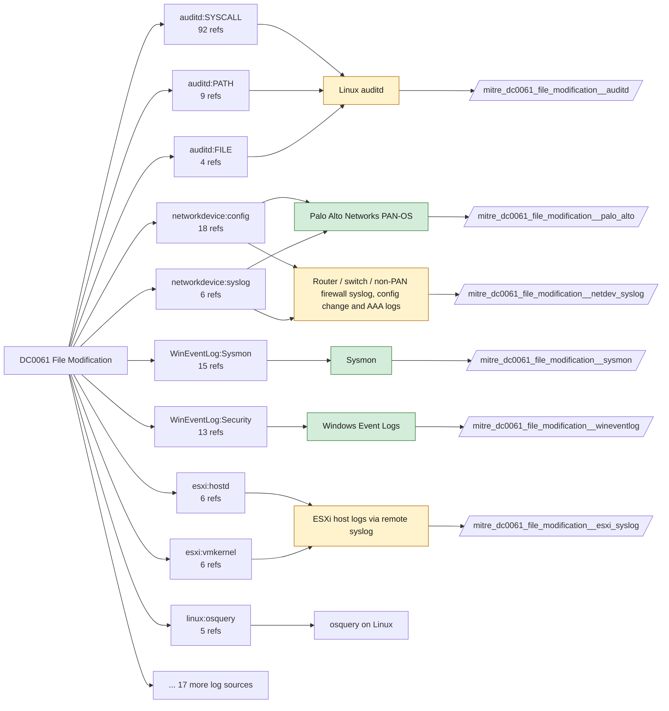

# DC0061 File Modification

[ATT&CK](https://attack.mitre.org/datacomponents/DC0061) · version 3.0 · modified 2026-10-13 · ATT&CK release 20.1

Status: **Live** · umbrella eventtype `mitre_dc0061_file_modification`

> Changes made to a file, including updates to its contents, metadata, access permissions, or attributes. These modifications may indicate legitimate activity (e.g., software updates) or unauthorized changes (e.g., tampering, ransomware, or adversarial modifications). Examples:   - Content Modifications: Changes to the content of a configuration file, such as modifying `/etc/ssh/sshd_config` on Linux or `C:\Windows\System32\drivers\etc\hosts` on Windows. - Permission Changes: Altering file permissions to allow broader access, such as changing a file from `644` to `777` on Linux or modifying NTFS permissions on Windows. - Attribute Modifications: Changing a file's attributes to hidden, read-only, or system on Windows. - Timestamp Manipulation: Adjusting a file's creation or modification timestamp using tools like `touch` in Linux or timestomping tools on Windows. - Software or System File Changes: Modifying system files such as `boot.ini`, kernel modules, or application binaries.

## Why this component matters

Configuration tampering, log wiping, timestomping, firewall rule files on Linux/ESXi, and PAN-OS config edits. Sysmon EID 2 only sees timestamp changes; Solidcore FILE_MODIFIED and Windows 4663 with SACLs are the real sources on Windows, auditd watches on Linux, shell/hostd logs on ESXi.

ATT&CK v20.1 has **179 analytics** across **116 detection strategies** that read this component, covering **116 techniques**. Tactics most dependent on it: persistence (70), privilege-escalation (49), stealth (42), impact (24).

Analytic references by platform: macOS 62, Linux 61, Windows 26, Network Devices 12, ESXi 11, Office Suite 3, Containers 3, IaaS 1

## Where it comes from



## Requirements

Component specific:

- Windows has no native content-modification event; rely on Solidcore Change Control or SACLs (4663 WriteData) on the paths you care about.
- ESXi: hostd and shell logs record datastore and config file changes only when ESXi Shell/SSH auditing is enabled.

Per feed (from `config/stack.yml` and `config/log_sources.yml`):

| Feed | Status | Sourcetype or source | Constraint | Origin | TA / collector |
|---|---|---|---|---|---|
| `palo_alto` | live | sourcetype=`pan:config` | `(whole feed)` | defaults | Splunk Add-on for Palo Alto Networks (pan:*) |
| `solidcore` | live | sourcetype=`mcafee:epo` | `(threat_name IN (FILE_MODIFIED, FILE_ATTR_MODIFIED, FILE_RENAMED, WRITE_DENIED, OWNERSHIP_DENIED) OR event_description IN (FILE_MODIFIED, FILE_ATTR_MODIFIED, FILE_RENAMED, WRITE_DENIED, OWNERSHIP_DENIED)) (product_name="Solidcore*")` | defaults | Arrives through the ePO TA; Solidcore events carry event names such as FILE_CREATED, FILE_MODIFIED, FILE_DELETED, EXECUTION_DENIED, REG_VALUE_MODIFIED, PROCESS_HIJACK_ATTEMPTED. Verify field names (threat_name / event_description) in your data. |
| `sysmon` | live | source=`XmlWinEventLog:Microsoft-Windows-Sysmon/Operational` | `EventCode IN (2, 11, 15)` | defaults | Splunk Add-on for Sysmon (needs Splunk_TA_windows for XML parsing) |
| `wineventlog` | live | source=`XmlWinEventLog:Security` | `EventCode IN (4663, 4670)` | defaults | Splunk Add-on for Microsoft Windows (Splunk_TA_windows), XML rendering (renderXml = true) |
| `auditd` | ready (tick in stack.yml) | sourcetype=`linux:audit` | `type IN (PATH, SYSCALL) (syscall IN (chmod, chown, fchmod, fchmodat, fchown, ftruncate, pwrite, rename, renameat, setxattr, truncate, write) OR SYSCALL IN (chmod, chown, fchmod, fchmodat, fchown, ftruncate, pwrite, rename, renameat, setxattr, truncate, write))` | defaults | Splunk Add-on for Unix and Linux (linux:audit) or auditd -> auditbeat/syslog |
| `ebpf` | ready (tick in stack.yml) | sourcetype=`falco` | `(whole feed)` | derived | Vendor specific (falco JSON, tetragon) |
| `esxi_syslog` | ready (tick in stack.yml) | sourcetype=`vmware:esxlog:hostd`, sourcetype=`vmware:esxlog:shell`, sourcetype=`vmware:esxlog:vmkernel` | `(whole feed)` | defaults | Splunk Add-on for VMware ESXi Logs (vmware:esxlog:<log>) |
| `linux_syslog` | ready (tick in stack.yml) | sourcetype=`linux_messages_syslog`, sourcetype=`linux_secure`, sourcetype=`syslog` | `(process=fwupd)` | derived | Splunk Add-on for Unix and Linux (syslog, linux_secure, linux_messages_syslog) |
| `netdev_syslog` | ready (tick in stack.yml) | sourcetype=`cisco:asa`, sourcetype=`cisco:ios`, sourcetype=`syslog` | `(whole feed)` | derived | Cisco Networks Add-on (cisco:ios, cisco:asa), Juniper/Arista TAs, or generic syslog |

Collection prerequisites:

- **palo_alto**: Log forwarding profiles attached to every security rule (traffic start+end, threat, url, wildfire, data).
- **palo_alto**: System and Config logs forwarded from each firewall / Panorama; GlobalProtect logs enabled.
- **palo_alto**: URL filtering and Threat Prevention licensed for pan:threat subtypes url/vulnerability/virus/spyware.
- **palo_alto**: Operational (show/debug) commands are not in config or system logs by default. Enable administrator activity audit tracking (Device > Setup > Management > Logging and Reporting, PAN-OS 10.1+) and forward the audit log if you want CLI discovery analytics for the firewall.
- **solidcore**: Change Control file and registry monitoring rules scoped to the paths/keys of interest; Application Control in Enabled (not Observe) mode for EXECUTION_DENIED.
- **sysmon**: Sysmon deployed with a maintained modular configuration (e.g. sysmon-modular or SwiftOnSecurity). Event IDs referenced by a data component only exist if the config includes that rule group (ProcessAccess=10, ImageLoad=7, DNS=22, FileDelete=23/26, ClipboardChange=24, ProcessTampering=25, FileBlock=27/28 are off in minimal configs).
- **sysmon**: Hashes configured (SHA256 at least, IMPHASH useful) for File/Process metadata components.
- **wineventlog**: Advanced Audit Policy configured (at minimum Process Creation, Logon, Account Management, Object Access, Policy Change, Privilege Use, Detailed Tracking). Without the matching subcategory the EventCodes below never fire.
- **wineventlog**: Include command line in process creation events enabled for 4688 (Computer Configuration > Administrative Templates > System > Audit Process Creation).
- **wineventlog**: PowerShell Script Block Logging (4104) and Module Logging (4103) enabled via GPO for the PowerShell/Operational channel.
- **wineventlog**: Object access events (4656/4663/4657/4660/4670) require SACLs on the files/keys of interest.
- **wineventlog**: Non-default channels (TaskScheduler, WMI-Activity, CodeIntegrity, Defender, Firewall, WinRM, SMBClient/Server...) must be listed as inputs in Splunk_TA_windows inputs.conf; several are disabled by default in Windows.
- **auditd**: audit rules for execve, connect, open/openat on sensitive paths, ptrace, module load, mount, setuid; a Neo23x0/auditd baseline or Florian Roth's rule set is a reasonable start.
- **auditd**: log_format = ENRICHED in auditd.conf so syscall names and uids resolve (otherwise syscall numbers are architecture dependent).
- **esxi_syslog**: Syslog.global.logHost set on every host; ESXi Shell/SSH audit enabled; consider Syslog.global.auditRecord (ESXi 8).
- **netdev_syslog**: Enable config-change archive logging and AAA command accounting; forward at informational level.

Review notes: `solidcore` has 2 ATT&CK reference(s) with no usable event filter (prose channel), constraint origin is *defaults*; `wineventlog` has 2 ATT&CK reference(s) with no usable event filter (prose channel), constraint origin is *defaults*; `ebpf` has 3 ATT&CK reference(s) with no usable event filter (prose channel), constraint origin is *derived*; `linux_syslog` has 3 ATT&CK reference(s) with no usable event filter (prose channel), constraint origin is *derived*; `netdev_syslog` has 31 ATT&CK reference(s) with no usable event filter (prose channel), constraint origin is *derived*.

## Splunk

Eventtypes (literal constraints, see `dist/splunk/TA-mitre-attack-datacomponents/default/eventtypes.conf`):

```ini
[mitre_dc0061_file_modification__palo_alto]
search = index=pan_logs sourcetype="pan:config"

[mitre_dc0061_file_modification__solidcore]
search = index=epo sourcetype="mcafee:epo" (threat_name IN (FILE_MODIFIED, FILE_ATTR_MODIFIED, FILE_RENAMED, WRITE_DENIED, OWNERSHIP_DENIED) OR event_description IN (FILE_MODIFIED, FILE_ATTR_MODIFIED, FILE_RENAMED, WRITE_DENIED, OWNERSHIP_DENIED)) (product_name="Solidcore*")

[mitre_dc0061_file_modification__sysmon]
search = index=sysmon source="XmlWinEventLog:Microsoft-Windows-Sysmon/Operational" EventCode IN (2, 11, 15)

[mitre_dc0061_file_modification__wineventlog]
search = index=wineventlog source="XmlWinEventLog:Security" EventCode IN (4663, 4670)

[mitre_dc0061_file_modification__auditd]
search = index=linux sourcetype="linux:audit" type IN (PATH, SYSCALL) (syscall IN (chmod, chown, fchmod, fchmodat, fchown, ftruncate, pwrite, rename, renameat, setxattr, truncate, write) OR SYSCALL IN (chmod, chown, fchmod, fchmodat, fchown, ftruncate, pwrite, rename, renameat, setxattr, truncate, write))
disabled = 1

[mitre_dc0061_file_modification__ebpf]
search = index=linux sourcetype=falco
disabled = 1

[mitre_dc0061_file_modification__esxi_syslog]
search = index=vmware sourcetype IN ("vmware:esxlog:hostd", "vmware:esxlog:shell", "vmware:esxlog:vmkernel")
disabled = 1

[mitre_dc0061_file_modification__linux_syslog]
search = index=linux sourcetype IN (linux_messages_syslog, linux_secure, syslog) (process=fwupd)
disabled = 1

[mitre_dc0061_file_modification__netdev_syslog]
search = index=netops sourcetype IN ("cisco:asa", "cisco:ios", syslog)
disabled = 1

[mitre_dc0061_file_modification]
search = eventtype=mitre_dc0061_file_modification__palo_alto OR eventtype=mitre_dc0061_file_modification__solidcore OR eventtype=mitre_dc0061_file_modification__sysmon OR eventtype=mitre_dc0061_file_modification__wineventlog OR eventtype=mitre_dc0061_file_modification__auditd OR eventtype=mitre_dc0061_file_modification__ebpf OR eventtype=mitre_dc0061_file_modification__esxi_syslog OR eventtype=mitre_dc0061_file_modification__linux_syslog OR eventtype=mitre_dc0061_file_modification__netdev_syslog
```

Macros for analytics: `` `mitre_dc0061` `` (umbrella), `` `mitre_dc0061_palo_alto` ``, `` `mitre_dc0061_solidcore` ``, `` `mitre_dc0061_sysmon` ``, `` `mitre_dc0061_wineventlog` ``, `` `mitre_dc0061_auditd` ``, `` `mitre_dc0061_ebpf` ``, `` `mitre_dc0061_esxi_syslog` ``, `` `mitre_dc0061_linux_syslog` ``, `` `mitre_dc0061_netdev_syslog` ``, `` `mitre_dc0061_filter` `` (site exclusions).
CIM: `Endpoint.Filesystem` via `` `mitre_dc0061_dm` `` / `` `mitre_dc0061_dm_where` `` for `tstats`. CIM tags emitted for: `sysmon`.

## Sigma

Generic logsource categories scoped by this component in `dist/sigma/pipelines/splunk_mitre_dc.yml`: product `windows`: `file_event`, `file_change`, `file_rename`; product `linux`: `file_event`.

## Dependents

Top techniques detected through this component (of 116):

| Technique | Name | Tactics | Analytics using this DC |
|---|---|---|---|
| [T1053](https://attack.mitre.org/techniques/T1053) | Scheduled Task/Job | execution, persistence, privilege-escalation | 4 |
| [T1098.004](https://attack.mitre.org/techniques/T1098/004) | SSH Authorized Keys | persistence, privilege-escalation | 4 |
| [T1486](https://attack.mitre.org/techniques/T1486) | Data Encrypted for Impact | impact | 4 |
| [T1491](https://attack.mitre.org/techniques/T1491) | Defacement | impact | 4 |
| [T1491.001](https://attack.mitre.org/techniques/T1491/001) | Internal Defacement | impact | 4 |
| [T1554](https://attack.mitre.org/techniques/T1554) | Compromise Host Software Binary | persistence | 4 |
| [T1037](https://attack.mitre.org/techniques/T1037) | Boot or Logon Initialization Scripts | persistence, privilege-escalation | 3 |
| [T1053.003](https://attack.mitre.org/techniques/T1053/003) | Cron | execution, persistence, privilege-escalation | 3 |
| [T1080](https://attack.mitre.org/techniques/T1080) | Taint Shared Content | lateral-movement | 3 |
| [T1491.002](https://attack.mitre.org/techniques/T1491/002) | External Defacement | impact | 3 |
| [T1543](https://attack.mitre.org/techniques/T1543) | Create or Modify System Process | persistence, privilege-escalation | 3 |
| [T1564.005](https://attack.mitre.org/techniques/T1564/005) | Hidden File System | stealth | 3 |
| [T1565](https://attack.mitre.org/techniques/T1565) | Data Manipulation | impact | 3 |
| [T1565.001](https://attack.mitre.org/techniques/T1565/001) | Stored Data Manipulation | impact | 3 |
| [T1014](https://attack.mitre.org/techniques/T1014) | Rootkit | stealth | 2 |
| … | 101 more | | |

Full list: `lookups/mitre_attack_analytics.csv` filtered on `dc_ids` containing `DC0061`.
