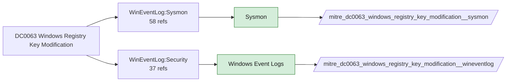

# DC0063 Windows Registry Key Modification

[ATT&CK](https://attack.mitre.org/datacomponents/DC0063) · version 2.0 · modified 2026-10-13 · ATT&CK release 20.1

Status: **Live** · umbrella eventtype `mitre_dc0063_windows_registry_key_modification`

> Changes made to an existing registry key or its values. These modifications can include altering permissions, modifying stored data, or updating configuration settings.  *Data Collection Measures:*  - Windows Event Logs     - Event ID 4657 - Registry Value Modified: Logs changes to registry values, including modifications to startup entries, security settings, or system configurations. - Sysmon (System Monitor) for Windows     - Sysmon Event ID 13 - Registry Value Set: Captures changes to specific registry values.     - Sysmon Event ID 14 - Registry Key & Value Renamed: Logs renaming of registry keys, which may indicate evasion attempts. - Endpoint Detection and Response (EDR) Solutions     - Monitor registry modifications for suspicious behavior.

## Why this component matters

The most-used registry component: 89 analytics for persistence, defense evasion (Defender/UAC/LSA settings) and credential access. Sysmon EID 13/14 carry the value written; 4657 needs SACLs; Solidcore REG_VALUE_MODIFIED covers protected keys.

ATT&CK v20.1 has **89 analytics** across **86 detection strategies** that read this component, covering **86 techniques**. Tactics most dependent on it: persistence (35), privilege-escalation (26), stealth (20), defense-impairment (15).

Analytic references by platform: Windows 87, macOS 1, Office Suite 1

## Where it comes from



## Requirements

Component specific:

- Sysmon EID 13 includes Details (the written value) which is what most analytics match on; make sure the config does not exclude it.

Per feed (from `config/stack.yml` and `config/log_sources.yml`):

| Feed | Status | Sourcetype or source | Constraint | Origin | TA / collector |
|---|---|---|---|---|---|
| `solidcore` | live | sourcetype=`mcafee:epo:syslog` | `(threat_name IN (REG_VALUE_MODIFIED, REG_KEY_MODIFIED) OR event_description IN (REG_VALUE_MODIFIED, REG_KEY_MODIFIED)) (product_name="Solidcore*")` | defaults | Arrives through the ePO TA; Solidcore events carry event names such as FILE_CREATED, FILE_MODIFIED, FILE_DELETED, EXECUTION_DENIED, REG_VALUE_MODIFIED, PROCESS_HIJACK_ATTEMPTED. Verify field names (threat_name / event_description) in your data. |
| `sysmon` | live | source=`XmlWinEventLog:Microsoft-Windows-Sysmon/Operational` | `EventCode IN (13, 14)` | defaults | Splunk Add-on for Sysmon (needs Splunk_TA_windows for XML parsing) |
| `wineventlog` | live | source=`XmlWinEventLog:Security` | `EventCode IN (4657, 4663, 4670)` | defaults | Splunk Add-on for Microsoft Windows (Splunk_TA_windows), XML rendering (renderXml = true) |

Collection prerequisites:

- **solidcore**: Change Control file and registry monitoring rules scoped to the paths/keys of interest; Application Control in Enabled (not Observe) mode for EXECUTION_DENIED.
- **sysmon**: Sysmon deployed with a maintained modular configuration (e.g. sysmon-modular or SwiftOnSecurity). Event IDs referenced by a data component only exist if the config includes that rule group (ProcessAccess=10, ImageLoad=7, DNS=22, FileDelete=23/26, ClipboardChange=24, ProcessTampering=25, FileBlock=27/28 are off in minimal configs).
- **sysmon**: Hashes configured (SHA256 at least, IMPHASH useful) for File/Process metadata components.
- **wineventlog**: Advanced Audit Policy configured (at minimum Process Creation, Logon, Account Management, Object Access, Policy Change, Privilege Use, Detailed Tracking). Without the matching subcategory the EventCodes below never fire.
- **wineventlog**: Include command line in process creation events enabled for 4688 (Computer Configuration > Administrative Templates > System > Audit Process Creation).
- **wineventlog**: PowerShell Script Block Logging (4104) and Module Logging (4103) enabled via GPO for the PowerShell/Operational channel.
- **wineventlog**: Object access events (4656/4663/4657/4660/4670) require SACLs on the files/keys of interest.
- **wineventlog**: Non-default channels (TaskScheduler, WMI-Activity, CodeIntegrity, Defender, Firewall, WinRM, SMBClient/Server...) must be listed as inputs in Splunk_TA_windows inputs.conf; several are disabled by default in Windows.

## Splunk

Eventtypes (literal constraints, see `dist/splunk/TA-mitre-attack-datacomponents/default/eventtypes.conf`):

```ini
[mitre_dc0063_windows_registry_key_modification__solidcore]
search = index=epo sourcetype="mcafee:epo:syslog" (threat_name IN (REG_VALUE_MODIFIED, REG_KEY_MODIFIED) OR event_description IN (REG_VALUE_MODIFIED, REG_KEY_MODIFIED)) (product_name="Solidcore*")

[mitre_dc0063_windows_registry_key_modification__sysmon]
search = index=sysmon source="XmlWinEventLog:Microsoft-Windows-Sysmon/Operational" EventCode IN (13, 14)

[mitre_dc0063_windows_registry_key_modification__wineventlog]
search = index=wineventlog source="XmlWinEventLog:Security" EventCode IN (4657, 4663, 4670)

[mitre_dc0063_windows_registry_key_modification]
search = eventtype=mitre_dc0063_windows_registry_key_modification__solidcore OR eventtype=mitre_dc0063_windows_registry_key_modification__sysmon OR eventtype=mitre_dc0063_windows_registry_key_modification__wineventlog
```

Macros for analytics: `` `mitre_dc0063` `` (umbrella), `` `mitre_dc0063_solidcore` ``, `` `mitre_dc0063_sysmon` ``, `` `mitre_dc0063_wineventlog` ``, `` `mitre_dc0063_filter` `` (site exclusions).
CIM: `Endpoint.Registry` via `` `mitre_dc0063_dm` `` / `` `mitre_dc0063_dm_where` `` for `tstats`. CIM tags emitted for: `sysmon`.

## Sigma

Generic logsource categories scoped by this component in `dist/sigma/pipelines/splunk_mitre_dc.yml`: product `windows`: `registry_event`, `registry_set`.

## Dependents

Top techniques detected through this component (of 86):

| Technique | Name | Tactics | Analytics using this DC |
|---|---|---|---|
| [T1553.006](https://attack.mitre.org/techniques/T1553/006) | Code Signing Policy Modification | defense-impairment | 4 |
| [T1003.001](https://attack.mitre.org/techniques/T1003/001) | LSASS Memory | credential-access | 3 |
| [T1003.002](https://attack.mitre.org/techniques/T1003/002) | Security Account Manager | credential-access | 3 |
| [T1012](https://attack.mitre.org/techniques/T1012) | Query Registry | discovery | 3 |
| [T1027.011](https://attack.mitre.org/techniques/T1027/011) | Fileless Storage | stealth | 3 |
| [T1037](https://attack.mitre.org/techniques/T1037) | Boot or Logon Initialization Scripts | persistence, privilege-escalation | 3 |
| [T1053.005](https://attack.mitre.org/techniques/T1053/005) | Scheduled Task | execution, persistence, privilege-escalation | 3 |
| [T1056.001](https://attack.mitre.org/techniques/T1056/001) | Keylogging | collection, credential-access | 3 |
| [T1070](https://attack.mitre.org/techniques/T1070) | Indicator Removal | stealth | 3 |
| [T1070.007](https://attack.mitre.org/techniques/T1070/007) | Clear Network Connection History and Configurations | stealth | 3 |
| [T1070.009](https://attack.mitre.org/techniques/T1070/009) | Clear Persistence | stealth | 3 |
| [T1082](https://attack.mitre.org/techniques/T1082) | System Information Discovery | discovery | 3 |
| [T1111](https://attack.mitre.org/techniques/T1111) | Multi-Factor Authentication Interception | credential-access | 3 |
| [T1112](https://attack.mitre.org/techniques/T1112) | Modify Registry | defense-impairment, persistence | 3 |
| [T1137](https://attack.mitre.org/techniques/T1137) | Office Application Startup | persistence | 3 |
| … | 71 more | | |

Full list: `lookups/mitre_attack_analytics.csv` filtered on `dc_ids` containing `DC0063`.
