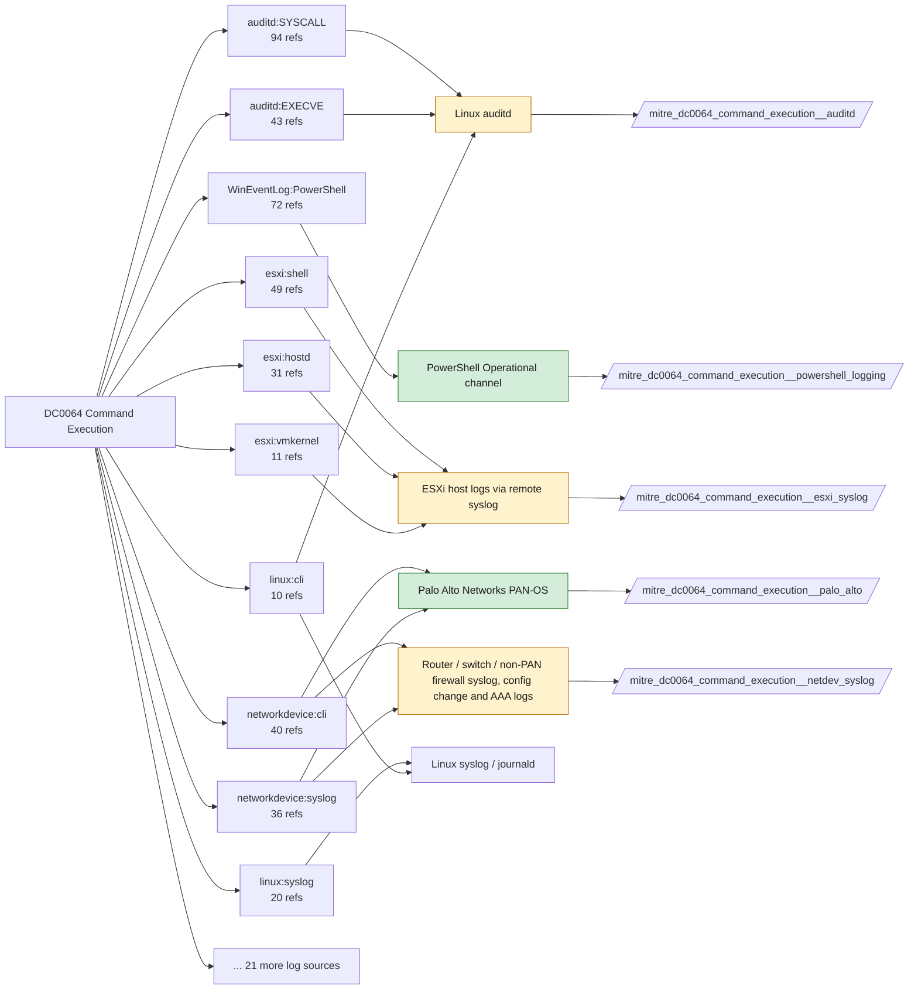

# DC0064 Command Execution

[ATT&CK](https://attack.mitre.org/datacomponents/DC0064) · version 2.2 · modified 2026-10-13 · ATT&CK release 20.1

Status: **Live** · umbrella eventtype `mitre_dc0064_command_execution`

> Command Execution involves monitoring and capturing the execution of textual commands (including shell commands, cmdlets, and scripts) within an operating system or application. These commands may include arguments or parameters and are typically executed through interpreters such as `cmd.exe`, `bash`, `zsh`, `PowerShell`, or programmatic execution. Examples:   - Windows Command Prompt     - dir – Lists directory contents.     - net user – Queries or manipulates user accounts.     - tasklist – Lists running processes. - PowerShell     - Get-Process – Retrieves processes running on a system.     - Set-ExecutionPolicy – Changes PowerShell script execution policies.     - Invoke-WebRequest – Downloads remote resources. - Linux Shell     - ls – Lists files in a directory.     - cat /etc/passwd – Reads the user accounts file.     - curl http://malicious-site.com – Retrieves content from a malicious URL. - Container Environments     - docker exec – Executes a command inside a running container.     - kubectl exec – Runs commands in Kubernetes pods. - macOS Terminal     - open – Opens files or URLs.     - dscl . -list /Users – Lists all users on the system.     - osascript -e – Executes AppleScript commands.

## Why this component matters

Separates the command line from the process record: analytics here look at arguments, encoded payloads, interpreter switches and the operator's shell on devices and hypervisors. For Windows it is served by Sysmon EID 1 and 4688 plus PowerShell 4103/4104; for PAN-OS and ESXi it is the config/system and shell logs; Linux needs auditd EXECVE records, which carry the full argv.

ATT&CK v20.1 has **339 analytics** across **211 detection strategies** that read this component, covering **211 techniques**. Tactics most dependent on it: discovery (75), stealth (72), persistence (47), defense-impairment (31).

Analytic references by platform: Linux 84, macOS 74, Windows 62, ESXi 49, Network Devices 40, Office Suite 12, IaaS 7, Containers 6, SaaS 3, Identity Provider 2

## Where it comes from



## Requirements

Component specific:

- PowerShell Script Block Logging (4104) and Module Logging (4103) via GPO; add the PowerShell/Operational channel as an input.
- auditd EXECVE records require the execve rule; argv is split across a0..aN unless ENRICHED or the TA reassembles it.
- PAN-OS config logs need config-log forwarding enabled per device group or Panorama.

Per feed (from `config/stack.yml` and `config/log_sources.yml`):

| Feed | Status | Sourcetype or source | Constraint | Origin | TA / collector |
|---|---|---|---|---|---|
| `palo_alto` | live | sourcetype=`pan:config`, sourcetype=`pan:system` | `(whole feed)` | defaults | Splunk Add-on for Palo Alto Networks (pan:*) |
| `powershell_logging` | live | source=`XmlWinEventLog:Microsoft-Windows-PowerShell/Operational` | `EventCode IN (4103, 4104)` | defaults | Splunk Add-on for Microsoft Windows |
| `sysmon` | live | source=`XmlWinEventLog:Microsoft-Windows-Sysmon/Operational` | `EventCode IN (1)` | defaults | Splunk Add-on for Sysmon (needs Splunk_TA_windows for XML parsing) |
| `trellix_epo` | live | sourcetype=`mcafee:epo:syslog` | `(threat_type="AMSI*" OR threat_name="AMSI*")` | defaults | Splunk Add-on for McAfee ePO Syslog (sourcetype mcafee:epo:syslog, documented by Splunk). If ePO data arrives another way (DB Connect pull, a community Trellix REST add-on such as trellix_epo:threat_events), change the sourcetype here. |
| `wineventlog` | live | source=`XmlWinEventLog:Security` | `EventCode IN (4688)` | defaults | Splunk Add-on for Microsoft Windows (Splunk_TA_windows), XML rendering (renderXml = true) |
| `auditd` | ready (tick in stack.yml) | sourcetype=`linux:audit` | `type IN (EXECVE, PROCTITLE, SYSCALL) (syscall IN (execve, execveat) OR SYSCALL IN (execve, execveat))` | defaults | Splunk Add-on for Unix and Linux (linux:audit) or auditd -> auditbeat/syslog |
| `container_runtime` | ready (tick in stack.yml) | sourcetype=`docker:daemon`, sourcetype=`docker:events` | `(status IN (exec_create, exec_start))` | defaults | docker events scripted input or OpenTelemetry (docker:events, containerd) |
| `ebpf` | ready (tick in stack.yml) | sourcetype=`falco` | `(whole feed)` | derived | Vendor specific (falco JSON, tetragon) |
| `edr_telemetry` | ready (tick in stack.yml) | sourcetype=`edr:telemetry` | `(whole feed)` | derived | Vendor specific |
| `esxi_syslog` | ready (tick in stack.yml) | sourcetype=`vmware:esxlog:shell` | `(whole feed)` | defaults | Splunk Add-on for VMware ESXi Logs (vmware:esxlog:<log>) |
| `kubernetes_audit` | ready (tick in stack.yml) | sourcetype=`kube:apiserver-audit` | `(objectRef.subresource=exec OR objectRef.subresource=attach)` | defaults | Splunk OpenTelemetry Collector for Kubernetes / Splunk Connect for Kubernetes |
| `netdev_syslog` | ready (tick in stack.yml) | sourcetype=`cisco:asa`, sourcetype=`cisco:ios`, sourcetype=`syslog` | `(whole feed)` | derived | Cisco Networks Add-on (cisco:ios, cisco:asa), Juniper/Arista TAs, or generic syslog |
| `vcenter` | ready (tick in stack.yml) | sourcetype=`vmware:vclog:vpxd` | `(whole feed)` | derived | Splunk Add-on for VMware (vmware:vclog:vpxd) |

Collection prerequisites:

- **palo_alto**: Log forwarding profiles attached to every security rule (traffic start+end, threat, url, wildfire, data).
- **palo_alto**: System and Config logs forwarded from each firewall / Panorama; GlobalProtect logs enabled.
- **palo_alto**: URL filtering and Threat Prevention licensed for pan:threat subtypes url/vulnerability/virus/spyware.
- **palo_alto**: Operational (show/debug) commands are not in config or system logs by default. Enable administrator activity audit tracking (Device > Setup > Management > Logging and Reporting, PAN-OS 10.1+) and forward the audit log if you want CLI discovery analytics for the firewall.
- **powershell_logging**: Turn on Script Block Logging and Module Logging GPO; consider Transcription to a protected share.
- **powershell_logging**: Add Microsoft-Windows-PowerShell/Operational as a WinEventLog input (renderXml=true).
- **sysmon**: Sysmon deployed with a maintained modular configuration (e.g. sysmon-modular or SwiftOnSecurity). Event IDs referenced by a data component only exist if the config includes that rule group (ProcessAccess=10, ImageLoad=7, DNS=22, FileDelete=23/26, ClipboardChange=24, ProcessTampering=25, FileBlock=27/28 are off in minimal configs).
- **sysmon**: Hashes configured (SHA256 at least, IMPHASH useful) for File/Process metadata components.
- **trellix_epo**: ePO configured to forward threat events to Splunk (syslog or DB pull); confirm product_name/threat_type fields populate.
- **trellix_epo**: ENS AMSI and Exploit Prevention enabled if AMSI-type analytics are expected.
- **wineventlog**: Advanced Audit Policy configured (at minimum Process Creation, Logon, Account Management, Object Access, Policy Change, Privilege Use, Detailed Tracking). Without the matching subcategory the EventCodes below never fire.
- **wineventlog**: Include command line in process creation events enabled for 4688 (Computer Configuration > Administrative Templates > System > Audit Process Creation).
- **wineventlog**: PowerShell Script Block Logging (4104) and Module Logging (4103) enabled via GPO for the PowerShell/Operational channel.
- **wineventlog**: Object access events (4656/4663/4657/4660/4670) require SACLs on the files/keys of interest.
- **wineventlog**: Non-default channels (TaskScheduler, WMI-Activity, CodeIntegrity, Defender, Firewall, WinRM, SMBClient/Server...) must be listed as inputs in Splunk_TA_windows inputs.conf; several are disabled by default in Windows.
- **auditd**: audit rules for execve, connect, open/openat on sensitive paths, ptrace, module load, mount, setuid; a Neo23x0/auditd baseline or Florian Roth's rule set is a reasonable start.
- **auditd**: log_format = ENRICHED in auditd.conf so syscall names and uids resolve (otherwise syscall numbers are architecture dependent).
- **esxi_syslog**: Syslog.global.logHost set on every host; ESXi Shell/SSH audit enabled; consider Syslog.global.auditRecord (ESXi 8).
- **kubernetes_audit**: Audit policy at Metadata level minimum
- **kubernetes_audit**: RequestResponse for secrets/pods/exec; ship the audit log file from control-plane nodes.
- **netdev_syslog**: Enable config-change archive logging and AAA command accounting; forward at informational level.

Review notes: `wineventlog` has 6 ATT&CK reference(s) with no usable event filter (prose channel), constraint origin is *defaults*; `container_runtime` has 6 ATT&CK reference(s) with no usable event filter (prose channel), constraint origin is *defaults*; `ebpf` has 2 ATT&CK reference(s) with no usable event filter (prose channel), constraint origin is *derived*; `edr_telemetry` has 4 ATT&CK reference(s) with no usable event filter (prose channel), constraint origin is *derived*; `kubernetes_audit` has 4 ATT&CK reference(s) with no usable event filter (prose channel), constraint origin is *defaults*; `netdev_syslog` has 81 ATT&CK reference(s) with no usable event filter (prose channel), constraint origin is *derived*; `vcenter` has 3 ATT&CK reference(s) with no usable event filter (prose channel), constraint origin is *derived*.

## Splunk

Eventtypes (literal constraints, see `dist/splunk/TA-mitre-attack-datacomponents/default/eventtypes.conf`):

```ini
[mitre_dc0064_command_execution__palo_alto]
search = index=pan_logs sourcetype IN ("pan:config", "pan:system")

[mitre_dc0064_command_execution__powershell_logging]
search = index=wineventlog source="XmlWinEventLog:Microsoft-Windows-PowerShell/Operational" EventCode IN (4103, 4104)

[mitre_dc0064_command_execution__sysmon]
search = index=sysmon source="XmlWinEventLog:Microsoft-Windows-Sysmon/Operational" EventCode IN (1)

[mitre_dc0064_command_execution__trellix_epo]
search = index=epo sourcetype="mcafee:epo:syslog" (threat_type="AMSI*" OR threat_name="AMSI*")

[mitre_dc0064_command_execution__wineventlog]
search = index=wineventlog source="XmlWinEventLog:Security" EventCode IN (4688)

[mitre_dc0064_command_execution__auditd]
search = index=linux sourcetype="linux:audit" type IN (EXECVE, PROCTITLE, SYSCALL) (syscall IN (execve, execveat) OR SYSCALL IN (execve, execveat))
disabled = 1

[mitre_dc0064_command_execution__container_runtime]
search = index=k8s sourcetype IN ("docker:daemon", "docker:events") (status IN (exec_create, exec_start))
disabled = 1

[mitre_dc0064_command_execution__ebpf]
search = index=linux sourcetype=falco
disabled = 1

[mitre_dc0064_command_execution__edr_telemetry]
search = index=edr sourcetype="edr:telemetry"
disabled = 1

[mitre_dc0064_command_execution__esxi_syslog]
search = index=vmware sourcetype="vmware:esxlog:shell"
disabled = 1

[mitre_dc0064_command_execution__kubernetes_audit]
search = index=k8s sourcetype="kube:apiserver-audit" (objectRef.subresource=exec OR objectRef.subresource=attach)
disabled = 1

[mitre_dc0064_command_execution__netdev_syslog]
search = index=netops sourcetype IN ("cisco:asa", "cisco:ios", syslog)
disabled = 1

[mitre_dc0064_command_execution__vcenter]
search = index=vmware sourcetype="vmware:vclog:vpxd"
disabled = 1

[mitre_dc0064_command_execution]
search = eventtype=mitre_dc0064_command_execution__palo_alto OR eventtype=mitre_dc0064_command_execution__powershell_logging OR eventtype=mitre_dc0064_command_execution__sysmon OR eventtype=mitre_dc0064_command_execution__trellix_epo OR eventtype=mitre_dc0064_command_execution__wineventlog OR eventtype=mitre_dc0064_command_execution__auditd OR eventtype=mitre_dc0064_command_execution__container_runtime OR eventtype=mitre_dc0064_command_execution__ebpf OR eventtype=mitre_dc0064_command_execution__edr_telemetry OR eventtype=mitre_dc0064_command_execution__esxi_syslog OR eventtype=mitre_dc0064_command_execution__kubernetes_audit OR eventtype=mitre_dc0064_command_execution__netdev_syslog OR eventtype=mitre_dc0064_command_execution__vcenter
```

Macros for analytics: `` `mitre_dc0064` `` (umbrella), `` `mitre_dc0064_palo_alto` ``, `` `mitre_dc0064_powershell_logging` ``, `` `mitre_dc0064_sysmon` ``, `` `mitre_dc0064_trellix_epo` ``, `` `mitre_dc0064_wineventlog` ``, `` `mitre_dc0064_auditd` ``, `` `mitre_dc0064_container_runtime` ``, `` `mitre_dc0064_ebpf` ``, `` `mitre_dc0064_edr_telemetry` ``, `` `mitre_dc0064_esxi_syslog` ``, `` `mitre_dc0064_kubernetes_audit` ``, `` `mitre_dc0064_netdev_syslog` ``, `` `mitre_dc0064_vcenter` ``, `` `mitre_dc0064_filter` `` (site exclusions).
CIM: `Endpoint.Processes` via `` `mitre_dc0064_dm` `` / `` `mitre_dc0064_dm_where` `` for `tstats`. CIM tags emitted for: `sysmon`, `wineventlog`, `auditd`.

## Sigma

No generic Sigma category maps to this component; rules use `product`/`service` logsources, which the pipeline maps to index and sourcetype.

## Dependents

Top techniques detected through this component (of 211):

| Technique | Name | Tactics | Analytics using this DC |
|---|---|---|---|
| [T1518](https://attack.mitre.org/techniques/T1518) | Software Discovery | discovery | 11 |
| [T1690](https://attack.mitre.org/techniques/T1690) | Prevent Command History Logging | defense-impairment | 11 |
| [T1049](https://attack.mitre.org/techniques/T1049) | System Network Connections Discovery | discovery | 10 |
| [T1082](https://attack.mitre.org/techniques/T1082) | System Information Discovery | discovery | 10 |
| [T1201](https://attack.mitre.org/techniques/T1201) | Password Policy Discovery | discovery | 10 |
| [T1552.001](https://attack.mitre.org/techniques/T1552/001) | Credentials In Files | credential-access | 10 |
| [T1654](https://attack.mitre.org/techniques/T1654) | Log Enumeration | discovery | 10 |
| [T1016](https://attack.mitre.org/techniques/T1016) | System Network Configuration Discovery | discovery | 9 |
| [T1033](https://attack.mitre.org/techniques/T1033) | System Owner/User Discovery | discovery | 9 |
| [T1040](https://attack.mitre.org/techniques/T1040) | Network Sniffing | credential-access, discovery | 9 |
| [T1059.004](https://attack.mitre.org/techniques/T1059/004) | Unix Shell | execution | 9 |
| [T1070.007](https://attack.mitre.org/techniques/T1070/007) | Clear Network Connection History and Configurations | stealth | 9 |
| [T1070.008](https://attack.mitre.org/techniques/T1070/008) | Clear Mailbox Data | stealth | 9 |
| [T1087.002](https://attack.mitre.org/techniques/T1087/002) | Domain Account | discovery | 9 |
| [T1114.003](https://attack.mitre.org/techniques/T1114/003) | Email Forwarding Rule | collection | 9 |
| … | 196 more | | |

Full list: `lookups/mitre_attack_analytics.csv` filtered on `dc_ids` containing `DC0064`.
