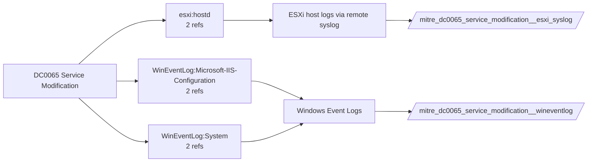

# DC0065 Service Modification

[ATT&CK](https://attack.mitre.org/datacomponents/DC0065) · version 2.1 · modified 2026-05-12 · ATT&CK release 20.1

Umbrella eventtype `mitre_dc0065_service_modification` over 2 feed(s)

> Changes made to an existing service or daemon, such as modifying the service name, start type, execution parameters, or security configurations.

## Why this component matters

Changing a service's binary path, start type or account (7040, 4657 on the Services key) to hijack or disable it, and IIS module changes.

ATT&CK v20.1 has **3 analytics** across **3 detection strategies** that read this component, covering **3 techniques**. Tactics most dependent on it: persistence (1), defense-impairment (1), stealth (1), execution (1).

Analytic references by platform: Windows 2, ESXi 1

## Where it comes from



## Requirements

Per feed (from `config/stack.yml` and `config/log_sources.yml`):

| Feed | Schedule | Sourcetype or source | Constraint | Origin | TA / collector |
|---|---|---|---|---|---|
| `esxi_syslog` | scheduled | sourcetype=`vmware:esxlog:hostd` | `(whole feed)` | defaults | Splunk Add-on for VMware ESXi Logs (vmware:esxlog:<log>) |
| `wineventlog` | scheduled | source=`XmlWinEventLog:Security`, source=`XmlWinEventLog:System` | `EventCode IN (4657, 7036, 7040)` | defaults | Splunk Add-on for Microsoft Windows (Splunk_TA_windows), XML rendering (renderXml = true) |

Collection prerequisites:

- **esxi_syslog**: Syslog.global.logHost set on every host; ESXi Shell/SSH audit enabled; consider Syslog.global.auditRecord (ESXi 8).
- **wineventlog**: Advanced Audit Policy configured (at minimum Process Creation, Logon, Account Management, Object Access, Policy Change, Privilege Use, Detailed Tracking). Without the matching subcategory the EventCodes below never fire.
- **wineventlog**: Include command line in process creation events enabled for 4688 (Computer Configuration > Administrative Templates > System > Audit Process Creation).
- **wineventlog**: PowerShell Script Block Logging (4104) and Module Logging (4103) enabled via GPO for the PowerShell/Operational channel.
- **wineventlog**: Object access events (4656/4663/4657/4660/4670) require SACLs on the files/keys of interest.
- **wineventlog**: Non-default channels (TaskScheduler, WMI-Activity, CodeIntegrity, Defender, Firewall, WinRM, SMBClient/Server...) must be listed as inputs in Splunk_TA_windows inputs.conf; several are disabled by default in Windows.

Review notes: `wineventlog` has 2 ATT&CK reference(s) with no usable event filter (prose channel), constraint origin is *defaults*.

## Splunk

Eventtypes (literal constraints, see `dist/splunk/TA-mitre-attack-datacomponents/default/eventtypes.conf`):

```ini
[mitre_dc0065_service_modification__esxi_syslog]
search = index=vmware sourcetype="vmware:esxlog:hostd"

[mitre_dc0065_service_modification__wineventlog]
search = index=wineventlog source IN ("XmlWinEventLog:Security", "XmlWinEventLog:System") EventCode IN (4657, 7036, 7040)

[mitre_dc0065_service_modification]
search = eventtype=mitre_dc0065_service_modification__esxi_syslog OR eventtype=mitre_dc0065_service_modification__wineventlog
```

Macros for analytics: `` `mitre_dc0065` `` (umbrella), `` `mitre_dc0065_esxi_syslog` ``, `` `mitre_dc0065_wineventlog` ``, `` `mitre_dc0065_filter` `` (site exclusions).
CIM: `Endpoint.Services` via `` `mitre_dc0065_dm` `` / `` `mitre_dc0065_dm_where` `` for `tstats`. CIM tags emitted for: `wineventlog`.

## Sigma

No generic Sigma category maps to this component; rules use `product`/`service` logsources, which the pipeline maps to index and sourcetype.

## Dependents

Top techniques detected through this component (of 3):

| Technique | Name | Tactics | Analytics using this DC |
|---|---|---|---|
| [T1505.004](https://attack.mitre.org/techniques/T1505/004) | IIS Components | persistence | 1 |
| [T1574.011](https://attack.mitre.org/techniques/T1574/011) | Services Registry Permissions Weakness | stealth, execution | 1 |
| [T1685](https://attack.mitre.org/techniques/T1685) | Disable or Modify Tools | defense-impairment | 1 |

Full list: `lookups/mitre_attack_analytics.csv` filtered on `dc_ids` containing `DC0065`.
