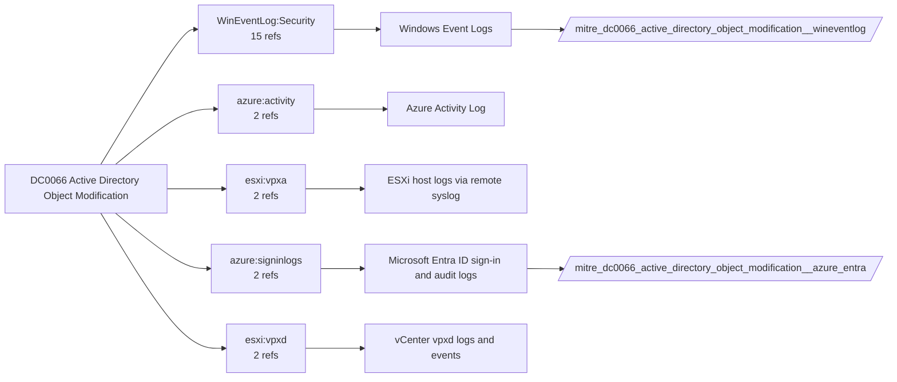

# DC0066 Active Directory Object Modification

[ATT&CK](https://attack.mitre.org/datacomponents/DC0066) · version 2.0 · modified 2025-11-12 · ATT&CK release 20.1

Umbrella eventtype `mitre_dc0066_active_directory_object_modification` over 2 feed(s)

> Changes to AD objects (e.g., users, groups, OUs) are logged as Event ID 5136 (Object Modification) or 5163 (Attribute Changes). Examples:  - User Account: Modifying attributes (e.g., group membership, enabling/disabling accounts). - Group Membership: Adding/removing members. - OU: Changing properties/permissions (e.g., delegation). - Service Account: Modifying SPNs or other attributes. - Object Attributes: Changes to passwords, logon hours, or control flags.

## Why this component matters

Directory service changes (5136/5137/5141), domain trust changes (4739), SID history and ACL edits; Entra audit logs for the cloud directory.

ATT&CK v20.1 has **18 analytics** across **17 detection strategies** that read this component, covering **17 techniques**. Tactics most dependent on it: defense-impairment (11), privilege-escalation (8), persistence (7), credential-access (5).

Analytic references by platform: Windows 12, ESXi 2, Identity Provider 2, Office Suite 1, SaaS 1

## Where it comes from



## Requirements

Component specific:

- Audit Directory Service Changes on domain controllers, with SACLs on the objects (the default AdminSDHolder-protected set is a good start).

Per feed (from `config/stack.yml` and `config/log_sources.yml`):

| Feed | Schedule | Sourcetype or source | Constraint | Origin | TA / collector |
|---|---|---|---|---|---|
| `azure_entra` | scheduled | sourcetype=`azure:aad:audit` | `(whole feed)` | defaults | Splunk Add-on for Microsoft Azure (azure:aad:signin, azure:aad:audit) or Microsoft Cloud Services add-on via Event Hub |
| `wineventlog` | scheduled | source=`XmlWinEventLog:Security` | `EventCode IN (4662, 4739, 5136, 5137, 5139, 5141, 5163)` | defaults | Splunk Add-on for Microsoft Windows (Splunk_TA_windows), XML rendering (renderXml = true) |

Collection prerequisites:

- **azure_entra**: Diagnostic settings on the tenant streaming SignInLogs
- **azure_entra**: AuditLogs
- **azure_entra**: NonInteractiveUserSignInLogs
- **azure_entra**: ServicePrincipalSignInLogs to an Event Hub or direct Graph pull.
- **wineventlog**: Advanced Audit Policy configured (at minimum Process Creation, Logon, Account Management, Object Access, Policy Change, Privilege Use, Detailed Tracking). Without the matching subcategory the EventCodes below never fire.
- **wineventlog**: Include command line in process creation events enabled for 4688 (Computer Configuration > Administrative Templates > System > Audit Process Creation).
- **wineventlog**: PowerShell Script Block Logging (4104) and Module Logging (4103) enabled via GPO for the PowerShell/Operational channel.
- **wineventlog**: Object access events (4656/4663/4657/4660/4670) require SACLs on the files/keys of interest.
- **wineventlog**: Non-default channels (TaskScheduler, WMI-Activity, CodeIntegrity, Defender, Firewall, WinRM, SMBClient/Server...) must be listed as inputs in Splunk_TA_windows inputs.conf; several are disabled by default in Windows.

Review notes: `azure_entra` has 2 ATT&CK reference(s) with no usable event filter (prose channel), constraint origin is *defaults*.

## Splunk

Eventtypes (literal constraints, see `dist/splunk/TA-mitre-attack-datacomponents/default/eventtypes.conf`):

```ini
[mitre_dc0066_active_directory_object_modification__azure_entra]
search = index=azure sourcetype="azure:aad:audit"

[mitre_dc0066_active_directory_object_modification__wineventlog]
search = index=wineventlog source="XmlWinEventLog:Security" EventCode IN (4662, 4739, 5136, 5137, 5139, 5141, 5163)

[mitre_dc0066_active_directory_object_modification]
search = eventtype=mitre_dc0066_active_directory_object_modification__azure_entra OR eventtype=mitre_dc0066_active_directory_object_modification__wineventlog
```

Macros for analytics: `` `mitre_dc0066` `` (umbrella), `` `mitre_dc0066_azure_entra` ``, `` `mitre_dc0066_wineventlog` ``, `` `mitre_dc0066_filter` `` (site exclusions).
CIM: `Change.All_Changes` via `` `mitre_dc0066_dm` `` / `` `mitre_dc0066_dm_where` `` for `tstats`. CIM tags emitted for: `wineventlog`.

## Sigma

No generic Sigma category maps to this component; rules use `product`/`service` logsources, which the pipeline maps to index and sourcetype.

## Dependents

Top techniques detected through this component (of 17):

| Technique | Name | Tactics | Analytics using this DC |
|---|---|---|---|
| [T1222](https://attack.mitre.org/techniques/T1222) | File and Directory Permissions Modification | defense-impairment | 2 |
| [T1098](https://attack.mitre.org/techniques/T1098) | Account Manipulation | persistence, privilege-escalation | 1 |
| [T1098.001](https://attack.mitre.org/techniques/T1098/001) | Additional Cloud Credentials | persistence, privilege-escalation | 1 |
| [T1134](https://attack.mitre.org/techniques/T1134) | Access Token Manipulation | stealth, privilege-escalation | 1 |
| [T1134.002](https://attack.mitre.org/techniques/T1134/002) | Create Process with Token | stealth, privilege-escalation | 1 |
| [T1134.005](https://attack.mitre.org/techniques/T1134/005) | SID-History Injection | stealth, privilege-escalation | 1 |
| [T1207](https://attack.mitre.org/techniques/T1207) | Rogue Domain Controller | defense-impairment | 1 |
| [T1222.001](https://attack.mitre.org/techniques/T1222/001) | Windows Permissions | defense-impairment | 1 |
| [T1484](https://attack.mitre.org/techniques/T1484) | Domain or Tenant Policy Modification | defense-impairment, privilege-escalation | 1 |
| [T1484.001](https://attack.mitre.org/techniques/T1484/001) | Group Policy Modification | defense-impairment, privilege-escalation | 1 |
| [T1484.002](https://attack.mitre.org/techniques/T1484/002) | Trust Modification | defense-impairment, privilege-escalation | 1 |
| [T1556.005](https://attack.mitre.org/techniques/T1556/005) | Reversible Encryption | defense-impairment, persistence, credential-access | 1 |
| [T1556.006](https://attack.mitre.org/techniques/T1556/006) | Multi-Factor Authentication | defense-impairment, persistence, credential-access | 1 |
| [T1556.007](https://attack.mitre.org/techniques/T1556/007) | Hybrid Identity | defense-impairment, persistence, credential-access | 1 |
| [T1556.009](https://attack.mitre.org/techniques/T1556/009) | Conditional Access Policies | defense-impairment, persistence, credential-access | 1 |
| … | 2 more | | |

Full list: `lookups/mitre_attack_analytics.csv` filtered on `dc_ids` containing `DC0066`.
