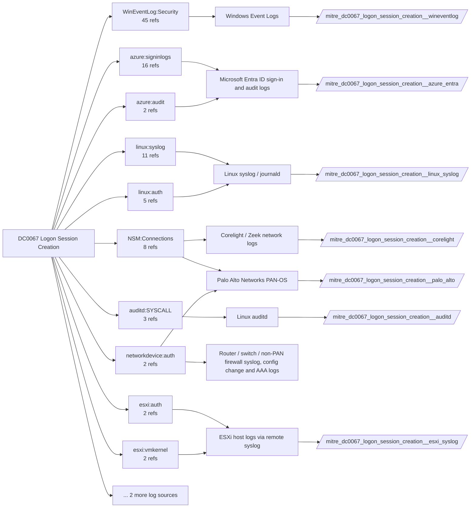

# DC0067 Logon Session Creation

[ATT&CK](https://attack.mitre.org/datacomponents/DC0067) · version 2.1 · modified 2026-10-13 · ATT&CK release 20.1

Umbrella eventtype `mitre_dc0067_logon_session_creation` over 7 feed(s)

> The successful establishment of a new user session following a successful authentication attempt. This typically signifies that a user has provided valid credentials or authentication tokens, and the system has initiated a session associated with that user account. This data is crucial for tracking authentication events and identifying potential unauthorized access. Examples:   - Windows Systems     - Event ID: 4624         - Logon Type: 2 (Interactive) or 10 (Remote Interactive via RDP).         - Account Name: JohnDoe         - Source Network Address: 192.168.1.100         - Authentication Package: NTLM - Linux Systems     - /var/log/utmp or /var/log/wtmp:         - Log format: login user [tty] from [source_ip]         - User: jane         - IP: 10.0.0.5         - Timestamp: 2024-12-28 08:30:00 - macOS Systems     - /var/log/asl.log or unified logging framework:         - Log: com.apple.securityd: Authentication succeeded for user 'admin' - Cloud Environments     - Azure Sign-In Logs:         - Activity: Sign-in successful         - Client App: Browser         - Location: Unknown (Country: X) - Google Workspace     - Activity: Login         - Event Type: successful_login         - Source IP: 203.0.113.55

## Why this component matters

4624/4625/4648 are the foundation of lateral movement, brute force and pass-the-hash detection; GlobalProtect logs cover VPN logons, Corelight kerberos/ntlm/ssh/rdp see them on the wire, Entra sign-in logs cover cloud.

ATT&CK v20.1 has **97 analytics** across **58 detection strategies** that read this component, covering **58 techniques**. Tactics most dependent on it: lateral-movement (30), credential-access (23), initial-access (13), persistence (12).

Analytic references by platform: Windows 36, IaaS 11, SaaS 10, Office Suite 10, Linux 10, macOS 9, Identity Provider 7, ESXi 2, Network Devices 1, Containers 1

## Where it comes from



## Requirements

Component specific:

- Audit Logon/Logoff subcategories (Logon, Logoff, Special Logon, Other Logon/Logoff Events) enabled on every host, not only domain controllers.
- Linux: linux_secure (sshd, sudo, pam) via the Unix TA; auditd USER_LOGIN records.

Per feed (from `config/stack.yml` and `config/log_sources.yml`):

| Feed | Schedule | Sourcetype or source | Constraint | Origin | TA / collector |
|---|---|---|---|---|---|
| `auditd` | scheduled | sourcetype=`linux:audit` | `type IN (USER_AUTH, USER_LOGIN, USER_START)` | defaults | Splunk Add-on for Unix and Linux (linux:audit) or auditd -> auditbeat/syslog |
| `azure_entra` | scheduled | sourcetype=`azure:aad:signin` | `(whole feed)` | defaults | Splunk Add-on for Microsoft Azure (azure:aad:signin, azure:aad:audit) or Microsoft Cloud Services add-on via Event Hub |
| `corelight` | scheduled | sourcetype=`corelight_kerberos`, sourcetype=`corelight_ntlm`, sourcetype=`corelight_rdp`, sourcetype=`corelight_ssh` | `(whole feed)` | defaults | Corelight App for Splunk (corelight_<log>). For TA_zeek use prefix zeek: and suffix :json. |
| `esxi_syslog` | scheduled | sourcetype=`vmware:esxlog:auth`, sourcetype=`vmware:esxlog:hostd` | `(whole feed)` | defaults | Splunk Add-on for VMware ESXi Logs (vmware:esxlog:<log>) |
| `linux_syslog` | scheduled | sourcetype=`linux_secure` | `(whole feed)` | defaults | Splunk Add-on for Unix and Linux (syslog, linux_secure, linux_messages_syslog) |
| `palo_alto` | scheduled | sourcetype=`pan:globalprotect`, sourcetype=`pan:system` | `(whole feed)` | defaults | Splunk Add-on for Palo Alto Networks (pan:*) |
| `wineventlog` | scheduled | source=`XmlWinEventLog:Security` | `EventCode IN (4624, 4625, 4648, 4778)` | defaults | Splunk Add-on for Microsoft Windows (Splunk_TA_windows), XML rendering (renderXml = true) |

Collection prerequisites:

- **auditd**: audit rules for execve, connect, open/openat on sensitive paths, ptrace, module load, mount, setuid; a Neo23x0/auditd baseline or Florian Roth's rule set is a reasonable start.
- **auditd**: log_format = ENRICHED in auditd.conf so syscall names and uids resolve (otherwise syscall numbers are architecture dependent).
- **azure_entra**: Diagnostic settings on the tenant streaming SignInLogs
- **azure_entra**: AuditLogs
- **azure_entra**: NonInteractiveUserSignInLogs
- **azure_entra**: ServicePrincipalSignInLogs to an Event Hub or direct Graph pull.
- **corelight**: Sensor placement covering east-west (DC, server VLANs) and north-south; without internal taps the lateral-movement components are blind.
- **corelight**: Enable the log set above; files/pe/smb_* and ldap/kerberos/ntlm are what distinguish Corelight from flow data.
- **esxi_syslog**: Syslog.global.logHost set on every host; ESXi Shell/SSH audit enabled; consider Syslog.global.auditRecord (ESXi 8).
- **palo_alto**: Log forwarding profiles attached to every security rule (traffic start+end, threat, url, wildfire, data).
- **palo_alto**: System and Config logs forwarded from each firewall / Panorama; GlobalProtect logs enabled.
- **palo_alto**: URL filtering and Threat Prevention licensed for pan:threat subtypes url/vulnerability/virus/spyware.
- **palo_alto**: Operational (show/debug) commands are not in config or system logs by default. Enable administrator activity audit tracking (Device > Setup > Management > Logging and Reporting, PAN-OS 10.1+) and forward the audit log if you want CLI discovery analytics for the firewall.
- **wineventlog**: Advanced Audit Policy configured (at minimum Process Creation, Logon, Account Management, Object Access, Policy Change, Privilege Use, Detailed Tracking). Without the matching subcategory the EventCodes below never fire.
- **wineventlog**: Include command line in process creation events enabled for 4688 (Computer Configuration > Administrative Templates > System > Audit Process Creation).
- **wineventlog**: PowerShell Script Block Logging (4104) and Module Logging (4103) enabled via GPO for the PowerShell/Operational channel.
- **wineventlog**: Object access events (4656/4663/4657/4660/4670) require SACLs on the files/keys of interest.
- **wineventlog**: Non-default channels (TaskScheduler, WMI-Activity, CodeIntegrity, Defender, Firewall, WinRM, SMBClient/Server...) must be listed as inputs in Splunk_TA_windows inputs.conf; several are disabled by default in Windows.

Review notes: `azure_entra` has 18 ATT&CK reference(s) with no usable event filter (prose channel), constraint origin is *defaults*; `corelight` has 8 ATT&CK reference(s) with no usable event filter (prose channel), constraint origin is *defaults*; `linux_syslog` has 16 ATT&CK reference(s) with no usable event filter (prose channel), constraint origin is *defaults*.

## Splunk

Eventtypes (literal constraints, see `dist/splunk/TA-mitre-attack-datacomponents/default/eventtypes.conf`):

```ini
[mitre_dc0067_logon_session_creation__auditd]
search = index=linux sourcetype="linux:audit" type IN (USER_AUTH, USER_LOGIN, USER_START)

[mitre_dc0067_logon_session_creation__azure_entra]
search = index=azure sourcetype="azure:aad:signin"

[mitre_dc0067_logon_session_creation__corelight]
search = index=corelight sourcetype IN (corelight_kerberos, corelight_ntlm, corelight_rdp, corelight_ssh)

[mitre_dc0067_logon_session_creation__esxi_syslog]
search = index=vmware sourcetype IN ("vmware:esxlog:auth", "vmware:esxlog:hostd")

[mitre_dc0067_logon_session_creation__linux_syslog]
search = index=linux sourcetype=linux_secure

[mitre_dc0067_logon_session_creation__palo_alto]
search = index=pan_logs sourcetype IN ("pan:globalprotect", "pan:system")

[mitre_dc0067_logon_session_creation__wineventlog]
search = index=wineventlog source="XmlWinEventLog:Security" EventCode IN (4624, 4625, 4648, 4778)

[mitre_dc0067_logon_session_creation]
search = eventtype=mitre_dc0067_logon_session_creation__auditd OR eventtype=mitre_dc0067_logon_session_creation__azure_entra OR eventtype=mitre_dc0067_logon_session_creation__corelight OR eventtype=mitre_dc0067_logon_session_creation__esxi_syslog OR eventtype=mitre_dc0067_logon_session_creation__linux_syslog OR eventtype=mitre_dc0067_logon_session_creation__palo_alto OR eventtype=mitre_dc0067_logon_session_creation__wineventlog
```

Macros for analytics: `` `mitre_dc0067` `` (umbrella), `` `mitre_dc0067_auditd` ``, `` `mitre_dc0067_azure_entra` ``, `` `mitre_dc0067_corelight` ``, `` `mitre_dc0067_esxi_syslog` ``, `` `mitre_dc0067_linux_syslog` ``, `` `mitre_dc0067_palo_alto` ``, `` `mitre_dc0067_wineventlog` ``, `` `mitre_dc0067_filter` `` (site exclusions).
CIM: `Authentication.Authentication` via `` `mitre_dc0067_dm` `` / `` `mitre_dc0067_dm_where` `` for `tstats`. CIM tags emitted for: `azure_entra`, `linux_syslog`, `palo_alto`, `wineventlog`.

## Sigma

No generic Sigma category maps to this component; rules use `product`/`service` logsources, which the pipeline maps to index and sourcetype.

## Dependents

Top techniques detected through this component (of 58):

| Technique | Name | Tactics | Analytics using this DC |
|---|---|---|---|
| [T1199](https://attack.mitre.org/techniques/T1199) | Trusted Relationship | initial-access | 6 |
| [T1021](https://attack.mitre.org/techniques/T1021) | Remote Services | lateral-movement | 5 |
| [T1021.007](https://attack.mitre.org/techniques/T1021/007) | Cloud Services | lateral-movement | 4 |
| [T1538](https://attack.mitre.org/techniques/T1538) | Cloud Service Dashboard | discovery | 4 |
| [T1552.001](https://attack.mitre.org/techniques/T1552/001) | Credentials In Files | credential-access | 4 |
| [T1606](https://attack.mitre.org/techniques/T1606) | Forge Web Credentials | credential-access | 4 |
| [T1526](https://attack.mitre.org/techniques/T1526) | Cloud Service Discovery | discovery | 3 |
| [T1563](https://attack.mitre.org/techniques/T1563) | Remote Service Session Hijacking | lateral-movement | 3 |
| [T1606.001](https://attack.mitre.org/techniques/T1606/001) | Web Cookies | credential-access | 3 |
| [T1606.002](https://attack.mitre.org/techniques/T1606/002) | SAML Tokens | credential-access | 3 |
| [T1021.005](https://attack.mitre.org/techniques/T1021/005) | VNC | lateral-movement | 2 |
| [T1059.004](https://attack.mitre.org/techniques/T1059/004) | Unix Shell | execution | 2 |
| [T1114.002](https://attack.mitre.org/techniques/T1114/002) | Remote Email Collection | collection | 2 |
| [T1189](https://attack.mitre.org/techniques/T1189) | Drive-by Compromise | initial-access | 2 |
| [T1213.005](https://attack.mitre.org/techniques/T1213/005) | Messaging Applications | collection | 2 |
| … | 43 more | | |

Full list: `lookups/mitre_attack_analytics.csv` filtered on `dc_ids` containing `DC0067`.
