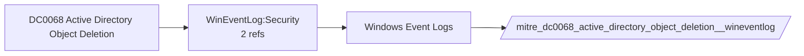

# DC0068 Active Directory Object Deletion

[ATT&CK](https://attack.mitre.org/datacomponents/DC0068) · version 2.0 · modified 2025-11-12 · ATT&CK release 20.1

Umbrella eventtype `mitre_dc0068_active_directory_object_deletion` over 1 feed(s)

> Object deletion in AD (e.g., user accounts, groups, OUs) is logged as Event ID 5141. Examples:  - User Account: Deleted user. - Group: Deleted security/distribution group. - Organizational Unit (OU): Loss of configurations or policies. - Service Account: Disrupted operations or cover tracks. - Trust Object: Removed domain trust, disrupting connectivity.  *Data Collection Measures:*  - Audit Policy:     - Enable "Audit Directory Service Changes" (Success and Failure).     - Path: `Computer Configuration > Policies > Windows Settings > Security Settings > Advanced Audit Policy Configuration > Audit Policies > Directory Service Changes`.     - Key Event: Event ID 5141. - Log Forwarding: Use WEF to centralize logs for SIEM tools (e.g., Splunk). - Enable EDR Monitoring:     - Detect processes or users that initiate unauthorized object deletions.     - Monitor tools and scripts that may delete key directory objects.

## Why this component matters

Object deletions (5141) and replication partner removals (4929).

ATT&CK v20.1 has **1 analytics** across **1 detection strategies** that read this component, covering **1 techniques**. Tactics most dependent on it: credential-access (1).

Analytic references by platform: Windows 1

## Where it comes from



## Requirements

Per feed (from `config/stack.yml` and `config/log_sources.yml`):

| Feed | Schedule | Sourcetype or source | Constraint | Origin | TA / collector |
|---|---|---|---|---|---|
| `wineventlog` | scheduled | source=`XmlWinEventLog:Security` | `EventCode IN (4929, 5141)` | defaults | Splunk Add-on for Microsoft Windows (Splunk_TA_windows), XML rendering (renderXml = true) |

Collection prerequisites:

- **wineventlog**: Advanced Audit Policy configured (at minimum Process Creation, Logon, Account Management, Object Access, Policy Change, Privilege Use, Detailed Tracking). Without the matching subcategory the EventCodes below never fire.
- **wineventlog**: Include command line in process creation events enabled for 4688 (Computer Configuration > Administrative Templates > System > Audit Process Creation).
- **wineventlog**: PowerShell Script Block Logging (4104) and Module Logging (4103) enabled via GPO for the PowerShell/Operational channel.
- **wineventlog**: Object access events (4656/4663/4657/4660/4670) require SACLs on the files/keys of interest.
- **wineventlog**: Non-default channels (TaskScheduler, WMI-Activity, CodeIntegrity, Defender, Firewall, WinRM, SMBClient/Server...) must be listed as inputs in Splunk_TA_windows inputs.conf; several are disabled by default in Windows.

## Splunk

Eventtypes (literal constraints, see `dist/splunk/TA-mitre-attack-datacomponents/default/eventtypes.conf`):

```ini
[mitre_dc0068_active_directory_object_deletion__wineventlog]
search = index=wineventlog source="XmlWinEventLog:Security" EventCode IN (4929, 5141)

[mitre_dc0068_active_directory_object_deletion]
search = eventtype=mitre_dc0068_active_directory_object_deletion__wineventlog
```

Macros for analytics: `` `mitre_dc0068` `` (umbrella), `` `mitre_dc0068_wineventlog` ``, `` `mitre_dc0068_filter` `` (site exclusions).
CIM: `Change.All_Changes` via `` `mitre_dc0068_dm` `` / `` `mitre_dc0068_dm_where` `` for `tstats`. CIM tags emitted for: `wineventlog`.

## Sigma

No generic Sigma category maps to this component; rules use `product`/`service` logsources, which the pipeline maps to index and sourcetype.

## Dependents

Top techniques detected through this component (of 1):

| Technique | Name | Tactics | Analytics using this DC |
|---|---|---|---|
| [T1003.006](https://attack.mitre.org/techniques/T1003/006) | DCSync | credential-access | 1 |

Full list: `lookups/mitre_attack_analytics.csv` filtered on `dc_ids` containing `DC0068`.
