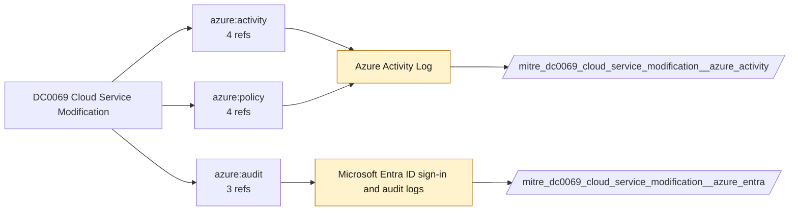

# DC0069 Cloud Service Modification

[ATT&CK](https://attack.mitre.org/datacomponents/DC0069) · version 2.0 · modified 2025-11-12 · ATT&CK release 20.1

Status: **Ready** (needs a feed you have not ticked) · umbrella eventtype `mitre_dc0069_cloud_service_modification`

> Cloud service modification refers to changes made to the configuration, settings, or data of a cloud service. These modifications can include administrative changes such as enabling or disabling features, altering permissions, or deleting critical components. Monitoring these changes is critical to detect potential misconfigurations or malicious activity. Examples:   - AWS Cloud Service Modifications: A user disables AWS CloudTrail logging (StopLogging) or deletes a CloudWatch configuration rule (DeleteConfigRule). - Azure Cloud Service Modifications: Changes to Azure Role-Based Access Control (RBAC) roles, such as adding a new Contributor role to a sensitive resource. - Google Cloud Service Modifications: Deletion of a Google Cloud Storage bucket or disabling a Google Cloud Function. - Office 365 Cloud Service Modifications: Altering mailbox permissions or disabling auditing in Microsoft 365.

## Why this component matters

Azure Activity Log control-plane writes and Entra audit changes (conditional access, app registrations, role assignments).

ATT&CK v20.1 has **24 analytics** across **18 detection strategies** that read this component, covering **18 techniques**. Tactics most dependent on it: defense-impairment (10), persistence (9), credential-access (7), execution (5).

Analytic references by platform: IaaS 13, SaaS 7, Office Suite 2, Identity Provider 2

## Where it comes from



## Requirements

Component specific:

- Activity Log export for every subscription; Entra AuditLogs diagnostic setting.

Per feed (from `config/stack.yml` and `config/log_sources.yml`):

| Feed | Status | Sourcetype or source | Constraint | Origin | TA / collector |
|---|---|---|---|---|---|
| `azure_activity` | ready (tick in stack.yml) | sourcetype=`mscs:azure:audit` | `(whole feed)` | defaults | Splunk Add-on for Microsoft Cloud Services (mscs:azure:audit) |
| `azure_entra` | ready (tick in stack.yml) | sourcetype=`azure:aad:audit` | `(whole feed)` | defaults | Splunk Add-on for Microsoft Azure (azure:aad:signin, azure:aad:audit) or Microsoft Cloud Services add-on via Event Hub |

Collection prerequisites:

- **azure_activity**: Export Activity Log for every subscription to the Event Hub.
- **azure_entra**: Diagnostic settings on the tenant streaming SignInLogs
- **azure_entra**: AuditLogs
- **azure_entra**: NonInteractiveUserSignInLogs
- **azure_entra**: ServicePrincipalSignInLogs to an Event Hub or direct Graph pull.

Review notes: `azure_activity` has 4 ATT&CK reference(s) with no usable event filter (prose channel), constraint origin is *defaults*; `azure_entra` has 3 ATT&CK reference(s) with no usable event filter (prose channel), constraint origin is *defaults*.

## Splunk

Eventtypes (literal constraints, see `dist/splunk/TA-mitre-attack-datacomponents/default/eventtypes.conf`):

```ini
[mitre_dc0069_cloud_service_modification__azure_activity]
search = index=azure sourcetype="mscs:azure:audit"
disabled = 1

[mitre_dc0069_cloud_service_modification__azure_entra]
search = index=azure sourcetype="azure:aad:audit"
disabled = 1

[mitre_dc0069_cloud_service_modification]
search = eventtype=mitre_dc0069_cloud_service_modification__azure_activity OR eventtype=mitre_dc0069_cloud_service_modification__azure_entra
```

Macros for analytics: `` `mitre_dc0069` `` (umbrella), `` `mitre_dc0069_azure_activity` ``, `` `mitre_dc0069_azure_entra` ``, `` `mitre_dc0069_filter` `` (site exclusions).
CIM: `Change.All_Changes` via `` `mitre_dc0069_dm` `` / `` `mitre_dc0069_dm_where` `` for `tstats`. CIM tags emitted for: `azure_activity`.

## Sigma

No generic Sigma category maps to this component; rules use `product`/`service` logsources, which the pipeline maps to index and sourcetype.

## Dependents

Top techniques detected through this component (of 18):

| Technique | Name | Tactics | Analytics using this DC |
|---|---|---|---|
| [T1648](https://attack.mitre.org/techniques/T1648) | Serverless Execution | execution | 3 |
| [T1546](https://attack.mitre.org/techniques/T1546) | Event Triggered Execution | privilege-escalation, persistence | 2 |
| [T1556](https://attack.mitre.org/techniques/T1556) | Modify Authentication Process | defense-impairment, persistence, credential-access | 2 |
| [T1671](https://attack.mitre.org/techniques/T1671) | Cloud Application Integration | persistence | 2 |
| [T1685.002](https://attack.mitre.org/techniques/T1685/002) | Disable or Modify Cloud Log | defense-impairment | 2 |
| [T1040](https://attack.mitre.org/techniques/T1040) | Network Sniffing | credential-access, discovery | 1 |
| [T1059.009](https://attack.mitre.org/techniques/T1059/009) | Cloud API | execution | 1 |
| [T1213](https://attack.mitre.org/techniques/T1213) | Data from Information Repositories | collection | 1 |
| [T1496](https://attack.mitre.org/techniques/T1496) | Resource Hijacking | impact | 1 |
| [T1496.004](https://attack.mitre.org/techniques/T1496/004) | Cloud Service Hijacking | impact | 1 |
| [T1528](https://attack.mitre.org/techniques/T1528) | Steal Application Access Token | credential-access | 1 |
| [T1556.006](https://attack.mitre.org/techniques/T1556/006) | Multi-Factor Authentication | defense-impairment, persistence, credential-access | 1 |
| [T1556.007](https://attack.mitre.org/techniques/T1556/007) | Hybrid Identity | defense-impairment, persistence, credential-access | 1 |
| [T1556.009](https://attack.mitre.org/techniques/T1556/009) | Conditional Access Policies | defense-impairment, persistence, credential-access | 1 |
| [T1578.005](https://attack.mitre.org/techniques/T1578/005) | Modify Cloud Compute Configurations | defense-impairment | 1 |
| … | 3 more | | |

Full list: `lookups/mitre_attack_analytics.csv` filtered on `dc_ids` containing `DC0069`.
