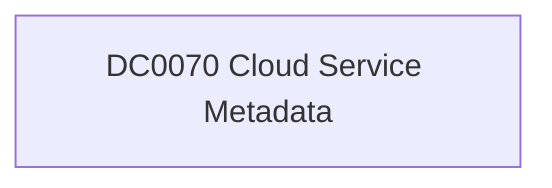

# DC0070 Cloud Service Metadata

[ATT&CK](https://attack.mitre.org/datacomponents/DC0070) · version 2.0 · modified 2025-11-12 · ATT&CK release 20.1

Status: **Out of scope** for the current platform set

> Cloud service metadata refers to the contextual and descriptive information about cloud services, including their name, type, purpose, configuration, and activity around them. This metadata is essential for understanding the roles and functions of cloud services, their operational status, and their potential misuse. Examples:   - Azure Service Metadata: Metadata describing a resource in Azure, such as an Azure Storage Account or a Virtual Machine. - AWS Cloud Service Metadata: Metadata for an AWS EC2 instance collected using the `DescribeInstances` API call. - Google Cloud Service Metadata: Metadata for a Google Compute Engine instance collected using `gcloud compute instances describe`. - Office 365 Metadata: Metadata about an Office 365 SharePoint site.

## Why this component matters

ATT&CK v20.1 has **10 analytics** across **9 detection strategies** that read this component, covering **9 techniques**. Tactics most dependent on it: collection (5), credential-access (2), execution (1), impact (1).

Analytic references by platform: IaaS 4, SaaS 2, Windows 2, Identity Provider 1, Office Suite 1

## Where it comes from

## Requirements

Per feed (from `config/stack.yml` and `config/log_sources.yml`):

| Feed | Status | Sourcetypes | Constraint | Origin | TA / collector |
|---|---|---|---|---|---|

## Splunk

No eventtypes rendered: none of this component's log sources belong to an in-scope platform feed. See [gaps](../gaps.md).

## Sigma

No generic Sigma category maps to this component; rules use `product`/`service` logsources, which the pipeline maps to index and sourcetype.

## Dependents

Top techniques detected through this component (of 9):

| Technique | Name | Tactics | Analytics using this DC |
|---|---|---|---|
| [T1114.003](https://attack.mitre.org/techniques/T1114/003) | Email Forwarding Rule | collection | 2 |
| [T1213.002](https://attack.mitre.org/techniques/T1213/002) | Sharepoint | collection | 1 |
| [T1213.003](https://attack.mitre.org/techniques/T1213/003) | Code Repositories | collection | 1 |
| [T1213.006](https://attack.mitre.org/techniques/T1213/006) | Databases | collection | 1 |
| [T1499.003](https://attack.mitre.org/techniques/T1499/003) | Application Exhaustion Flood | impact | 1 |
| [T1552](https://attack.mitre.org/techniques/T1552) | Unsecured Credentials | credential-access | 1 |
| [T1552.005](https://attack.mitre.org/techniques/T1552/005) | Cloud Instance Metadata API | credential-access | 1 |
| [T1578](https://attack.mitre.org/techniques/T1578) | Modify Cloud Compute Infrastructure | defense-impairment | 1 |
| [T1677](https://attack.mitre.org/techniques/T1677) | Poisoned Pipeline Execution | execution | 1 |

Full list: `lookups/mitre_attack_analytics.csv` filtered on `dc_ids` containing `DC0070`.
