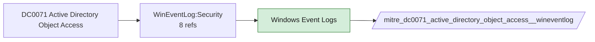

# DC0071 Active Directory Object Access

[ATT&CK](https://attack.mitre.org/datacomponents/DC0071) · version 2.0 · modified 2025-10-21 · ATT&CK release 20.1

Status: **Live** · umbrella eventtype `mitre_dc0071_active_directory_object_access`

> Object access refers to activities where AD objects (e.g., user accounts, groups, policies) are accessed or queried. Example: Windows Event ID 4661 logs object access attempts. Examples:  - Attribute Access: e.g., `userPassword`, `memberOf`, `securityDescriptor`. - Group Enumeration: Enumerating critical group members (e.g., Domain Admins). - User Attributes: Commonly accessed attributes like `samAccountName`, `lastLogonTimestamp`. - Policy Access: Accessing GPOs to understand security settings.  *Data Collection Measures:*  - Audit Policies:     - Enable "Audit Directory Service Access" under Advanced Audit Policies (Success and Failure).     - Path: `Computer Configuration > Policies > Windows Settings > Security Settings > Advanced Audit Policy Configuration > Audit Policies > Object AccessEnable: Audit Directory Service Access` (Success and Failure).     - Captured Events: IDs 4661, 4662. - Event Forwarding: Use WEF to centralize logs for SIEM analysis. - SIEM Integration: Collect and parse logs (e.g., 4661, 4662) using tools like Splunk or Azure Sentinel. - Log Filtering: - Focus on sensitive objects/attributes like:     - `Domain Admins` group.     - `userPassword`, `ntSecurityDescriptor`. - Enable EDR Monitoring:     - Detect processes accessing sensitive AD objects (e.g., samAccountName, securityDescriptor).     - Log all attempts to enumerate critical groups (e.g., "Domain Admins").

## Why this component matters

4661/4662 with SACLs catch DCSync (replication rights use) and LDAP reconnaissance against sensitive objects.

ATT&CK v20.1 has **6 analytics** across **6 detection strategies** that read this component, covering **6 techniques**. Tactics most dependent on it: discovery (3), credential-access (2), defense-impairment (1).

Analytic references by platform: Windows 6

## Where it comes from



## Requirements

Component specific:

- Audit Directory Service Access and SACLs for Replicating Directory Changes on the domain object.

Per feed (from `config/stack.yml` and `config/log_sources.yml`):

| Feed | Status | Sourcetype or source | Constraint | Origin | TA / collector |
|---|---|---|---|---|---|
| `wineventlog` | live | source=`XmlWinEventLog:Security` | `EventCode IN (4661, 4662)` | defaults | Splunk Add-on for Microsoft Windows (Splunk_TA_windows), XML rendering (renderXml = true) |

Collection prerequisites:

- **wineventlog**: Advanced Audit Policy configured (at minimum Process Creation, Logon, Account Management, Object Access, Policy Change, Privilege Use, Detailed Tracking). Without the matching subcategory the EventCodes below never fire.
- **wineventlog**: Include command line in process creation events enabled for 4688 (Computer Configuration > Administrative Templates > System > Audit Process Creation).
- **wineventlog**: PowerShell Script Block Logging (4104) and Module Logging (4103) enabled via GPO for the PowerShell/Operational channel.
- **wineventlog**: Object access events (4656/4663/4657/4660/4670) require SACLs on the files/keys of interest.
- **wineventlog**: Non-default channels (TaskScheduler, WMI-Activity, CodeIntegrity, Defender, Firewall, WinRM, SMBClient/Server...) must be listed as inputs in Splunk_TA_windows inputs.conf; several are disabled by default in Windows.

## Splunk

Eventtypes (literal constraints, see `dist/splunk/TA-mitre-attack-datacomponents/default/eventtypes.conf`):

```ini
[mitre_dc0071_active_directory_object_access__wineventlog]
search = index=wineventlog source="XmlWinEventLog:Security" EventCode IN (4661, 4662)

[mitre_dc0071_active_directory_object_access]
search = eventtype=mitre_dc0071_active_directory_object_access__wineventlog
```

Macros for analytics: `` `mitre_dc0071` `` (umbrella), `` `mitre_dc0071_wineventlog` ``, `` `mitre_dc0071_filter` `` (site exclusions).
CIM: `Change.All_Changes` via `` `mitre_dc0071_dm` `` / `` `mitre_dc0071_dm_where` `` for `tstats`. CIM tags emitted for: none (no feed is known CIM-compliant for this model).

## Sigma

No generic Sigma category maps to this component; rules use `product`/`service` logsources, which the pipeline maps to index and sourcetype.

## Dependents

Top techniques detected through this component (of 6):

| Technique | Name | Tactics | Analytics using this DC |
|---|---|---|---|
| [T1003](https://attack.mitre.org/techniques/T1003) | OS Credential Dumping | credential-access | 1 |
| [T1003.006](https://attack.mitre.org/techniques/T1003/006) | DCSync | credential-access | 1 |
| [T1201](https://attack.mitre.org/techniques/T1201) | Password Policy Discovery | discovery | 1 |
| [T1207](https://attack.mitre.org/techniques/T1207) | Rogue Domain Controller | defense-impairment | 1 |
| [T1482](https://attack.mitre.org/techniques/T1482) | Domain Trust Discovery | discovery | 1 |
| [T1615](https://attack.mitre.org/techniques/T1615) | Group Policy Discovery | discovery | 1 |

Full list: `lookups/mitre_attack_analytics.csv` filtered on `dc_ids` containing `DC0071`.
