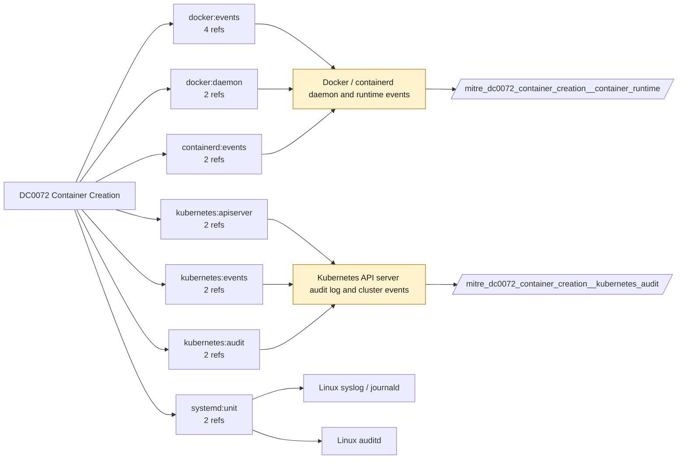

# DC0072 Container Creation

[ATT&CK](https://attack.mitre.org/datacomponents/DC0072) · version 2.0 · modified 2025-11-12 · ATT&CK release 20.1

Status: **Ready** (needs a feed you have not ticked) · umbrella eventtype `mitre_dc0072_container_creation`

> "Container Creation" data component captures details about the initial construction of a container in a containerized environment. This includes events where a new container is instantiated, such as through Docker, Kubernetes, or other container orchestration platforms. Monitoring these events helps detect unauthorized or potentially malicious container creation. Examples:  - Docker Example: `docker create my-container`, `docker run --name=my-container nginx:latest` - Kubernetes Example: `kubectl run my-pod --image=nginx`, `kubectl create deployment my-deployment --image=nginx` - Cloud Container Services Example     - AWS ECS: Task or service creation (`RunTask` or `CreateService`).     - Azure Container Instances: Deployment of a container group.     - Google Kubernetes Engine (GKE): Creation of new pods via GCP APIs.

## Why this component matters

Pod and container creation in Kubernetes audit (verb=create pods) and docker/containerd create events; privileged or host-mounted containers are the key analytic.

ATT&CK v20.1 has **8 analytics** across **8 detection strategies** that read this component, covering **8 techniques**. Tactics most dependent on it: execution (4), privilege-escalation (4), persistence (3), impact (1).

Analytic references by platform: Containers 7, Linux 1

## Where it comes from



## Requirements

Component specific:

- Kubernetes audit policy at RequestResponse for pods so the spec (privileged, hostPID, volumes) is logged.

Per feed (from `config/stack.yml` and `config/log_sources.yml`):

| Feed | Status | Sourcetype or source | Constraint | Origin | TA / collector |
|---|---|---|---|---|---|
| `container_runtime` | ready (tick in stack.yml) | sourcetype=`containerd:events`, sourcetype=`docker:daemon`, sourcetype=`docker:events` | `(status=create)` | defaults | docker events scripted input or OpenTelemetry (docker:events, containerd) |
| `kubernetes_audit` | ready (tick in stack.yml) | sourcetype=`kube:apiserver-audit`, sourcetype=`kube:objects:events` | `verb IN (create) (objectRef.resource=pods)` | defaults | Splunk OpenTelemetry Collector for Kubernetes / Splunk Connect for Kubernetes |

Collection prerequisites:

- **kubernetes_audit**: Audit policy at Metadata level minimum
- **kubernetes_audit**: RequestResponse for secrets/pods/exec; ship the audit log file from control-plane nodes.

Review notes: `container_runtime` has 8 ATT&CK reference(s) with no usable event filter (prose channel), constraint origin is *defaults*; `kubernetes_audit` has 2 ATT&CK reference(s) with no usable event filter (prose channel), constraint origin is *defaults*.

## Splunk

Eventtypes (literal constraints, see `dist/splunk/TA-mitre-attack-datacomponents/default/eventtypes.conf`):

```ini
[mitre_dc0072_container_creation__container_runtime]
search = index=k8s sourcetype IN ("containerd:events", "docker:daemon", "docker:events") (status=create)
disabled = 1

[mitre_dc0072_container_creation__kubernetes_audit]
search = index=k8s sourcetype IN ("kube:apiserver-audit", "kube:objects:events") verb IN (create) (objectRef.resource=pods)
disabled = 1

[mitre_dc0072_container_creation]
search = eventtype=mitre_dc0072_container_creation__container_runtime OR eventtype=mitre_dc0072_container_creation__kubernetes_audit
```

Macros for analytics: `` `mitre_dc0072` `` (umbrella), `` `mitre_dc0072_container_runtime` ``, `` `mitre_dc0072_kubernetes_audit` ``, `` `mitre_dc0072_filter` `` (site exclusions).
CIM: no data model mapping; analytics on this component run as raw eventtype searches.

## Sigma

No generic Sigma category maps to this component; rules use `product`/`service` logsources, which the pipeline maps to index and sourcetype.

## Dependents

Top techniques detected through this component (of 8):

| Technique | Name | Tactics | Analytics using this DC |
|---|---|---|---|
| [T1053.007](https://attack.mitre.org/techniques/T1053/007) | Container Orchestration Job | execution, persistence, privilege-escalation | 1 |
| [T1059.013](https://attack.mitre.org/techniques/T1059/013) | Container CLI/API | execution | 1 |
| [T1204](https://attack.mitre.org/techniques/T1204) | User Execution | execution | 1 |
| [T1204.003](https://attack.mitre.org/techniques/T1204/003) | Malicious Image | execution | 1 |
| [T1496.001](https://attack.mitre.org/techniques/T1496/001) | Compute Hijacking | impact | 1 |
| [T1543](https://attack.mitre.org/techniques/T1543) | Create or Modify System Process | persistence, privilege-escalation | 1 |
| [T1543.005](https://attack.mitre.org/techniques/T1543/005) | Container Service | persistence, privilege-escalation | 1 |
| [T1611](https://attack.mitre.org/techniques/T1611) | Escape to Host | privilege-escalation | 1 |

Full list: `lookups/mitre_attack_analytics.csv` filtered on `dc_ids` containing `DC0072`.
