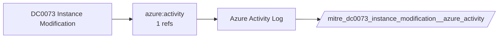

# DC0073 Instance Modification

[ATT&CK](https://attack.mitre.org/datacomponents/DC0073) · version 2.1 · modified 2026-05-12 · ATT&CK release 20.1

Umbrella eventtype `mitre_dc0073_instance_modification` over 1 feed(s)

> Changes made to a virtual machine (VM) or compute instance, including alterations to its configuration, metadata, attached policies, or operational state. Such modifications can include updating metadata, attaching or detaching resource policies, resizing instances, or modifying network configurations. Examples:  - AWS: instance modifications include API actions like `ModifyInstanceAttribute`, `ModifyInstanceMetadataOptions`, or `RebootInstances`. - Azure: modifications can be tracked through operations like `Microsoft.Compute/virtualMachines/write`. - GCP: instance modification events include operations like `instances.setMetadata`, `instances.addResourcePolicies`, or `instances.resize`.  *Data Collection Measures:*  - AWS CloudTrail: Log Location: Stored in S3 or forwarded to CloudWatch. - Azure Activity Logs: Log Location: Accessible via Azure Monitor or exported to a storage account. - GCP Audit Logs: Log Location: Logs Explorer or BigQuery.

## Why this component matters

ATT&CK v20.1 has **2 analytics** across **2 detection strategies** that read this component, covering **2 techniques**. Tactics most dependent on it: defense-impairment (2).

Analytic references by platform: IaaS 2

## Where it comes from



## Requirements

Per feed (from `config/stack.yml` and `config/log_sources.yml`):

| Feed | Schedule | Sourcetype or source | Constraint | Origin | TA / collector |
|---|---|---|---|---|---|
| `azure_activity` | scheduled | sourcetype=`mscs:azure:audit` | `(whole feed)` | derived | Splunk Add-on for Microsoft Cloud Services (mscs:azure:audit) |

Collection prerequisites:

- **azure_activity**: Export Activity Log for every subscription to the Event Hub.

Review notes: `azure_activity` has 1 ATT&CK reference(s) with no usable event filter (prose channel), constraint origin is *derived*.

## Splunk

Eventtypes (literal constraints, see `dist/splunk/TA-mitre-attack-datacomponents/default/eventtypes.conf`):

```ini
[mitre_dc0073_instance_modification__azure_activity]
search = index=azure sourcetype="mscs:azure:audit"

[mitre_dc0073_instance_modification]
search = eventtype=mitre_dc0073_instance_modification__azure_activity
```

Macros for analytics: `` `mitre_dc0073` `` (umbrella), `` `mitre_dc0073_azure_activity` ``, `` `mitre_dc0073_filter` `` (site exclusions).
CIM: no data model mapping; analytics on this component run as raw eventtype searches.

## Sigma

No generic Sigma category maps to this component; rules use `product`/`service` logsources, which the pipeline maps to index and sourcetype.

## Dependents

Top techniques detected through this component (of 2):

| Technique | Name | Tactics | Analytics using this DC |
|---|---|---|---|
| [T1578.004](https://attack.mitre.org/techniques/T1578/004) | Revert Cloud Instance | defense-impairment | 1 |
| [T1687](https://attack.mitre.org/techniques/T1687) | Exploitation for Defense Impairment | defense-impairment | 1 |

Full list: `lookups/mitre_attack_analytics.csv` filtered on `dc_ids` containing `DC0073`.
