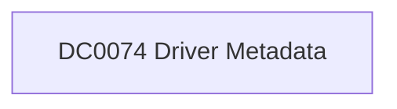

# DC0074 Driver Metadata

[ATT&CK](https://attack.mitre.org/datacomponents/DC0074) · version 2.1 · modified 2026-05-12 · ATT&CK release 20.1

Status: **Out of scope** for the current platform set

> to contextual data about a driver, including its attributes, functionality, and activity. This can involve details such as the driver's origin, integrity, cryptographic signature, issues reported during its use, and runtime behavior. Examples include metadata captured during driver integrity checks, hash validation, or error reporting. Examples:   - Driver Signature Validation: A driver is validated to ensure it is signed by a trusted Certificate Authority (CA). - Driver Hash Verification: The hash of a driver is compared to a known good hash stored in a database. - Driver Compatibility Issues: A driver error is logged due to compatibility issues with a particular version of the operating system. - Vulnerable Driver Identification: Metadata indicates the driver version is outdated or contains a known vulnerability. - Monitoring Driver Integrity: Drivers are monitored for any unauthorized modifications to their binary or associated files.  This data component can be collected through the following measures:  Windows  - Windows Event Logs:     - Event ID 3000-3006: Logs metadata about driver signature validation.     - Event ID 2000-2011 (Windows Defender Application Control): Tracks driver integrity and policy enforcement. - Sysmon Logs: Configure Sysmon to capture driver loading metadata (Event ID 6). - Driver Verifier: Use Driver Verifier to collect diagnostic and performance data about drivers, including stability and compatibility metrics. - PowerShell: Use commands to retrieve metadata about installed drivers: `Get-WindowsDriver -Online | Select-Object Driver, ProviderName, Version`  Linux  - Auditd: Configure audit rules to monitor driver interactions and collect metadata: `auditctl -w /lib/modules/ -p rwxa -k driver_metadata` - dmesg: Use `dmesg` to extract kernel logs with driver metadata: `dmesg | grep "module"` - lsmod and modinfo: Commands to list loaded modules and retrieve metadata about drivers: `lsmod` | `modinfo <module_name>`  macOS  - Unified Logs: Collect metadata from system logs about kernel extensions (kexts): `log show --predicate 'eventMessage contains "kext load"' --info` - kextstat: Command to retrieve information about loaded kernel extensions: `kextstat`  SIEM Tools  - Ingest Driver Metadata: Collect driver metadata logs from Sysmon, Auditd, or macOS logs into SIEMs like Splunk or Elastic.  Vulnerability Management Tools  - Use these tools to collect metadata about vulnerable drivers across enterprise systems.

## Why this component matters

ATT&CK v20.1 has **1 analytics** across **1 detection strategies** that read this component, covering **1 techniques**. Tactics most dependent on it: defense-impairment (1).

Analytic references by platform: macOS 1

## Where it comes from

## Requirements

Per feed (from `config/stack.yml` and `config/log_sources.yml`):

| Feed | Status | Sourcetype or source | Constraint | Origin | TA / collector |
|---|---|---|---|---|---|

## Splunk

No eventtypes rendered: none of this component's log sources belong to an in-scope platform feed. See [gaps](../gaps.md).

## Sigma

No generic Sigma category maps to this component; rules use `product`/`service` logsources, which the pipeline maps to index and sourcetype.

## Dependents

Top techniques detected through this component (of 1):

| Technique | Name | Tactics | Analytics using this DC |
|---|---|---|---|
| [T1687](https://attack.mitre.org/techniques/T1687) | Exploitation for Defense Impairment | defense-impairment | 1 |

Full list: `lookups/mitre_attack_analytics.csv` filtered on `dc_ids` containing `DC0074`.
