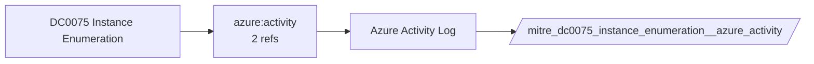

# DC0075 Instance Enumeration

[ATT&CK](https://attack.mitre.org/datacomponents/DC0075) · version 2.0 · modified 2025-10-21 · ATT&CK release 20.1

Umbrella eventtype `mitre_dc0075_instance_enumeration` over 1 feed(s)

> The process of retrieving or querying a list of virtual machine instances or compute instances within a cloud infrastructure. This activity provides a view of all available or running instances, typically including their associated metadata such as instance ID, name, state, and configuration details. Examples:  - AWS: instance enumeration involves the `DescribeInstances` API call, which retrieves information about running or stopped EC2 instances. - Azure: VM enumeration can be monitored via the `Microsoft.Compute/virtualMachines/read` operation. - GCP: instance enumeration is logged as an `instance.list` operation within GCP Audit Logs.  *Data Collection Measures:*  - AWS CloudTrail: CloudTrail logs stored in S3 or forwarded to CloudWatch. - Azure Activity Logs: Accessible via Azure Monitor or exported to a storage account. - GCP Audit Logs: Logs Explorer or BigQuery.

## Why this component matters

ATT&CK v20.1 has **2 analytics** across **2 detection strategies** that read this component, covering **2 techniques**. Tactics most dependent on it: discovery (2).

Analytic references by platform: IaaS 2

## Where it comes from



## Requirements

Per feed (from `config/stack.yml` and `config/log_sources.yml`):

| Feed | Schedule | Sourcetype or source | Constraint | Origin | TA / collector |
|---|---|---|---|---|---|
| `azure_activity` | scheduled | sourcetype=`mscs:azure:audit` | `(whole feed)` | derived | Splunk Add-on for Microsoft Cloud Services (mscs:azure:audit) |

Collection prerequisites:

- **azure_activity**: Export Activity Log for every subscription to the Event Hub.

Review notes: `azure_activity` has 2 ATT&CK reference(s) with no usable event filter (prose channel), constraint origin is *derived*.

## Splunk

Eventtypes (literal constraints, see `dist/splunk/TA-mitre-attack-datacomponents/default/eventtypes.conf`):

```ini
[mitre_dc0075_instance_enumeration__azure_activity]
search = index=azure sourcetype="mscs:azure:audit"

[mitre_dc0075_instance_enumeration]
search = eventtype=mitre_dc0075_instance_enumeration__azure_activity
```

Macros for analytics: `` `mitre_dc0075` `` (umbrella), `` `mitre_dc0075_azure_activity` ``, `` `mitre_dc0075_filter` `` (site exclusions).
CIM: no data model mapping; analytics on this component run as raw eventtype searches.

## Sigma

No generic Sigma category maps to this component; rules use `product`/`service` logsources, which the pipeline maps to index and sourcetype.

## Dependents

Top techniques detected through this component (of 2):

| Technique | Name | Tactics | Analytics using this DC |
|---|---|---|---|
| [T1082](https://attack.mitre.org/techniques/T1082) | System Information Discovery | discovery | 1 |
| [T1580](https://attack.mitre.org/techniques/T1580) | Cloud Infrastructure Discovery | discovery | 1 |

Full list: `lookups/mitre_attack_analytics.csv` filtered on `dc_ids` containing `DC0075`.
