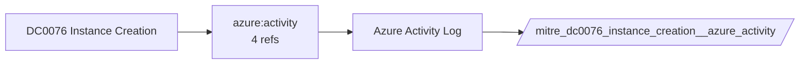

# DC0076 Instance Creation

[ATT&CK](https://attack.mitre.org/datacomponents/DC0076) · version 2.0 · modified 2025-11-12 · ATT&CK release 20.1

Umbrella eventtype `mitre_dc0076_instance_creation` over 1 feed(s)

> The initial provisioning and construction of a virtual machine (VM) or compute instance within a cloud infrastructure environment. This activity involves defining and allocating resources such as CPU, memory, storage, and networking to spin up a new compute instance. Examples:  - AWS: creating an EC2 instance using RunInstances API calls. - Azure, creating a VM through the Azure Resource Manager (ARM). - GCP, an `instance.insert` action recorded.

## Why this component matters

ATT&CK v20.1 has **3 analytics** across **3 detection strategies** that read this component, covering **3 techniques**. Tactics most dependent on it: execution (2), defense-impairment (1).

Analytic references by platform: IaaS 2, Windows 1

## Where it comes from



## Requirements

Per feed (from `config/stack.yml` and `config/log_sources.yml`):

| Feed | Schedule | Sourcetype or source | Constraint | Origin | TA / collector |
|---|---|---|---|---|---|
| `azure_activity` | scheduled | sourcetype=`mscs:azure:audit` | `(whole feed)` | derived | Splunk Add-on for Microsoft Cloud Services (mscs:azure:audit) |

Collection prerequisites:

- **azure_activity**: Export Activity Log for every subscription to the Event Hub.

Review notes: `azure_activity` has 4 ATT&CK reference(s) with no usable event filter (prose channel), constraint origin is *derived*.

## Splunk

Eventtypes (literal constraints, see `dist/splunk/TA-mitre-attack-datacomponents/default/eventtypes.conf`):

```ini
[mitre_dc0076_instance_creation__azure_activity]
search = index=azure sourcetype="mscs:azure:audit"

[mitre_dc0076_instance_creation]
search = eventtype=mitre_dc0076_instance_creation__azure_activity
```

Macros for analytics: `` `mitre_dc0076` `` (umbrella), `` `mitre_dc0076_azure_activity` ``, `` `mitre_dc0076_filter` `` (site exclusions).
CIM: no data model mapping; analytics on this component run as raw eventtype searches.

## Sigma

No generic Sigma category maps to this component; rules use `product`/`service` logsources, which the pipeline maps to index and sourcetype.

## Dependents

Top techniques detected through this component (of 3):

| Technique | Name | Tactics | Analytics using this DC |
|---|---|---|---|
| [T1204](https://attack.mitre.org/techniques/T1204) | User Execution | execution | 1 |
| [T1204.003](https://attack.mitre.org/techniques/T1204/003) | Malicious Image | execution | 1 |
| [T1578.002](https://attack.mitre.org/techniques/T1578/002) | Create Cloud Instance | defense-impairment | 1 |

Full list: `lookups/mitre_attack_analytics.csv` filtered on `dc_ids` containing `DC0076`.
