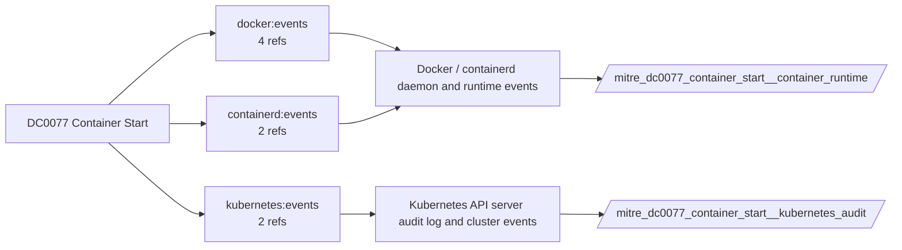

# DC0077 Container Start

[ATT&CK](https://attack.mitre.org/datacomponents/DC0077) · version 2.0 · modified 2025-10-21 · ATT&CK release 20.1

Umbrella eventtype `mitre_dc0077_container_start` over 2 feed(s)

> "Container Start" data component captures events related to the activation or invocation of a container within a containerized environment. This includes starting a previously stopped container, restarting an existing container, or initializing a container for runtime. Monitoring these activities is critical for identifying unauthorized or unexpected container activations, which may indicate potential adversarial activity or misconfigurations. Examples:   - Docker Example: `docker start <container_name>`, `docker restart <container_name>` - Kubernetes Example: Kubernetes automatically restarts containers as part of pod lifecycle management (e.g., due to health checks or configuration changes). - Cloud-Native Example     - AWS ECS: API Call: StartTask to activate a stopped ECS task.     - Azure Container Instances: Command to restart a container group instance.     - GCP Kubernetes Engine: Automatic restarts as part of node or pod management.  This data component can be collected through the following measures:  - Docker Audit Logging: Enable Docker logging to capture start and restart events. Use tools like auditd to monitor terminal activity involving container lifecycle commands. - Kubernetes Audit Logs: Enable Kubernetes API server audit logging. - Cloud Provider Logs     - AWS CloudTrail: Capture StartTask or related API calls for ECS.     - Azure Monitor: Track activity in container groups that indicate start or restart events.     - GCP Cloud Logging: Record logs related to pod restarts or scaling events in Kubernetes Engine. - SIEM Integration: Collect logs from Docker, Kubernetes, and cloud services to correlate container start events.

## Why this component matters

Container start events and kubelet Started/Pulled events; pairs with creation for image and entrypoint checks.

ATT&CK v20.1 has **4 analytics** across **4 detection strategies** that read this component, covering **4 techniques**. Tactics most dependent on it: execution (4).

Analytic references by platform: Containers 3, Linux 1

## Where it comes from



## Requirements

Per feed (from `config/stack.yml` and `config/log_sources.yml`):

| Feed | Schedule | Sourcetype or source | Constraint | Origin | TA / collector |
|---|---|---|---|---|---|
| `container_runtime` | scheduled | sourcetype=`containerd:events`, sourcetype=`docker:events` | `(status=start)` | defaults | docker events scripted input or OpenTelemetry (docker:events, containerd) |
| `kubernetes_audit` | scheduled | sourcetype=`kube:objects:events` | `(reason=Started OR reason=Pulled OR reason=Created)` | defaults | Splunk OpenTelemetry Collector for Kubernetes / Splunk Connect for Kubernetes |

Collection prerequisites:

- **kubernetes_audit**: Audit policy at Metadata level minimum
- **kubernetes_audit**: RequestResponse for secrets/pods/exec; ship the audit log file from control-plane nodes.

Review notes: `container_runtime` has 6 ATT&CK reference(s) with no usable event filter (prose channel), constraint origin is *defaults*; `kubernetes_audit` has 2 ATT&CK reference(s) with no usable event filter (prose channel), constraint origin is *defaults*.

## Splunk

Eventtypes (literal constraints, see `dist/splunk/TA-mitre-attack-datacomponents/default/eventtypes.conf`):

```ini
[mitre_dc0077_container_start__container_runtime]
search = index=k8s sourcetype IN ("containerd:events", "docker:events") (status=start)

[mitre_dc0077_container_start__kubernetes_audit]
search = index=k8s sourcetype="kube:objects:events" (reason=Started OR reason=Pulled OR reason=Created)

[mitre_dc0077_container_start]
search = eventtype=mitre_dc0077_container_start__container_runtime OR eventtype=mitre_dc0077_container_start__kubernetes_audit
```

Macros for analytics: `` `mitre_dc0077` `` (umbrella), `` `mitre_dc0077_container_runtime` ``, `` `mitre_dc0077_kubernetes_audit` ``, `` `mitre_dc0077_filter` `` (site exclusions).
CIM: no data model mapping; analytics on this component run as raw eventtype searches.

## Sigma

No generic Sigma category maps to this component; rules use `product`/`service` logsources, which the pipeline maps to index and sourcetype.

## Dependents

Top techniques detected through this component (of 4):

| Technique | Name | Tactics | Analytics using this DC |
|---|---|---|---|
| [T1059.013](https://attack.mitre.org/techniques/T1059/013) | Container CLI/API | execution | 1 |
| [T1204](https://attack.mitre.org/techniques/T1204) | User Execution | execution | 1 |
| [T1204.003](https://attack.mitre.org/techniques/T1204/003) | Malicious Image | execution | 1 |
| [T1610](https://attack.mitre.org/techniques/T1610) | Deploy Container | execution | 1 |

Full list: `lookups/mitre_attack_analytics.csv` filtered on `dc_ids` containing `DC0077`.
