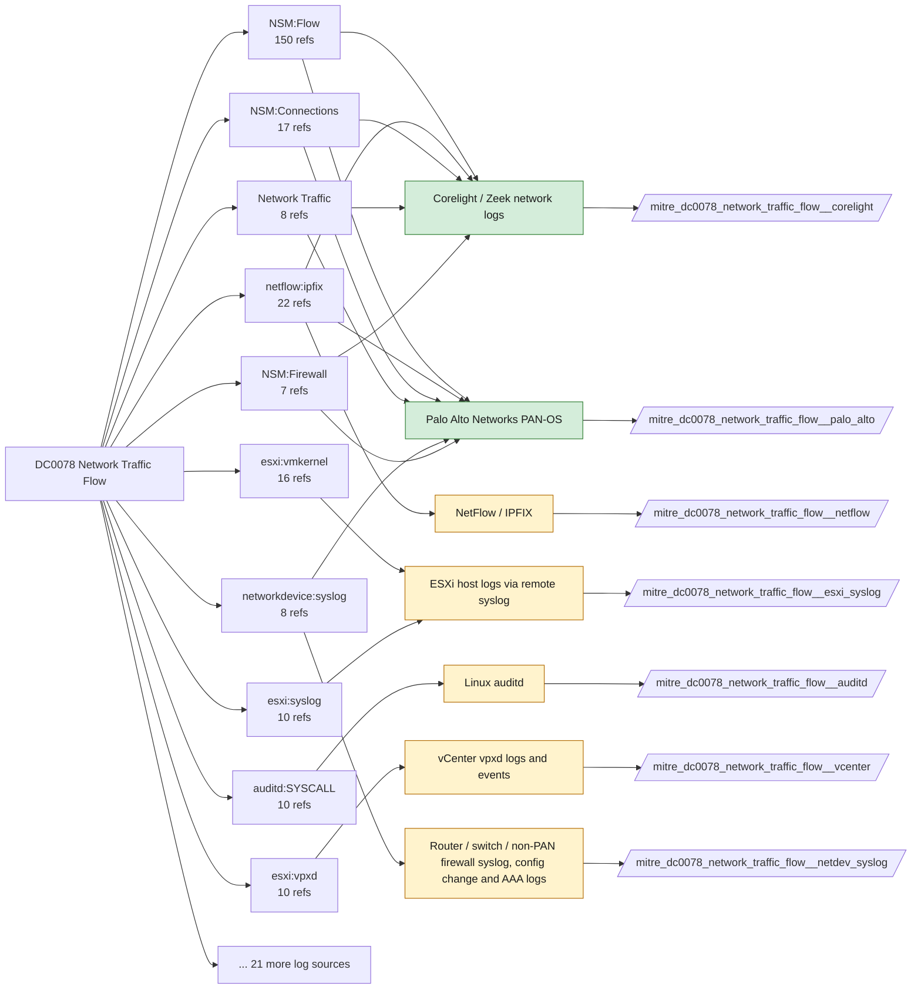

# DC0078 Network Traffic Flow

[ATT&CK](https://attack.mitre.org/datacomponents/DC0078) · version 2.2 · modified 2026-10-13 · ATT&CK release 20.1

Status: **Live** · umbrella eventtype `mitre_dc0078_network_traffic_flow`

> Summarized network packet data that captures session-level details such as source/destination IPs, ports, protocol types, timestamps, and data volume, without storing full packet payloads. This is commonly used for traffic analysis, anomaly detection, and network performance monitoring.

## Why this component matters

Volume, duration, periodicity and direction of sessions: beaconing, exfiltration, scanning. conn.log and pan:traffic are the sources; the Windows Filtering Platform events (5156) are a host-level fallback.

ATT&CK v20.1 has **176 analytics** across **92 detection strategies** that read this component, covering **92 techniques**. Tactics most dependent on it: command-and-control (73), exfiltration (29), initial-access (19), impact (19).

Analytic references by platform: Linux 51, macOS 43, ESXi 26, Network Devices 18, Windows 18, IaaS 9, PRE 7, Containers 3, SaaS 1

## Where it comes from



## Requirements

Component specific:

- For beaconing analytics the sensor must observe the full session (both directions); asymmetric routing breaks conn.log duration and byte counts.

Per feed (from `config/stack.yml` and `config/log_sources.yml`):

| Feed | Status | Sourcetype or source | Constraint | Origin | TA / collector |
|---|---|---|---|---|---|
| `corelight` | live | sourcetype=`corelight_conn` | `(whole feed)` | defaults | Corelight App for Splunk (corelight_<log>). For TA_zeek use prefix zeek: and suffix :json. |
| `palo_alto` | live | sourcetype=`pan:traffic` | `(whole feed)` | defaults | Splunk Add-on for Palo Alto Networks (pan:*) |
| `sysmon` | live | source=`XmlWinEventLog:Microsoft-Windows-Sysmon/Operational` | `EventCode IN (3)` | defaults | Splunk Add-on for Sysmon (needs Splunk_TA_windows for XML parsing) |
| `wineventlog` | live | source=`XmlWinEventLog:Security` | `EventCode IN (5156, 5157)` | defaults | Splunk Add-on for Microsoft Windows (Splunk_TA_windows), XML rendering (renderXml = true) |
| `wireshark` | hunt-only | sourcetype=`wireshark:json` | `(whole feed)` | derived | None standard. tshark -T ek output (wireshark:json) or Splunk Stream for continuous capture. |
| `auditd` | ready (tick in stack.yml) | sourcetype=`linux:audit` | `type IN (SYSCALL) (syscall IN (connect, recvfrom, sendmsg, sendto) OR SYSCALL IN (connect, recvfrom, sendmsg, sendto))` | defaults | Splunk Add-on for Unix and Linux (linux:audit) or auditd -> auditbeat/syslog |
| `edr_telemetry` | ready (tick in stack.yml) | sourcetype=`edr:telemetry` | `(whole feed)` | derived | Vendor specific |
| `esxi_syslog` | ready (tick in stack.yml) | sourcetype=`vmware:esxlog:hostd`, sourcetype=`vmware:esxlog:vmkernel`, sourcetype=`vmware:esxlog:vobd` | `(whole feed)` | defaults | Splunk Add-on for VMware ESXi Logs (vmware:esxlog:<log>) |
| `iptables` | ready (tick in stack.yml) | sourcetype=`syslog` | `("IN=" "OUT=")` | derived | Splunk Add-on for Unix and Linux (syslog) |
| `netdev_syslog` | ready (tick in stack.yml) | sourcetype=`cisco:asa`, sourcetype=`cisco:ios`, sourcetype=`syslog` | `(whole feed)` | derived | Cisco Networks Add-on (cisco:ios, cisco:asa), Juniper/Arista TAs, or generic syslog |
| `netflow` | ready (tick in stack.yml) | sourcetype=`stream:netflow` | `(whole feed)` | derived | Splunk Stream or Splunk Add-on for NetFlow |
| `vcenter` | ready (tick in stack.yml) | sourcetype=`vmware:vclog:vpxd` | `(whole feed)` | derived | Splunk Add-on for VMware (vmware:vclog:vpxd) |
| `windows_firewall_log` | ready (tick in stack.yml) | sourcetype=`WinFirewall` | `(whole feed)` | derived | Splunk_TA_windows (monitor input on %systemroot%\System32\LogFiles\Firewall\pfirewall.log) |

Collection prerequisites:

- **corelight**: Sensor placement covering east-west (DC, server VLANs) and north-south; without internal taps the lateral-movement components are blind.
- **corelight**: Enable the log set above; files/pe/smb_* and ldap/kerberos/ntlm are what distinguish Corelight from flow data.
- **palo_alto**: Log forwarding profiles attached to every security rule (traffic start+end, threat, url, wildfire, data).
- **palo_alto**: System and Config logs forwarded from each firewall / Panorama; GlobalProtect logs enabled.
- **palo_alto**: URL filtering and Threat Prevention licensed for pan:threat subtypes url/vulnerability/virus/spyware.
- **palo_alto**: Operational (show/debug) commands are not in config or system logs by default. Enable administrator activity audit tracking (Device > Setup > Management > Logging and Reporting, PAN-OS 10.1+) and forward the audit log if you want CLI discovery analytics for the firewall.
- **sysmon**: Sysmon deployed with a maintained modular configuration (e.g. sysmon-modular or SwiftOnSecurity). Event IDs referenced by a data component only exist if the config includes that rule group (ProcessAccess=10, ImageLoad=7, DNS=22, FileDelete=23/26, ClipboardChange=24, ProcessTampering=25, FileBlock=27/28 are off in minimal configs).
- **sysmon**: Hashes configured (SHA256 at least, IMPHASH useful) for File/Process metadata components.
- **wineventlog**: Advanced Audit Policy configured (at minimum Process Creation, Logon, Account Management, Object Access, Policy Change, Privilege Use, Detailed Tracking). Without the matching subcategory the EventCodes below never fire.
- **wineventlog**: Include command line in process creation events enabled for 4688 (Computer Configuration > Administrative Templates > System > Audit Process Creation).
- **wineventlog**: PowerShell Script Block Logging (4104) and Module Logging (4103) enabled via GPO for the PowerShell/Operational channel.
- **wineventlog**: Object access events (4656/4663/4657/4660/4670) require SACLs on the files/keys of interest.
- **wineventlog**: Non-default channels (TaskScheduler, WMI-Activity, CodeIntegrity, Defender, Firewall, WinRM, SMBClient/Server...) must be listed as inputs in Splunk_TA_windows inputs.conf; several are disabled by default in Windows.
- **auditd**: audit rules for execve, connect, open/openat on sensitive paths, ptrace, module load, mount, setuid; a Neo23x0/auditd baseline or Florian Roth's rule set is a reasonable start.
- **auditd**: log_format = ENRICHED in auditd.conf so syscall names and uids resolve (otherwise syscall numbers are architecture dependent).
- **esxi_syslog**: Syslog.global.logHost set on every host; ESXi Shell/SSH audit enabled; consider Syslog.global.auditRecord (ESXi 8).
- **netdev_syslog**: Enable config-change archive logging and AAA command accounting; forward at informational level.
- **windows_firewall_log**: Enable logging of dropped and allowed connections per profile.

Review notes: `corelight` has 15 ATT&CK reference(s) with no usable event filter (prose channel), constraint origin is *defaults*; `wineventlog` has 2 ATT&CK reference(s) with no usable event filter (prose channel), constraint origin is *defaults*; `edr_telemetry` has 2 ATT&CK reference(s) with no usable event filter (prose channel), constraint origin is *derived*; `iptables` has 5 ATT&CK reference(s) with no usable event filter (prose channel), constraint origin is *derived*; `netdev_syslog` has 11 ATT&CK reference(s) with no usable event filter (prose channel), constraint origin is *derived*; `netflow` has 26 ATT&CK reference(s) with no usable event filter (prose channel), constraint origin is *derived*; `vcenter` has 10 ATT&CK reference(s) with no usable event filter (prose channel), constraint origin is *derived*; `windows_firewall_log` has 2 ATT&CK reference(s) with no usable event filter (prose channel), constraint origin is *derived*.

## Splunk

Eventtypes (literal constraints, see `dist/splunk/TA-mitre-attack-datacomponents/default/eventtypes.conf`):

```ini
[mitre_dc0078_network_traffic_flow__corelight]
search = index=corelight sourcetype=corelight_conn

[mitre_dc0078_network_traffic_flow__palo_alto]
search = index=pan_logs sourcetype="pan:traffic"

[mitre_dc0078_network_traffic_flow__sysmon]
search = index=sysmon source="XmlWinEventLog:Microsoft-Windows-Sysmon/Operational" EventCode IN (3)

[mitre_dc0078_network_traffic_flow__wineventlog]
search = index=wineventlog source="XmlWinEventLog:Security" EventCode IN (5156, 5157)

[mitre_dc0078_network_traffic_flow__wireshark]
search = index=pcap sourcetype="wireshark:json"
disabled = 1

[mitre_dc0078_network_traffic_flow__auditd]
search = index=linux sourcetype="linux:audit" type IN (SYSCALL) (syscall IN (connect, recvfrom, sendmsg, sendto) OR SYSCALL IN (connect, recvfrom, sendmsg, sendto))
disabled = 1

[mitre_dc0078_network_traffic_flow__edr_telemetry]
search = index=edr sourcetype="edr:telemetry"
disabled = 1

[mitre_dc0078_network_traffic_flow__esxi_syslog]
search = index=vmware sourcetype IN ("vmware:esxlog:hostd", "vmware:esxlog:vmkernel", "vmware:esxlog:vobd")
disabled = 1

[mitre_dc0078_network_traffic_flow__iptables]
search = index=linux sourcetype=syslog ("IN=" "OUT=")
disabled = 1

[mitre_dc0078_network_traffic_flow__netdev_syslog]
search = index=netops sourcetype IN ("cisco:asa", "cisco:ios", syslog)
disabled = 1

[mitre_dc0078_network_traffic_flow__netflow]
search = index=netflow sourcetype="stream:netflow"
disabled = 1

[mitre_dc0078_network_traffic_flow__vcenter]
search = index=vmware sourcetype="vmware:vclog:vpxd"
disabled = 1

[mitre_dc0078_network_traffic_flow__windows_firewall_log]
search = index=wineventlog sourcetype=WinFirewall
disabled = 1

[mitre_dc0078_network_traffic_flow]
search = eventtype=mitre_dc0078_network_traffic_flow__corelight OR eventtype=mitre_dc0078_network_traffic_flow__palo_alto OR eventtype=mitre_dc0078_network_traffic_flow__sysmon OR eventtype=mitre_dc0078_network_traffic_flow__wineventlog OR eventtype=mitre_dc0078_network_traffic_flow__wireshark OR eventtype=mitre_dc0078_network_traffic_flow__auditd OR eventtype=mitre_dc0078_network_traffic_flow__edr_telemetry OR eventtype=mitre_dc0078_network_traffic_flow__esxi_syslog OR eventtype=mitre_dc0078_network_traffic_flow__iptables OR eventtype=mitre_dc0078_network_traffic_flow__netdev_syslog OR eventtype=mitre_dc0078_network_traffic_flow__netflow OR eventtype=mitre_dc0078_network_traffic_flow__vcenter OR eventtype=mitre_dc0078_network_traffic_flow__windows_firewall_log
```

Macros for analytics: `` `mitre_dc0078` `` (umbrella), `` `mitre_dc0078_corelight` ``, `` `mitre_dc0078_palo_alto` ``, `` `mitre_dc0078_sysmon` ``, `` `mitre_dc0078_wineventlog` ``, `` `mitre_dc0078_wireshark` ``, `` `mitre_dc0078_auditd` ``, `` `mitre_dc0078_edr_telemetry` ``, `` `mitre_dc0078_esxi_syslog` ``, `` `mitre_dc0078_iptables` ``, `` `mitre_dc0078_netdev_syslog` ``, `` `mitre_dc0078_netflow` ``, `` `mitre_dc0078_vcenter` ``, `` `mitre_dc0078_windows_firewall_log` ``, `` `mitre_dc0078_filter` `` (site exclusions).
CIM: `Network_Traffic.All_Traffic` via `` `mitre_dc0078_dm` `` / `` `mitre_dc0078_dm_where` `` for `tstats`. CIM tags emitted for: `corelight`, `palo_alto`, `netflow`.

## Sigma

Generic logsource categories scoped by this component in `dist/sigma/pipelines/splunk_mitre_dc.yml`: product `paloalto`: `firewall`.

## Dependents

Top techniques detected through this component (of 92):

| Technique | Name | Tactics | Analytics using this DC |
|---|---|---|---|
| [T1090](https://attack.mitre.org/techniques/T1090) | Proxy | command-and-control | 5 |
| [T1090.001](https://attack.mitre.org/techniques/T1090/001) | Internal Proxy | command-and-control | 5 |
| [T1090.003](https://attack.mitre.org/techniques/T1090/003) | Multi-hop Proxy | command-and-control | 5 |
| [T1008](https://attack.mitre.org/techniques/T1008) | Fallback Channels | command-and-control | 4 |
| [T1048.003](https://attack.mitre.org/techniques/T1048/003) | Exfiltration Over Unencrypted Non-C2 Protocol | exfiltration | 4 |
| [T1090.002](https://attack.mitre.org/techniques/T1090/002) | External Proxy | command-and-control | 4 |
| [T1205](https://attack.mitre.org/techniques/T1205) | Traffic Signaling | stealth, persistence, command-and-control | 4 |
| [T1205.001](https://attack.mitre.org/techniques/T1205/001) | Port Knocking | stealth, persistence, command-and-control | 4 |
| [T1021.005](https://attack.mitre.org/techniques/T1021/005) | VNC | lateral-movement | 3 |
| [T1030](https://attack.mitre.org/techniques/T1030) | Data Transfer Size Limits | exfiltration | 3 |
| [T1041](https://attack.mitre.org/techniques/T1041) | Exfiltration Over C2 Channel | exfiltration | 3 |
| [T1048.001](https://attack.mitre.org/techniques/T1048/001) | Exfiltration Over Symmetric Encrypted Non-C2 Protocol | exfiltration | 3 |
| [T1104](https://attack.mitre.org/techniques/T1104) | Multi-Stage Channels | command-and-control | 3 |
| [T1132.001](https://attack.mitre.org/techniques/T1132/001) | Standard Encoding | command-and-control | 3 |
| [T1132.002](https://attack.mitre.org/techniques/T1132/002) | Non-Standard Encoding | command-and-control | 3 |
| … | 77 more | | |

Full list: `lookups/mitre_attack_analytics.csv` filtered on `dc_ids` containing `DC0078`.
