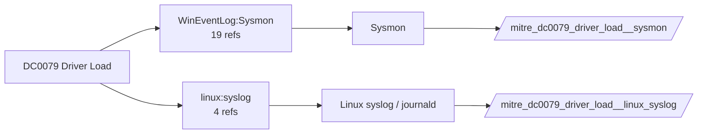

# DC0079 Driver Load

[ATT&CK](https://attack.mitre.org/datacomponents/DC0079) · version 2.0 · modified 2026-10-13 · ATT&CK release 20.1

Umbrella eventtype `mitre_dc0079_driver_load` over 4 feed(s)

> The process of attaching a driver, which is a software component that allows the operating system and applications to interact with hardware devices, to either user-mode or kernel-mode of a system. This can include benign actions (e.g., hardware drivers) or malicious behavior (e.g., rootkits or unsigned drivers). Examples:   - Legitimate Driver Loading: A new graphics driver from a vendor like NVIDIA or AMD is loaded into the system. - Unsigned Driver Loading: A driver without a valid digital signature is loaded into the kernel. - Rootkit Installation: A malicious rootkit driver is loaded to manipulate kernel-mode processes. - Anti-Virus or EDR Driver Loading: An Endpoint Detection and Response (EDR) solution loads its driver to monitor system activities. - Driver Misuse: A legitimate driver is loaded and exploited to execute malicious actions, such as using vulnerable drivers for bypassing defenses (e.g., Bring Your Own Vulnerable Driver (BYOVD) attacks).

## Why this component matters

Bring-your-own-vulnerable-driver and rootkit techniques depend on a kernel driver load. Sysmon EID 6 records signature and hashes; 7045 catches the service install that usually precedes it.

ATT&CK v20.1 has **16 analytics** across **15 detection strategies** that read this component, covering **15 techniques**. Tactics most dependent on it: persistence (5), stealth (4), impact (4), privilege-escalation (3).

Analytic references by platform: Windows 14, Linux 2

## Where it comes from



## Requirements

Component specific:

- Sysmon DriverLoad (EID 6) enabled; compare Hashes and Signature against the loldrivers list in phase 2.

Per feed (from `config/stack.yml` and `config/log_sources.yml`):

| Feed | Schedule | Sourcetype or source | Constraint | Origin | TA / collector |
|---|---|---|---|---|---|
| `auditd` | scheduled | sourcetype=`linux:audit` | `type IN (SYSCALL) (syscall IN (finit_module, init_module) OR SYSCALL IN (finit_module, init_module))` | defaults | Splunk Add-on for Unix and Linux (linux:audit) or auditd -> auditbeat/syslog |
| `linux_syslog` | scheduled | sourcetype=`linux_messages_syslog`, sourcetype=`linux_secure`, sourcetype=`syslog` | `(kernel)` | defaults | Splunk Add-on for Unix and Linux (syslog, linux_secure, linux_messages_syslog) |
| `sysmon` | scheduled | source=`XmlWinEventLog:Microsoft-Windows-Sysmon/Operational` | `EventCode IN (6)` | defaults | Splunk Add-on for Sysmon (needs Splunk_TA_windows for XML parsing) |
| `wineventlog` | scheduled | source=`XmlWinEventLog:Microsoft-Windows-CodeIntegrity/Operational`, source=`XmlWinEventLog:System` | `EventCode IN (3033, 3077, 7045)` | defaults | Splunk Add-on for Microsoft Windows (Splunk_TA_windows), XML rendering (renderXml = true) |

Collection prerequisites:

- **auditd**: audit rules for execve, connect, open/openat on sensitive paths, ptrace, module load, mount, setuid; a Neo23x0/auditd baseline or Florian Roth's rule set is a reasonable start.
- **auditd**: log_format = ENRICHED in auditd.conf so syscall names and uids resolve (otherwise syscall numbers are architecture dependent).
- **sysmon**: Sysmon deployed with a maintained modular configuration (e.g. sysmon-modular or SwiftOnSecurity). Event IDs referenced by a data component only exist if the config includes that rule group (ProcessAccess=10, ImageLoad=7, DNS=22, FileDelete=23/26, ClipboardChange=24, ProcessTampering=25, FileBlock=27/28 are off in minimal configs).
- **sysmon**: Hashes configured (SHA256 at least, IMPHASH useful) for File/Process metadata components.
- **wineventlog**: Advanced Audit Policy configured (at minimum Process Creation, Logon, Account Management, Object Access, Policy Change, Privilege Use, Detailed Tracking). Without the matching subcategory the EventCodes below never fire.
- **wineventlog**: Include command line in process creation events enabled for 4688 (Computer Configuration > Administrative Templates > System > Audit Process Creation).
- **wineventlog**: PowerShell Script Block Logging (4104) and Module Logging (4103) enabled via GPO for the PowerShell/Operational channel.
- **wineventlog**: Object access events (4656/4663/4657/4660/4670) require SACLs on the files/keys of interest.
- **wineventlog**: Non-default channels (TaskScheduler, WMI-Activity, CodeIntegrity, Defender, Firewall, WinRM, SMBClient/Server...) must be listed as inputs in Splunk_TA_windows inputs.conf; several are disabled by default in Windows.

Review notes: `linux_syslog` has 4 ATT&CK reference(s) with no usable event filter (prose channel), constraint origin is *defaults*.

## Splunk

Eventtypes (literal constraints, see `dist/splunk/TA-mitre-attack-datacomponents/default/eventtypes.conf`):

```ini
[mitre_dc0079_driver_load__auditd]
search = index=linux sourcetype="linux:audit" type IN (SYSCALL) (syscall IN (finit_module, init_module) OR SYSCALL IN (finit_module, init_module))

[mitre_dc0079_driver_load__linux_syslog]
search = index=linux sourcetype IN (linux_messages_syslog, linux_secure, syslog) (kernel)

[mitre_dc0079_driver_load__sysmon]
search = index=sysmon source="XmlWinEventLog:Microsoft-Windows-Sysmon/Operational" EventCode IN (6)

[mitre_dc0079_driver_load__wineventlog]
search = index=wineventlog source IN ("XmlWinEventLog:Microsoft-Windows-CodeIntegrity/Operational", "XmlWinEventLog:System") EventCode IN (3033, 3077, 7045)

[mitre_dc0079_driver_load]
search = eventtype=mitre_dc0079_driver_load__auditd OR eventtype=mitre_dc0079_driver_load__linux_syslog OR eventtype=mitre_dc0079_driver_load__sysmon OR eventtype=mitre_dc0079_driver_load__wineventlog
```

Macros for analytics: `` `mitre_dc0079` `` (umbrella), `` `mitre_dc0079_auditd` ``, `` `mitre_dc0079_linux_syslog` ``, `` `mitre_dc0079_sysmon` ``, `` `mitre_dc0079_wineventlog` ``, `` `mitre_dc0079_filter` `` (site exclusions).
CIM: `Endpoint.Services` via `` `mitre_dc0079_dm` `` / `` `mitre_dc0079_dm_where` `` for `tstats`. CIM tags emitted for: none (no feed is known CIM-compliant for this model).

## Sigma

Generic logsource categories scoped by this component in `dist/sigma/pipelines/splunk_mitre_dc.yml`: product `windows`: `driver_load`.

## Dependents

Top techniques detected through this component (of 15):

| Technique | Name | Tactics | Analytics using this DC |
|---|---|---|---|
| [T1542.002](https://attack.mitre.org/techniques/T1542/002) | Component Firmware | stealth, persistence | 2 |
| [T1014](https://attack.mitre.org/techniques/T1014) | Rootkit | stealth | 1 |
| [T1068](https://attack.mitre.org/techniques/T1068) | Exploitation for Privilege Escalation | privilege-escalation | 1 |
| [T1111](https://attack.mitre.org/techniques/T1111) | Multi-Factor Authentication Interception | credential-access | 1 |
| [T1195.002](https://attack.mitre.org/techniques/T1195/002) | Compromise Software Supply Chain | initial-access | 1 |
| [T1195.003](https://attack.mitre.org/techniques/T1195/003) | Compromise Hardware Supply Chain | initial-access | 1 |
| [T1200](https://attack.mitre.org/techniques/T1200) | Hardware Additions | initial-access | 1 |
| [T1205.002](https://attack.mitre.org/techniques/T1205/002) | Socket Filters | stealth, persistence, command-and-control | 1 |
| [T1495](https://attack.mitre.org/techniques/T1495) | Firmware Corruption | impact | 1 |
| [T1543.003](https://attack.mitre.org/techniques/T1543/003) | Windows Service | persistence, privilege-escalation | 1 |
| [T1547.008](https://attack.mitre.org/techniques/T1547/008) | LSASS Driver | persistence, privilege-escalation | 1 |
| [T1561](https://attack.mitre.org/techniques/T1561) | Disk Wipe | impact | 1 |
| [T1561.001](https://attack.mitre.org/techniques/T1561/001) | Disk Content Wipe | impact | 1 |
| [T1561.002](https://attack.mitre.org/techniques/T1561/002) | Disk Structure Wipe | impact | 1 |
| [T1687](https://attack.mitre.org/techniques/T1687) | Exploitation for Defense Impairment | defense-impairment | 1 |

Full list: `lookups/mitre_attack_analytics.csv` filtered on `dc_ids` containing `DC0079`.
