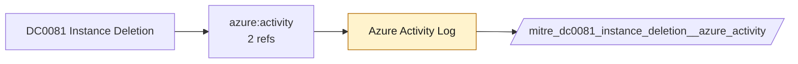

# DC0081 Instance Deletion

[ATT&CK](https://attack.mitre.org/datacomponents/DC0081) · version 2.0 · modified 2025-11-12 · ATT&CK release 20.1

Status: **Ready** (needs a feed you have not ticked) · umbrella eventtype `mitre_dc0081_instance_deletion`

> Removal of a virtual machine (VM) or compute instance within a cloud infrastructure. This activity results in the termination and deletion of the allocated resources (e.g., CPU, memory, storage), making the instance unavailable for future use. Examples:  - AWS: instance deletion involves the `TerminateInstances` API call, which is recorded in CloudTrail logs. - Azure: VM deletion can be monitored via Azure Activity Logs, showing the `Microsoft.Compute/virtualMachines/delete` operation. - GCP: instance deletion is logged as an instance.delete operation within GCP Audit Logs.

## Why this component matters

ATT&CK v20.1 has **1 analytics** across **1 detection strategies** that read this component, covering **1 techniques**. Tactics most dependent on it: defense-impairment (1).

Analytic references by platform: IaaS 1

## Where it comes from



## Requirements

Per feed (from `config/stack.yml` and `config/log_sources.yml`):

| Feed | Status | Sourcetype or source | Constraint | Origin | TA / collector |
|---|---|---|---|---|---|
| `azure_activity` | ready (tick in stack.yml) | sourcetype=`mscs:azure:audit` | `(whole feed)` | derived | Splunk Add-on for Microsoft Cloud Services (mscs:azure:audit) |

Collection prerequisites:

- **azure_activity**: Export Activity Log for every subscription to the Event Hub.

Review notes: `azure_activity` has 2 ATT&CK reference(s) with no usable event filter (prose channel), constraint origin is *derived*.

## Splunk

Eventtypes (literal constraints, see `dist/splunk/TA-mitre-attack-datacomponents/default/eventtypes.conf`):

```ini
[mitre_dc0081_instance_deletion__azure_activity]
search = index=azure sourcetype="mscs:azure:audit"
disabled = 1

[mitre_dc0081_instance_deletion]
search = eventtype=mitre_dc0081_instance_deletion__azure_activity
```

Macros for analytics: `` `mitre_dc0081` `` (umbrella), `` `mitre_dc0081_azure_activity` ``, `` `mitre_dc0081_filter` `` (site exclusions).
CIM: no data model mapping; analytics on this component run as raw eventtype searches.

## Sigma

No generic Sigma category maps to this component; rules use `product`/`service` logsources, which the pipeline maps to index and sourcetype.

## Dependents

Top techniques detected through this component (of 1):

| Technique | Name | Tactics | Analytics using this DC |
|---|---|---|---|
| [T1578.003](https://attack.mitre.org/techniques/T1578/003) | Delete Cloud Instance | defense-impairment | 1 |

Full list: `lookups/mitre_attack_analytics.csv` filtered on `dc_ids` containing `DC0081`.
