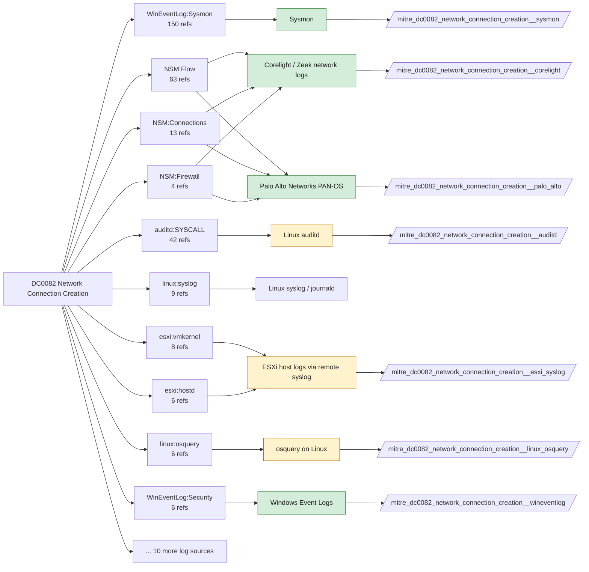

# DC0082 Network Connection Creation

[ATT&CK](https://attack.mitre.org/datacomponents/DC0082) · version 2.2 · modified 2026-10-13 · ATT&CK release 20.1

Status: **Live** · umbrella eventtype `mitre_dc0082_network_connection_creation`

> The initial establishment of a network session, where a system or process initiates a connection to a local or remote endpoint. This typically involves capturing socket information (source/destination IP, ports, protocol) and tracking session metadata. Monitoring these events helps detect lateral movement, exfiltration, and command-and-control (C2) activities.  *Data Collection Measures:*  - Windows:     - Event ID 5156 – Filtering Platform Connection - Logs network connections permitted by Windows Filtering Platform (WFP).     - Sysmon Event ID 3 – Network Connection Initiated - Captures process, source/destination IP, ports, and parent process. - Linux/macOS:     - Netfilter (iptables), nftables logs - Tracks incoming and outgoing network connections.     - AuditD (`connect` syscall) - Logs TCP, UDP, and ICMP connections.     - Zeek (`conn.log`) - Captures protocol, duration, and bytes transferred. - Cloud & Network Infrastructure:     - AWS VPC Flow Logs / Azure NSG Flow Logs - Logs IP traffic at the network level in cloud environments.     - Zeek (conn.log) or Suricata (network events) - Captures packet metadata for detection and correlation. - Endpoint Detection & Response (EDR):     - Detect anomalous network activity such as new C2 connections or data exfiltration attempts.

## Why this component matters

Ties a process to a socket. Sysmon EID 3 gives process-to-destination on the host; Corelight conn.log and PAN-OS traffic logs give the authoritative network-side record and cover everything that is not a Windows host. 246 analytics depend on it.

ATT&CK v20.1 has **246 analytics** across **155 detection strategies** that read this component, covering **155 techniques**. Tactics most dependent on it: command-and-control (86), stealth (58), exfiltration (33), persistence (22).

Analytic references by platform: Windows 135, Linux 46, macOS 32, Network Devices 12, ESXi 12, IaaS 5, Containers 4

## Where it comes from



## Requirements

Component specific:

- Sysmon NetworkConnect (EID 3) is high volume; scope by process or destination port in the config, and keep DNS (EID 22) separate.
- PAN-OS traffic logs must include session start and end on every rule; Corelight sensors must see east-west traffic for lateral-movement analytics.

Per feed (from `config/stack.yml` and `config/log_sources.yml`):

| Feed | Status | Sourcetypes | Constraint | Origin | TA / collector |
|---|---|---|---|---|---|
| `corelight` | live | `corelight_conn` | `(whole feed)` | defaults | Corelight App for Splunk (corelight_<log>). For TA_zeek use prefix zeek: and suffix :json. |
| `palo_alto` | live | `pan:traffic` | `(whole feed)` | defaults | Splunk Add-on for Palo Alto Networks (pan:*) |
| `sysmon` | live | `XmlWinEventLog:Microsoft-Windows-Sysmon/Operational` | `EventCode IN (3)` | defaults | Splunk Add-on for Sysmon (TA-microsoft-sysmon) |
| `wineventlog` | live | `XmlWinEventLog:Microsoft-Windows-Windows Firewall With Advanced Security/Firewall`, `XmlWinEventLog:Security` | `EventCode IN (5156, 5157, 5158)` | defaults | Splunk Add-on for Microsoft Windows (Splunk_TA_windows), XML rendering |
| `auditd` | ready (tick in stack.yml) | `linux:audit` | `type IN (SYSCALL) (syscall IN (accept, accept4, bind, connect, listen, socket) OR SYSCALL IN (accept, accept4, bind, connect, listen, socket))` | defaults | Splunk Add-on for Unix and Linux (linux:audit) or auditd -> auditbeat/syslog |
| `ebpf` | ready (tick in stack.yml) | `falco` | `(whole feed)` | derived | Vendor specific (falco JSON, tetragon) |
| `esxi_syslog` | ready (tick in stack.yml) | `vmware:esxlog:hostd`, `vmware:esxlog:vmkernel` | `(whole feed)` | defaults | Splunk Add-on for VMware ESXi Logs (vmware:esxlog:<log>) |
| `linux_osquery` | ready (tick in stack.yml) | `osquery:results` | `(name=process_open_sockets OR name=socket_events OR name=listening_ports)` | defaults | osquery TA |
| `netdev_syslog` | ready (tick in stack.yml) | `cisco:asa`, `cisco:ios`, `syslog` | `(whole feed)` | derived | Cisco Networks Add-on (cisco:ios, cisco:asa), Juniper/Arista TAs, or generic syslog |
| `netflow` | ready (tick in stack.yml) | `stream:netflow` | `(whole feed)` | derived | Splunk Stream or Splunk Add-on for NetFlow |
| `sysmon_linux` | ready (tick in stack.yml) | `sysmon:linux` | `EventCode IN (3)` | defaults | Splunk Add-on for Sysmon for Linux |

Collection prerequisites:

- **corelight**: Sensor placement covering east-west (DC, server VLANs) and north-south; without internal taps the lateral-movement components are blind.
- **corelight**: Enable the log set above; files/pe/smb_* and ldap/kerberos/ntlm are what distinguish Corelight from flow data.
- **palo_alto**: Log forwarding profiles attached to every security rule (traffic start+end, threat, url, wildfire, data).
- **palo_alto**: System and Config logs forwarded from each firewall / Panorama; GlobalProtect logs enabled.
- **palo_alto**: URL filtering and Threat Prevention licensed for pan:threat subtypes url/vulnerability/virus/spyware.
- **palo_alto**: Operational (show/debug) commands are not in config or system logs by default. Enable administrator activity audit tracking (Device > Setup > Management > Logging and Reporting, PAN-OS 10.1+) and forward the audit log if you want CLI discovery analytics for the firewall.
- **sysmon**: Sysmon deployed with a maintained modular configuration (e.g. sysmon-modular or SwiftOnSecurity). Event IDs referenced by a data component only exist if the config includes that rule group (ProcessAccess=10, ImageLoad=7, DNS=22, FileDelete=23/26, ClipboardChange=24, ProcessTampering=25, FileBlock=27/28 are off in minimal configs).
- **sysmon**: Hashes configured (SHA256 at least, IMPHASH useful) for File/Process metadata components.
- **wineventlog**: Advanced Audit Policy configured (at minimum Process Creation, Logon, Account Management, Object Access, Policy Change, Privilege Use, Detailed Tracking). Without the matching subcategory the EventCodes below never fire.
- **wineventlog**: Include command line in process creation events enabled for 4688 (Computer Configuration > Administrative Templates > System > Audit Process Creation).
- **wineventlog**: PowerShell Script Block Logging (4104) and Module Logging (4103) enabled via GPO for the PowerShell/Operational channel.
- **wineventlog**: Object access events (4656/4663/4657/4660/4670) require SACLs on the files/keys of interest.
- **wineventlog**: Non-default channels (TaskScheduler, WMI-Activity, CodeIntegrity, Defender, Firewall, WinRM, SMBClient/Server...) must be listed as inputs in Splunk_TA_windows inputs.conf; several are disabled by default in Windows.
- **auditd**: audit rules for execve, connect, open/openat on sensitive paths, ptrace, module load, mount, setuid; a Neo23x0/auditd baseline or Florian Roth's rule set is a reasonable start.
- **auditd**: log_format = ENRICHED in auditd.conf so syscall names and uids resolve (otherwise syscall numbers are architecture dependent).
- **esxi_syslog**: Syslog.global.logHost set on every host; ESXi Shell/SSH audit enabled; consider Syslog.global.auditRecord (ESXi 8).
- **netdev_syslog**: Enable config-change archive logging and AAA command accounting; forward at informational level.

Review notes: `corelight` has 19 ATT&CK reference(s) with no usable event filter (prose channel), constraint origin is *defaults*; `wineventlog` has 1 ATT&CK reference(s) with no usable event filter (prose channel), constraint origin is *defaults*; `ebpf` has 2 ATT&CK reference(s) with no usable event filter (prose channel), constraint origin is *derived*; `linux_osquery` has 6 ATT&CK reference(s) with no usable event filter (prose channel), constraint origin is *defaults*; `netdev_syslog` has 3 ATT&CK reference(s) with no usable event filter (prose channel), constraint origin is *derived*; `netflow` has 2 ATT&CK reference(s) with no usable event filter (prose channel), constraint origin is *derived*.

## Splunk

Eventtypes (literal constraints, see `dist/splunk/TA-mitre-attack-datacomponents/default/eventtypes.conf`):

```ini
[mitre_dc0082_network_connection_creation__corelight]
search = index=corelight sourcetype=corelight_conn

[mitre_dc0082_network_connection_creation__palo_alto]
search = index=pan_logs sourcetype=pan:traffic

[mitre_dc0082_network_connection_creation__sysmon]
search = index=sysmon sourcetype=XmlWinEventLog:Microsoft-Windows-Sysmon/Operational EventCode IN (3)

[mitre_dc0082_network_connection_creation__wineventlog]
search = index=wineventlog sourcetype IN ("XmlWinEventLog:Microsoft-Windows-Windows Firewall With Advanced Security/Firewall", "XmlWinEventLog:Security") EventCode IN (5156, 5157, 5158)

[mitre_dc0082_network_connection_creation__auditd]
search = index=linux sourcetype=linux:audit type IN (SYSCALL) (syscall IN (accept, accept4, bind, connect, listen, socket) OR SYSCALL IN (accept, accept4, bind, connect, listen, socket))
disabled = 1

[mitre_dc0082_network_connection_creation__ebpf]
search = index=linux sourcetype=falco
disabled = 1

[mitre_dc0082_network_connection_creation__esxi_syslog]
search = index=vmware sourcetype IN ("vmware:esxlog:hostd", "vmware:esxlog:vmkernel")
disabled = 1

[mitre_dc0082_network_connection_creation__linux_osquery]
search = index=osquery sourcetype=osquery:results (name=process_open_sockets OR name=socket_events OR name=listening_ports)
disabled = 1

[mitre_dc0082_network_connection_creation__netdev_syslog]
search = index=netops sourcetype IN ("cisco:asa", "cisco:ios", syslog)
disabled = 1

[mitre_dc0082_network_connection_creation__netflow]
search = index=netflow sourcetype=stream:netflow
disabled = 1

[mitre_dc0082_network_connection_creation__sysmon_linux]
search = index=linux sourcetype=sysmon:linux EventCode IN (3)
disabled = 1

[mitre_dc0082_network_connection_creation]
search = eventtype=mitre_dc0082_network_connection_creation__corelight OR eventtype=mitre_dc0082_network_connection_creation__palo_alto OR eventtype=mitre_dc0082_network_connection_creation__sysmon OR eventtype=mitre_dc0082_network_connection_creation__wineventlog OR eventtype=mitre_dc0082_network_connection_creation__auditd OR eventtype=mitre_dc0082_network_connection_creation__ebpf OR eventtype=mitre_dc0082_network_connection_creation__esxi_syslog OR eventtype=mitre_dc0082_network_connection_creation__linux_osquery OR eventtype=mitre_dc0082_network_connection_creation__netdev_syslog OR eventtype=mitre_dc0082_network_connection_creation__netflow OR eventtype=mitre_dc0082_network_connection_creation__sysmon_linux
```

Macros for analytics: `` `mitre_dc0082` `` (umbrella), `` `mitre_dc0082_corelight` ``, `` `mitre_dc0082_palo_alto` ``, `` `mitre_dc0082_sysmon` ``, `` `mitre_dc0082_wineventlog` ``, `` `mitre_dc0082_auditd` ``, `` `mitre_dc0082_ebpf` ``, `` `mitre_dc0082_esxi_syslog` ``, `` `mitre_dc0082_linux_osquery` ``, `` `mitre_dc0082_netdev_syslog` ``, `` `mitre_dc0082_netflow` ``, `` `mitre_dc0082_sysmon_linux` ``, `` `mitre_dc0082_filter` `` (site exclusions).
CIM: `Network_Traffic.All_Traffic` via `` `mitre_dc0082_dm` `` / `` `mitre_dc0082_dm_where` `` for `tstats`. CIM tags emitted for: `corelight`, `palo_alto`, `sysmon`.

## Sigma

Generic logsource categories scoped by this component in `dist/sigma/pipelines/splunk_mitre_dc.yml`: product `windows`: `network_connection`; product `linux`: `network_connection`; product `paloalto`: `firewall`.

## Dependents

Top techniques detected through this component (of 155):

| Technique | Name | Tactics | Analytics using this DC |
|---|---|---|---|
| [T1008](https://attack.mitre.org/techniques/T1008) | Fallback Channels | command-and-control | 4 |
| [T1090.002](https://attack.mitre.org/techniques/T1090/002) | External Proxy | command-and-control | 4 |
| [T1102](https://attack.mitre.org/techniques/T1102) | Web Service | command-and-control | 4 |
| [T1102.001](https://attack.mitre.org/techniques/T1102/001) | Dead Drop Resolver | command-and-control | 4 |
| [T1133](https://attack.mitre.org/techniques/T1133) | External Remote Services | persistence, initial-access | 4 |
| [T1205](https://attack.mitre.org/techniques/T1205) | Traffic Signaling | stealth, persistence, command-and-control | 4 |
| [T1205.001](https://attack.mitre.org/techniques/T1205/001) | Port Knocking | stealth, persistence, command-and-control | 4 |
| [T1001.001](https://attack.mitre.org/techniques/T1001/001) | Junk Data | command-and-control | 3 |
| [T1001.003](https://attack.mitre.org/techniques/T1001/003) | Protocol or Service Impersonation | command-and-control | 3 |
| [T1011.001](https://attack.mitre.org/techniques/T1011/001) | Exfiltration Over Bluetooth | exfiltration | 3 |
| [T1020](https://attack.mitre.org/techniques/T1020) | Automated Exfiltration | exfiltration | 3 |
| [T1027.003](https://attack.mitre.org/techniques/T1027/003) | Steganography | stealth | 3 |
| [T1027.004](https://attack.mitre.org/techniques/T1027/004) | Compile After Delivery | stealth | 3 |
| [T1030](https://attack.mitre.org/techniques/T1030) | Data Transfer Size Limits | exfiltration | 3 |
| [T1036.012](https://attack.mitre.org/techniques/T1036/012) | Browser Fingerprint | stealth | 3 |
| … | 140 more | | |

Full list: `lookups/mitre_attack_analytics.csv` filtered on `dc_ids` containing `DC0082`.
