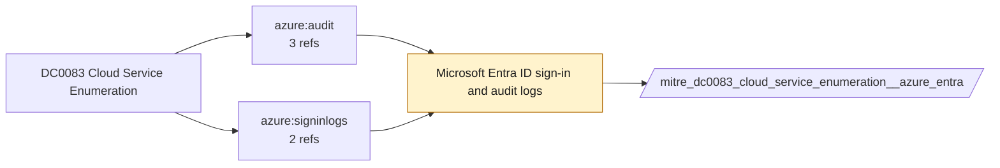

# DC0083 Cloud Service Enumeration

[ATT&CK](https://attack.mitre.org/datacomponents/DC0083) · version 3.0 · modified 2026-10-13 · ATT&CK release 20.1

Status: **Ready** (needs a feed you have not ticked) · umbrella eventtype `mitre_dc0083_cloud_service_enumeration`

> Cloud service enumeration involves listing or querying available cloud services in a cloud control plane. This activity is often performed to identify resources such as virtual machines, storage buckets, compute clusters, or other services within a cloud environment. Examples include API calls like `AWS ECS ListServices`, `Azure ListAllResources`, or `Google Cloud ListInstances`. Examples:   AWS Cloud Service Enumeration: The adversary gathers details about existing ECS services to identify opportunities for privilege escalation or exfiltration. - Azure Resource Enumeration: The adversary collects information about virtual machines, resource groups, and other Azure assets for reconnaissance purposes. - Google Cloud Resource Enumeration: The attacker seeks to map the environment and find misconfigured or underutilized resources for exploitation. - Office 365 Service Enumeration: The attacker may look for data repositories or collaboration tools to exfiltrate sensitive information.

## Why this component matters

Entra audit/sign-in and Activity Log read operations that reveal tenant reconnaissance (Graph queries, role listings).

ATT&CK v20.1 has **10 analytics** across **6 detection strategies** that read this component, covering **6 techniques**. Tactics most dependent on it: discovery (7), credential-access (3).

Analytic references by platform: IaaS 6, Identity Provider 2, Office Suite 1, SaaS 1

## Where it comes from



## Requirements

Per feed (from `config/stack.yml` and `config/log_sources.yml`):

| Feed | Status | Sourcetype or source | Constraint | Origin | TA / collector |
|---|---|---|---|---|---|
| `azure_activity` | ready (tick in stack.yml) | sourcetype=`mscs:azure:audit` | `(whole feed)` | defaults | Splunk Add-on for Microsoft Cloud Services (mscs:azure:audit) |
| `azure_entra` | ready (tick in stack.yml) | sourcetype=`azure:aad:audit` | `(whole feed)` | defaults | Splunk Add-on for Microsoft Azure (azure:aad:signin, azure:aad:audit) or Microsoft Cloud Services add-on via Event Hub |

Collection prerequisites:

- **azure_activity**: Export Activity Log for every subscription to the Event Hub.
- **azure_entra**: Diagnostic settings on the tenant streaming SignInLogs
- **azure_entra**: AuditLogs
- **azure_entra**: NonInteractiveUserSignInLogs
- **azure_entra**: ServicePrincipalSignInLogs to an Event Hub or direct Graph pull.

Review notes: `azure_entra` has 5 ATT&CK reference(s) with no usable event filter (prose channel), constraint origin is *defaults*.

## Splunk

Eventtypes (literal constraints, see `dist/splunk/TA-mitre-attack-datacomponents/default/eventtypes.conf`):

```ini
[mitre_dc0083_cloud_service_enumeration__azure_activity]
search = index=azure sourcetype="mscs:azure:audit"
disabled = 1

[mitre_dc0083_cloud_service_enumeration__azure_entra]
search = index=azure sourcetype="azure:aad:audit"
disabled = 1

[mitre_dc0083_cloud_service_enumeration]
search = eventtype=mitre_dc0083_cloud_service_enumeration__azure_activity OR eventtype=mitre_dc0083_cloud_service_enumeration__azure_entra
```

Macros for analytics: `` `mitre_dc0083` `` (umbrella), `` `mitre_dc0083_azure_activity` ``, `` `mitre_dc0083_azure_entra` ``, `` `mitre_dc0083_filter` `` (site exclusions).
CIM: `Change.All_Changes` via `` `mitre_dc0083_dm` `` / `` `mitre_dc0083_dm_where` `` for `tstats`. CIM tags emitted for: `azure_activity`.

## Sigma

No generic Sigma category maps to this component; rules use `product`/`service` logsources, which the pipeline maps to index and sourcetype.

## Dependents

Top techniques detected through this component (of 6):

| Technique | Name | Tactics | Analytics using this DC |
|---|---|---|---|
| [T1526](https://attack.mitre.org/techniques/T1526) | Cloud Service Discovery | discovery | 4 |
| [T1087](https://attack.mitre.org/techniques/T1087) | Account Discovery | discovery | 2 |
| [T1518](https://attack.mitre.org/techniques/T1518) | Software Discovery | discovery | 1 |
| [T1528](https://attack.mitre.org/techniques/T1528) | Steal Application Access Token | credential-access | 1 |
| [T1555](https://attack.mitre.org/techniques/T1555) | Credentials from Password Stores | credential-access | 1 |
| [T1555.006](https://attack.mitre.org/techniques/T1555/006) | Cloud Secrets Management Stores | credential-access | 1 |

Full list: `lookups/mitre_attack_analytics.csv` filtered on `dc_ids` containing `DC0083`.
