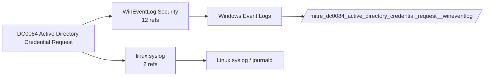

# DC0084 Active Directory Credential Request

[ATT&CK](https://attack.mitre.org/datacomponents/DC0084) · version 2.0 · modified 2025-11-12 · ATT&CK release 20.1

Umbrella eventtype `mitre_dc0084_active_directory_credential_request` over 2 feed(s)

> Requests for authentication credentials via Kerberos or other methods like NTLM and LDAP queries. Examples:  - Kerberos TGT and Service Tickets (Event IDs 4768, 4769) - NTLM Authentication Events - LDAP Bind Requests.

## Why this component matters

Kerberos ticket requests (4768/4769/4770) and Corelight kerberos.log underpin Kerberoasting, AS-REP roasting and golden/silver ticket analytics.

ATT&CK v20.1 has **9 analytics** across **9 detection strategies** that read this component, covering **9 techniques**. Tactics most dependent on it: credential-access (6), lateral-movement (2), defense-impairment (1).

Analytic references by platform: Windows 8, Linux 1

## Where it comes from



## Requirements

Component specific:

- Audit Kerberos Service Ticket Operations on all domain controllers; ensure encryption type (TicketEncryptionType) is logged.

Per feed (from `config/stack.yml` and `config/log_sources.yml`):

| Feed | Schedule | Sourcetype or source | Constraint | Origin | TA / collector |
|---|---|---|---|---|---|
| `corelight` | scheduled | sourcetype=`corelight_kerberos` | `(whole feed)` | defaults | Corelight App for Splunk (corelight_<log>). For TA_zeek use prefix zeek: and suffix :json. |
| `wineventlog` | scheduled | source=`XmlWinEventLog:Security` | `EventCode IN (4768, 4769, 4770, 4771, 4773)` | defaults | Splunk Add-on for Microsoft Windows (Splunk_TA_windows), XML rendering (renderXml = true) |

Collection prerequisites:

- **corelight**: Sensor placement covering east-west (DC, server VLANs) and north-south; without internal taps the lateral-movement components are blind.
- **corelight**: Enable the log set above; files/pe/smb_* and ldap/kerberos/ntlm are what distinguish Corelight from flow data.
- **wineventlog**: Advanced Audit Policy configured (at minimum Process Creation, Logon, Account Management, Object Access, Policy Change, Privilege Use, Detailed Tracking). Without the matching subcategory the EventCodes below never fire.
- **wineventlog**: Include command line in process creation events enabled for 4688 (Computer Configuration > Administrative Templates > System > Audit Process Creation).
- **wineventlog**: PowerShell Script Block Logging (4104) and Module Logging (4103) enabled via GPO for the PowerShell/Operational channel.
- **wineventlog**: Object access events (4656/4663/4657/4660/4670) require SACLs on the files/keys of interest.
- **wineventlog**: Non-default channels (TaskScheduler, WMI-Activity, CodeIntegrity, Defender, Firewall, WinRM, SMBClient/Server...) must be listed as inputs in Splunk_TA_windows inputs.conf; several are disabled by default in Windows.

## Splunk

Eventtypes (literal constraints, see `dist/splunk/TA-mitre-attack-datacomponents/default/eventtypes.conf`):

```ini
[mitre_dc0084_active_directory_credential_request__corelight]
search = index=corelight sourcetype=corelight_kerberos

[mitre_dc0084_active_directory_credential_request__wineventlog]
search = index=wineventlog source="XmlWinEventLog:Security" EventCode IN (4768, 4769, 4770, 4771, 4773)

[mitre_dc0084_active_directory_credential_request]
search = eventtype=mitre_dc0084_active_directory_credential_request__corelight OR eventtype=mitre_dc0084_active_directory_credential_request__wineventlog
```

Macros for analytics: `` `mitre_dc0084` `` (umbrella), `` `mitre_dc0084_corelight` ``, `` `mitre_dc0084_wineventlog` ``, `` `mitre_dc0084_filter` `` (site exclusions).
CIM: `Authentication.Authentication` via `` `mitre_dc0084_dm` `` / `` `mitre_dc0084_dm_where` `` for `tstats`. CIM tags emitted for: `wineventlog`.

## Sigma

No generic Sigma category maps to this component; rules use `product`/`service` logsources, which the pipeline maps to index and sourcetype.

## Dependents

Top techniques detected through this component (of 9):

| Technique | Name | Tactics | Analytics using this DC |
|---|---|---|---|
| [T1207](https://attack.mitre.org/techniques/T1207) | Rogue Domain Controller | defense-impairment | 1 |
| [T1550.002](https://attack.mitre.org/techniques/T1550/002) | Pass the Hash | lateral-movement | 1 |
| [T1550.003](https://attack.mitre.org/techniques/T1550/003) | Pass the Ticket | lateral-movement | 1 |
| [T1558](https://attack.mitre.org/techniques/T1558) | Steal or Forge Kerberos Tickets | credential-access | 1 |
| [T1558.001](https://attack.mitre.org/techniques/T1558/001) | Golden Ticket | credential-access | 1 |
| [T1558.002](https://attack.mitre.org/techniques/T1558/002) | Silver Ticket | credential-access | 1 |
| [T1558.003](https://attack.mitre.org/techniques/T1558/003) | Kerberoasting | credential-access | 1 |
| [T1558.004](https://attack.mitre.org/techniques/T1558/004) | AS-REP Roasting | credential-access | 1 |
| [T1649](https://attack.mitre.org/techniques/T1649) | Steal or Forge Authentication Certificates | credential-access | 1 |

Full list: `lookups/mitre_attack_analytics.csv` filtered on `dc_ids` containing `DC0084`.
